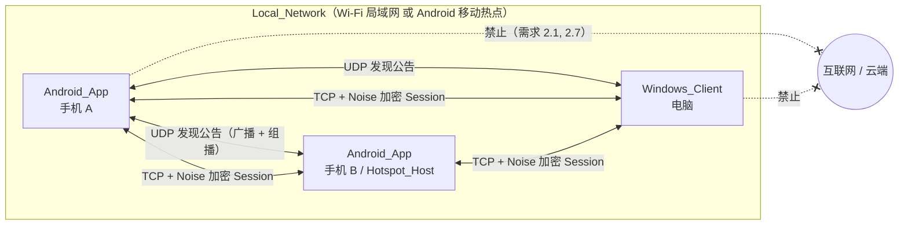
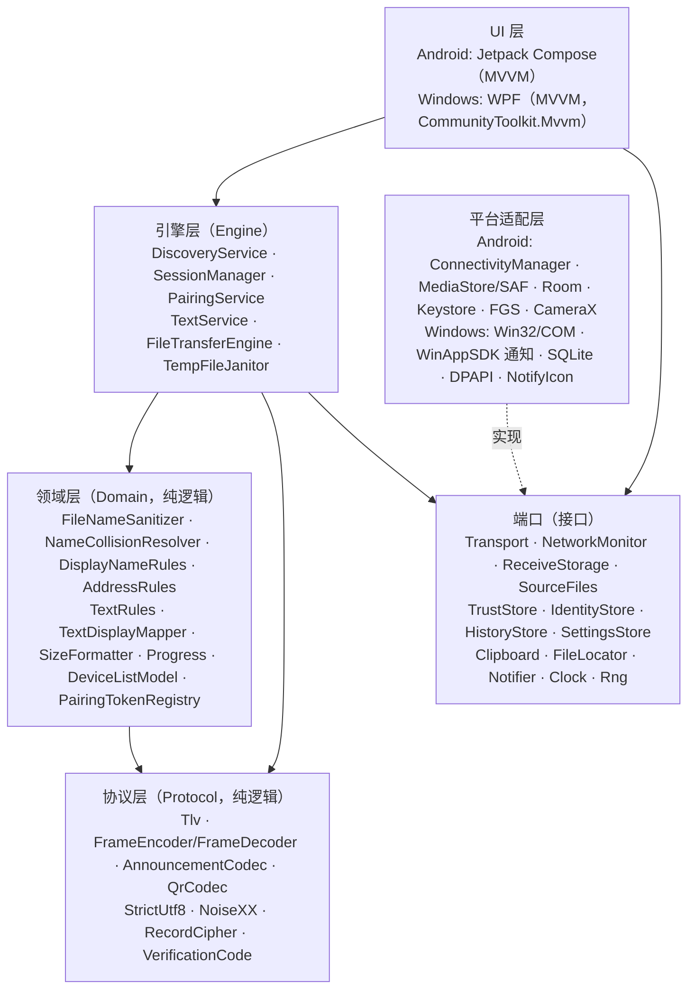
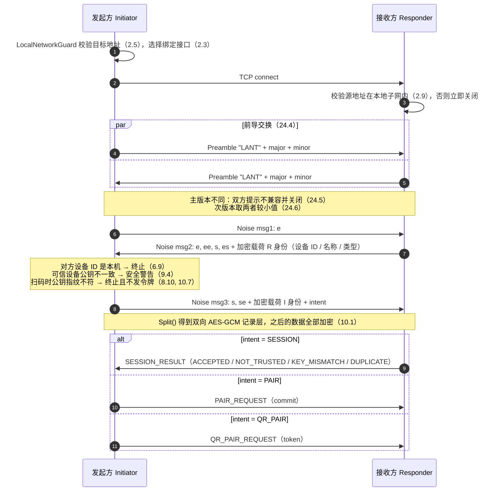
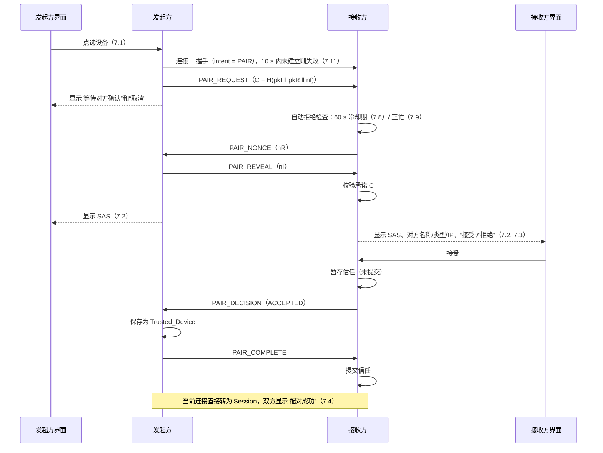
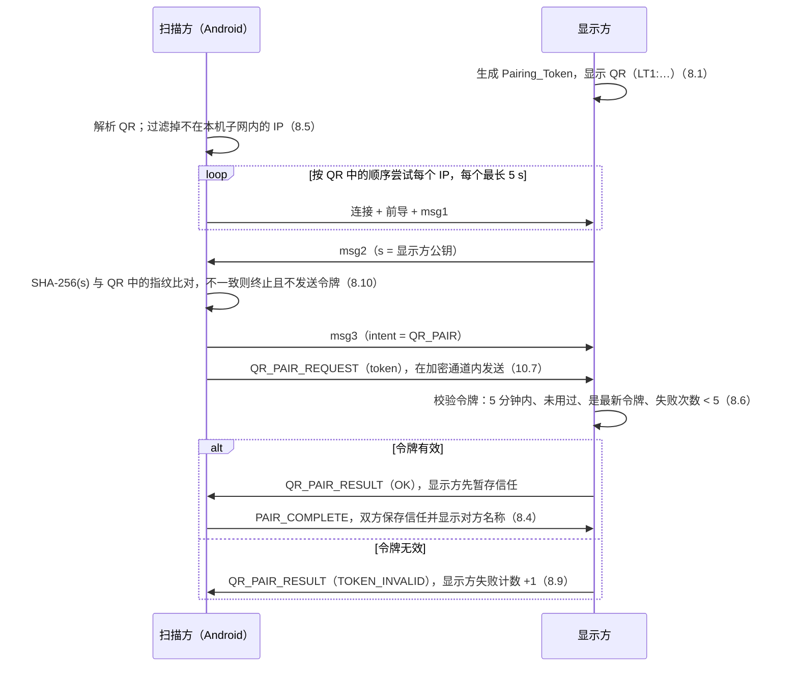
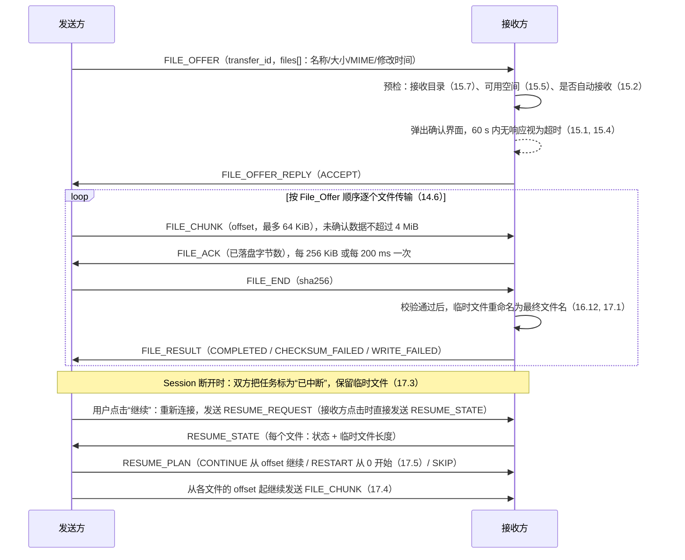
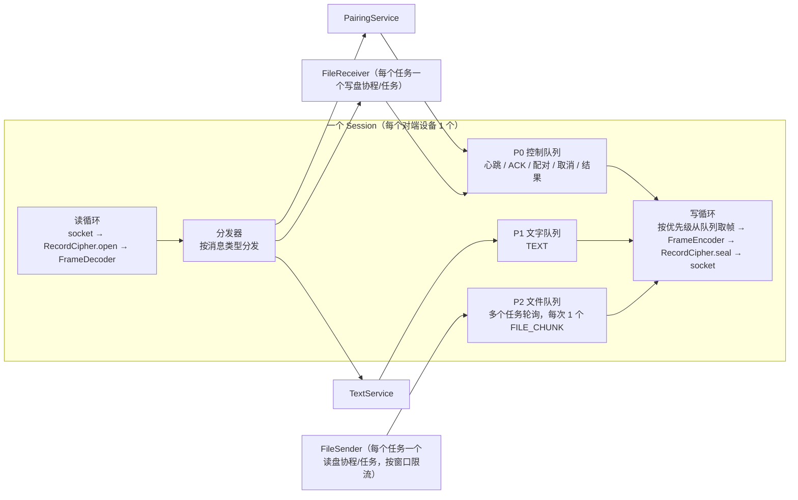
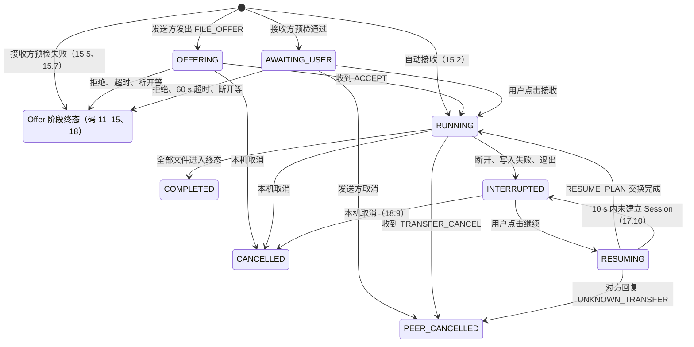
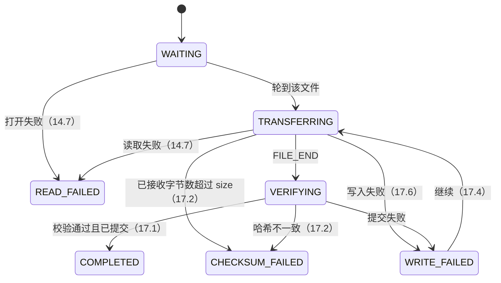

# Design Document

## Overview

LanTransfer 由 Android_App 和 Windows_Client 组成，在同一 Local_Network（Wi‑Fi 局域网或 Android 手机热点）内点对点传输 Text_Message 和文件，全部数据不经过互联网。本文档是后续开发的架构基础，确定以下内容：

- 总体架构、分层与 Monorepo 目录布局；
- Android 与 Windows 两端的技术栈及选型理由；
- 平台无关的线协议：发现公告、二维码载荷、连接前导与版本协商、握手认证与加密、配对、文字、文件分块/校验/续传、心跳；
- 两端组件接口、数据模型与持久化方案；
- 平台专项方案：Android 网络接口绑定、前台服务、MediaStore/SAF、FileProvider；Windows 防火墙、托盘、资源管理器定位、剪贴板；
- 并发模型、错误处理、正确性属性与测试策略。

### 设计原则

1. 协议是两端之间唯一的契约。两端各自原生实现，运行时代码不共享，但共享一份平台无关的协议规范（`protocol/spec`）和一套测试向量（`protocol/test-vectors`），两端测试套件都必须通过（需求 24）。
2. 纯逻辑核心 + 端口 + 平台适配。编解码、密码学握手、文件名处理、各类规则和状态归约器都写成无 I/O 的纯代码；会话与传输引擎只依赖抽象端口（Transport、Storage、Clock 等），因此不需要真机就能在 JVM / .NET 上做属性测试和跨端互通测试。
3. 网络出口只有一个。所有套接字都通过 `LocalNetworkGuard` 创建：目标地址必须是与本机某个 Local_Network 接口同子网的 Private_IPv4_Address；在 Android 上，套接字还必须绑定 Wi‑Fi `Network` 或热点接口地址（需求 2）。
4. 默认安全。每个 Session 都经过 Noise_XX 相互认证并加密；信任关系固定为“设备 ID → 身份公钥”。
5. 两端组件同名镜像。Kotlin 与 C# 中对应组件使用相同名字（C# 改为 PascalCase），便于对照评审和共享测试用例。

### 关键设计决策

| # | 决策点 | 选择 | 理由 | 相关需求 |
|---|---|---|---|---|
| D1 | Android 技术栈 | Kotlin + Jetpack Compose；minSdk 26、targetSdk 36 | 网络绑定、前台服务、MediaStore/SAF 等能力都有原生支持 | 1.1, 1.7, 2.3, 21 |
| D2 | Windows 技术栈 | .NET 10（LTS）+ WPF，x64 自包含发布 | 支持 Win10 1809 及以上；Win32/COM 互操作成熟（防火墙、资源管理器、剪贴板私有格式）；LTS 支持到 2028‑11 | 1.2, 3.5, 3.8, 13, 19 |
| D3 | 代码共享方式 | 不共享运行时代码，只共享协议规范和测试向量 | 需求 24 要求两端可独立开发、用测试向量验证；也避开了 JVM 桌面端在托盘、通知、剪贴板集成上的短板 | 24 |
| D4 | 设备发现 | 自定义 UDP 公告（子网定向广播 + 组播 239.255.42.58），周期 2 s | 需求 5/23 已规定公告字段和 512 B 上限；mDNS 在热点和各家 Android 系统上的行为不可控 | 5, 23 |
| D5 | 通信安全 | Noise_XX_25519_AESGCM_SHA256 握手 + 自定义记录层 | 双方用静态密钥相互认证，正好对应“设备身份 = 静态公钥”；有官方测试向量可验证两端实现；AES‑GCM 在两端都有硬件加速的原生实现 | 10 |
| D6 | 配对验证码 | 先承诺后揭示（commit/reveal），再由双方公钥和随机数派生 6 位码 | 中间人无法穷举碰撞，替换公钥后双方验证码相同的概率不超过 10⁻⁶ | 7.2, 10.3 |
| D7 | 帧编码 | 7 字节帧头 + TLV 载荷，规范编码（canonical） | 显式长度、无转义；未知字段可以跳过；容易写出跨语言的测试向量 | 22, 24 |
| D8 | 完整性校验 | 文件级 SHA‑256（端到端）+ 传输层 AEAD | 两端都有原生且硬件加速的实现；AEAD 防篡改和重放，SHA‑256 覆盖续传和磁盘写入 | 10.5, 17 |
| D9 | 持久化 | SQLite（Android 用 Room，Windows 用 Microsoft.Data.Sqlite）；文字以 UTF‑8 BLOB 存储 | 按字节往返，NUL 等字符不受数据库驱动影响 | 20.3 |
| D10 | 二维码 | 文本格式 `LT1:` + Base32(TLV)；Android 用 ZXing 解码，Windows 用 QRCoder 生成 | Base32 落在 QR 字母数字模式字符集内，二维码更小；ZXing 完全离线，不会上报使用数据 | 8, 23, 2.7 |
| D11 | Windows 安装程序 | Inno Setup 6（只带简体中文语言） | 安装引导程序是 32 位，在 x86 和旧版系统上也能运行并给出中文提示；原生支持 MinVersion / ArchitecturesAllowed | 1.5, 1.6, 3.5 |
| D12 | Windows 系统通知 | Windows App SDK 的 AppNotificationManager（非打包、自包含部署） | 微软为 WPF / 非打包 Win32 应用推荐的 API，支持按钮和进程内激活 | 21 |
| D13 | Android 后台运行 | 前台服务，类型为 `connectedDevice` | 没有运行时长上限；其前置条件由已声明的普通权限 CHANGE_WIFI_MULTICAST_STATE 满足 | 21.1, 21.2 |
| D14 | Android 分发 | 签名 APK 侧载（APK Signature Scheme v2 + v3），单一 universal APK（minSdk 26），开启 R8；自管 release keystore（不入仓库，离线备份）；升级 = 安装 versionCode 更高、签名相同的新 APK；应用内不检查更新 | 用户决定不上架应用商店，目标机型为 Google Pixel 和小米（HyperOS / MIUI）。minSdk 26 不需要 v1 签名；覆盖安装时应用数据保留（4.2）；keystore 丢失后无法发布可覆盖安装的升级包，只能卸载重装并丢失身份和信任，因此必须离线备份；不检查更新满足 2.7。详见 C6.5 | 1.1, 1.7, 2.7, 4.2 |

### 调研结论摘要

以下结论直接影响设计（内容已改写以符合许可要求）：

- Android 本地网络权限：Android 16 中是可选启用的兼容性开关；从 Android 17 起，targetSdk ≥ 37 的应用必须获得运行时权限 `ACCESS_LOCAL_NETWORK`，否则 TCP 连接会超时、UDP 收发会返回 EPERM。targetSdk < 37 的应用暂时获得隐式授权。本期采用 targetSdk 36，升级到 37 时需要增加权限申请流程（见待确认事项 Q5）。[Local network permission](https://developer.android.com/privacy-and-security/local-network-permission)
- Android 14 起前台服务必须声明类型。`connectedDevice` 的前置条件是在清单中声明 CHANGE_NETWORK_STATE、CHANGE_WIFI_STATE、CHANGE_WIFI_MULTICAST_STATE 等权限之一。[Foreground service types](https://developer.android.com/develop/background-work/services/fgs/service-types) 本应用以 APK 侧载分发（D14），不需要向 Google Play 提交前台服务类型声明，也不受 Play 的 targetSdk 时间表和敏感权限审核约束；系统按 targetSdk 施加的行为限制照常适用。
- 当 Wi‑Fi 没有互联网、系统默认网络是移动数据时，未绑定的套接字会走蜂窝网络。必须用 `Network.bindSocket()` 显式绑定到 Wi‑Fi `Network`（社区有大量相关记录）。[Stack Overflow 讨论](https://stackoverflow.com/questions/42492136/force-android-to-use-wifi-network-with-no-internet)
- .NET 10 是 LTS 版本，支持到 2028‑11；官方支持的系统列表包含 Windows 10 1809（LTSC）及更高版本。[Announcing .NET 10](https://devblogs.microsoft.com/dotnet/announcing-dotnet-10/)、[.NET 10 supported OS](https://github.com/dotnet/core/blob/main/release-notes/10.0/supported-os.md)
- 微软推荐 WPF / 非打包 Win32 应用使用 Windows App SDK 的 AppNotificationManager 发送通知；Windows App SDK 支持 Windows 10 1809（build 17763）及以上。[Notifications overview](https://learn.microsoft.com/en-us/windows/apps/develop/notifications/)、[System requirements](https://learn.microsoft.com/en-us/windows/apps/windows-app-sdk/system-requirements)
- Inno Setup 在当前系统不满足 ArchitecturesAllowed 时会显示错误信息并退出，可用来实现需求 1.6。[ArchitecturesAllowed](https://jrsoftware.org/ishelp/topic_setup_architecturesallowed.htm)
- Noise 协议有完整规范，社区维护了 JSON 格式的测试向量，可用于验证两端各自实现的握手。[Noise spec](https://github.com/noiseprotocol/noise_spec/blob/master/noise.md)、[Test vectors](https://github.com/noiseprotocol/noise_wiki/wiki/Test-vectors)
- 以下结论来自平台通用知识，尚未在本次调研中逐条核实，需要在实现阶段用测试确认：
  - Win32 剪贴板的 `CF_UNICODETEXT` 格式按 NUL 结尾，含 NUL 的文本必须额外写一份私有格式，才能保证读回一致（需求 13.3）；
  - Windows 10 的 SChannel 不支持 TLS 1.3；
  - Android API 26–32 没有平台内置的 X25519，需要 BouncyCastle。

### 待用户确认的决策

| # | 问题 | 当前设计 | 备选方案 |
|---|---|---|---|
| Q1 | Windows 端技术栈 | .NET 10 + WPF，与 Android 端分别实现 | Kotlin Multiplatform + Compose Desktop，可复用 Kotlin 核心代码；代价是 JVM 常驻内存更高，Toast 按钮、剪贴板私有格式、资源管理器选中文件等都要借助 JNA 调用 Win32 |
| Q2 | 安全协议 | 自行实现最小化的 Noise_XX（底层原语用 BouncyCastle 和平台加密库），并用官方向量验证 | TLS 1.2/1.3 + 自签证书钉扎。缺点：Windows 10 上没有 TLS 1.3；.NET 没有 TLS exporter；自签客户端证书在 SChannel 上有私钥存储方面的坑 |
| Q3 | 端口号 | TCP 默认 42580，UDP 发现端口 42581，组播组 239.255.42.58 | 实现前需对照 IANA 注册表和常见软件确认不冲突；Hyper‑V 的保留端口段可能占用 TCP 端口，由需求 5.7 的端口回退机制兜底 |
| Q4 | Android 分发渠道 | 已决定：签名 APK 侧载，目标机型 Pixel 与小米（HyperOS/MIUI）；见 D14、C6.5、Testing Strategy | —（已决定） |
| Q5 | 需求缺口 | 本期 targetSdk 36，不需要申请本地网络权限。厂商电池优化引导已由设计解决：C6.5 的后台运行引导作为满足 21.1、21.2 的手段，不修改需求 | 仍待定：升级到 targetSdk 37 时，需要补充一条需求，规定用户拒绝 `ACCESS_LOCAL_NETWORK` 时的提示和降级行为；届时回到需求阶段补充 |
| Q6 | 文件大小显示的舍入方式 | 截断到 1 位小数（例如 1023.99 KB 显示为 1023.9 KB），避免出现“1024.0 KB” | 四舍五入 |
| Q7 | 解除配对时进行中的 Transfer_Task | 按本机取消处理：先向对方发送取消通知，再删除未完成文件的临时文件 | 标记为“已中断”，保留临时文件（但已无法续传） |
| Q8 | 额外的 Windows 保留名 | 只处理需求 16.6 列出的名称 | 同时为 COM¹–COM³、LPT¹–LPT³、CONIN$、CONOUT$ 加前缀 |
| Q9 | Android 11+ 默认接收目录下的重名处理 | 默认目录使用 MediaStore；其他应用写入的文件对本应用不可见，遇到这类重名时由 MediaStore 生成 “ (n)” 序号，保证不覆盖已有文件，但 n 不一定是最小值 | 申请 MANAGE_EXTERNAL_STORAGE。侧载分发不经 Google Play 审核，技术上可行；但这是“所有文件访问”特殊权限，需要用户到系统设置中手动开启，设计按最小权限原则仍保留 MediaStore 方案 |
| Q10 | 修复 Windows 防火墙规则时的范围 | 重建本程序的允许规则，同时删除系统弹窗为本程序生成的“阻止”规则 | 只重建允许规则（如果存在阻止规则，修复后仍然无法连接） |
| Q11 | 清空记录时未结束任务的处理（M2） | 已决定：清空记录先取消（放弃）全部未结束任务，再删除全部记录（需求 20.5、20.10、20.11）；见 M2、C4.5 | —（已决定；未采用“只隐藏未结束任务、保留续传”的方案） |
| Q12 | 显示名称含 Unpaired_Surrogate | 已决定：先移除 Unpaired_Surrogate 再校验（需求 4.3–4.5、4.8、4.9）；见 C3.2 | —（已决定；未采用“替换为 U+FFFD”和“直接拒绝保存”的方案） |
| Q13 | 发起方收到 `SESSION_RESULT(KEY_MISMATCH)` 时的提示与 `OpenFailure` 映射 | 新增 `PeerKeyMismatch(name)`，显示与 9.4 相同的安全警告（含对方名称），不建立 Session、不修改信任（E1） | 显示通用的“对方拒绝连接”提示 |
| Q14 | 首次启动（或身份重置时）无法保存 Device_Identity | 不启动网络（不监听、不公告），主界面显示错误和“重试”按钮；查看记录等本地功能可用（E5） | 使用只在内存中的临时身份运行并显示警告；代价是每次启动设备 ID 都会变化，对方保存的信任无法沿用（4.2） |
| Q15 | 真机矩阵与测试设备范围；Windows 交互式测试（剪贴板、Toast、UAC）的执行方式 | Android 部分已决定（随 Q4）：真机为 Google Pixel（Android 16；有条件时再加 1 台较早版本的 Pixel）和小米（HyperOS，Android 14 / 15；有条件时再加 1 台 MIUI 设备）；模拟器覆盖 API 26、29、33、34、36，保证 minSdk 覆盖。待定：Windows 交互式测试暂按在自托管 runner 上运行，UAC 和安装程序在 VM 上手动执行 | Windows 交互式测试全部手动执行 |
| Q16 | 需求未规定的提示文案（表中标 ¹ 者，以及 Error Handling 中新增的提示）由谁确认 | 已采纳建议：C8.4 单一文案表 + 写作规范 + UI 开发前集中审阅暂定文案 | —（待用户审阅 C8.4 初稿） |
| Q17 | SAF 接收目录的范围（C6.2） | 只接受 `com.android.externalstorage.documents` 提供的目录树（内部共享存储、SD 卡、U 盘） | 接受任意 provider；代价是无法给出完整路径（19.8），云盘类目录还会把文件上传到互联网 |
| Q18 | 给收到的文件写入 Mark‑of‑the‑Web（C7.5） | 提交前写入 `Zone.Identifier`（ZoneId=3），SmartScreen 和 Office 受保护视图会把文件当作外部来源 | 不写入标记，收到的文件按本地文件打开，不出现额外的安全提示 |
| Q19 | 大小未知的 URI（C6.2） | 不加入待发送列表，提示“无法获取该文件的大小，暂不支持发送”（暂定文案） | 先完整复制到缓存目录以得到大小再发送；代价是占用额外存储，大文件或流式来源耗时较长 |

## Architecture

### 系统上下文



### 分层架构

两端结构相同，只有 UI 层和平台适配层的技术不同。



依赖规则：

- Protocol 和 Domain 不依赖任何平台 API，也不做 I/O；Kotlin 侧是纯 Kotlin/JVM 模块，C# 侧是 `net10.0` 类库。
- Engine 只通过端口访问网络、存储和系统服务。Kotlin 侧用 coroutines，C# 侧用 `Task` 和 `System.Threading.Channels`。
- 平台适配层是唯一允许调用系统 API 的地方，也是唯一允许创建套接字的地方（通过 `Transport` 端口）。

### 技术栈

下表中的版本是基线版本。工程初始化时，在 `android/gradle/libs.versions.toml` 和 `windows/Directory.Packages.props` 中精确锁定到当时最新的补丁版本（不使用版本范围），并开启依赖锁文件（Gradle dependency locking / NuGet `packages.lock.json`）。

**Android_App**

| 类别 | 选型 | 用途 / 说明 |
|---|---|---|
| 语言与构建 | Kotlin 2.2.x、JDK 17、AGP 8.x、Gradle Kotlin DSL | `compileSdk 36`、`targetSdk 36`、`minSdk 26`（需求 1.1、1.7） |
| UI | Jetpack Compose（BOM 锁定）+ Material 3；消息正文使用 `AndroidView(TextView)` | 用 TextView 是为了拦截“复制”菜单，把显示文本的选区映射回原文（需求 13.4） |
| 并发 | kotlinx-coroutines 1.10.x | 每个连接一个读协程和一个写协程，传输任务各自独立 |
| 持久化 | Room 2.7.x（KSP）；DataStore Preferences 1.1.x | 数据库存记录、信任列表、任务状态；DataStore 存设置项 |
| 密码学 | BouncyCastle `bcprov-jdk18on` 1.8x（只用 X25519）；平台 `Cipher("AES/GCM/NoPadding")`、`MessageDigest("SHA-256")`、`Mac("HmacSHA256")` | X25519 在 API 33 以前没有平台实现；AES‑GCM 由 Conscrypt 提供硬件加速 |
| 二维码 | ZXing `core` 3.5.3（生成与解码）+ CameraX 1.4.x | 完全离线；不使用 ML Kit，因为它会向 Google 发送使用指标，违反需求 2.7 |
| 后台运行 | 前台服务 `TransferForegroundService`（`foregroundServiceType="connectedDevice"`） | 需求 21.1、21.2 |
| 测试 | JUnit 5、Kotest 6.x（`kotest-property`）、Robolectric 4.x、AndroidX Test、Turbine、MockK | 属性测试主要放在 JVM 模块中运行 |

**Windows_Client**

| 类别 | 选型 | 用途 / 说明 |
|---|---|---|
| 运行时 | .NET 10 SDK（`global.json` 锁定）、C# 14；win-x64 自包含发布 + ReadyToRun | 用户机器上不需要预装 .NET |
| 目标框架 | 核心库用 `net10.0`；应用和平台库用 `net10.0-windows10.0.19041.0`，`SupportedOSPlatformVersion=10.0.17763.0` | 最低支持 Windows 10 1809（需求 1.2） |
| UI | WPF + CommunityToolkit.Mvvm 8.4.x；托盘使用 WinForms `NotifyIcon`（`UseWindowsForms=true`） | 托盘不引入第三方依赖 |
| 通知 | Microsoft.WindowsAppSDK 2.x（只使用 AppNotifications；`WindowsPackageType=None`、`WindowsAppSDKSelfContained=true`） | Toast 带“复制 / 打开文件 / 打开所在位置”按钮 |
| 持久化 | Microsoft.Data.Sqlite 10.0.x（手写 SQL，不使用 ORM） | 与 Android 端表结构保持一致 |
| 密码学 | BouncyCastle.Cryptography 2.6.x（只用 X25519）；`AesGcm`、`SHA256`、`HMACSHA256`（CNG）；System.Security.Cryptography.ProtectedData 10.0.x（DPAPI） | |
| 二维码 | QRCoder 1.6.x | 只负责生成，扫码只在 Android 端进行（需求 8.2） |
| 宿主 | Microsoft.Extensions.Hosting / DependencyInjection / Logging 10.0.x | 依赖注入与本地日志 |
| 安装程序 | Inno Setup 6.x，仓库中提交 `ChineseSimplified.isl` 并经过审校 | `MinVersion=10.0.17763`、`ArchitecturesAllowed=x64compatible` |
| 测试 | xUnit v3、FsCheck 3.x（`FsCheck.Xunit.v3`） | |

**共享**：`protocol/spec`（Markdown 格式的协议规范）、`protocol/test-vectors`（JSON 测试向量）、跨端互通测试脚本 `interop-tests/`。

### 仓库与模块布局

```text
phone-windows-file/
├─ README.md
├─ protocol/
│  ├─ spec/
│  │  ├─ lan-transfer-protocol.md     # 平台无关协议规范：字段、字节序、长度界定、编码、引入版本
│  │  └─ CHANGELOG.md                 # 每个 Protocol_Version 的变更
│  └─ test-vectors/
│     ├─ README.md                    # 向量格式说明
│     ├─ frames.json                  # 每种 Protocol_Message ↔ 期望字节
│     ├─ frames-invalid.json          # 各类解码错误的样例 + 期望错误类型
│     ├─ text-messages.json           # 需求 12.2–12.4 中每一类特殊字符
│     ├─ utf8-invalid.json            # 非法 UTF‑8 文本 → TEXT_CORRUPT
│     ├─ announcements.json           # 含 32 字符中文 + 表情名称的样例
│     ├─ qr-payloads.json             # 含多 IP、32 字符名称的样例
│     ├─ preamble.json                # 版本协商样例
│     ├─ noise-xx.json                # 官方 Noise 向量子集 + 本协议的固定密钥握手转录
│     ├─ verification-code.json       # commit / SAS 派生
│     └─ filename-sanitizer.json      # 输入 → android / windows 两套期望输出
├─ shared/
│  └─ ui-text/
│     └─ zh-CN.tsv                    # 两端界面文案的唯一来源，构建时生成 strings.xml / Strings.resx（C8.4）
├─ android/
│  ├─ settings.gradle.kts · build.gradle.kts · gradle/libs.versions.toml
│  ├─ core/protocol/                  # Kotlin/JVM：Tlv、帧、公告、二维码、Noise、记录层、SAS
│  ├─ core/domain/                    # Kotlin/JVM：文件名、规则、文本显示、归约器
│  ├─ core/engine/                    # Kotlin/JVM + coroutines：会话、配对、文字、文件引擎（基于端口）
│  ├─ app/                            # Android 应用：平台适配、前台服务、Compose UI
│  └─ tools/peer-cli/                 # JVM 命令行对端，用于跨端互通测试
├─ windows/
│  ├─ LanTransfer.sln · global.json · Directory.Build.props · Directory.Packages.props
│  ├─ src/LanTransfer.Protocol/       # net10.0，与 core/protocol 对应
│  ├─ src/LanTransfer.Domain/         # net10.0，与 core/domain 对应
│  ├─ src/LanTransfer.Engine/         # net10.0，与 core/engine 对应
│  ├─ src/LanTransfer.Platform.Windows/  # Win32/COM/WinAppSDK 适配
│  ├─ src/LanTransfer.App/            # WPF 应用、托盘、单实例
│  ├─ tools/LanTransfer.PeerCli/      # .NET 命令行对端
│  ├─ tests/LanTransfer.Protocol.Tests/ · LanTransfer.Domain.Tests/ · LanTransfer.Engine.Tests/
│  ├─ tests/LanTransfer.Platform.Windows.Tests/
│  └─ installer/LanTransfer.iss · installer/Languages/ChineseSimplified.isl
├─ interop-tests/                     # 在 JVM peer-cli 与 .NET PeerCli 之间运行场景脚本
└─ .github/workflows/                 # CI：android-jvm、android-instrumented、windows、interop、installer
```

Android 的 `core/*` 是纯 Kotlin/JVM 模块，供 `app` 引用，也可以直接在 JVM 上测试。这些模块只能使用 API 26 上可用的 Java API，构建时用 animal-sniffer 和 Android API 26 签名校验这一点。

### 连接建立流程

所有连接（点选配对、手动连接、扫码配对、可信设备直连、续传）都按同一个流程建立，区别只在握手第 3 条消息中的 `intent` 字段。



“获得目标 Endpoint 的设备 ID”这一步（需求 6.5–6.7）在收到 msg2 时完成。发起方据此决定 intent：

- 对方是 Trusted_Device 且公钥一致 → `SESSION`；
- 对方不是 Trusted_Device → `PAIR`；扫码流程中为 `QR_PAIR`。

所以手动输入地址连接和点选配对用的是同一条代码路径。

### 点选配对流程（需求 7）



- 超时：以发起方为准，从发送 PAIR_REQUEST 起计时 60 s；到时发起方发送 `PAIR_CANCEL(TIMEOUT)` 并提示“配对请求已超时”。接收方另有一个从收到请求起计时的 60 s 保底计时器（7.7）。
- 连接中断（7.12）：在收到 PAIR_COMPLETE 之前断开时，接收方删除暂存的信任；在收到 ACCEPTED 之前断开时，发起方不保存信任。
- 双方网络状态无法完全一致（两将军问题）。如果发起方已保存信任而接收方没有，之后发起方建立 Session 时会收到 NOT_TRUSTED，按需求 9.5 引导用户“重新配对”。

### 扫码配对流程（需求 8）



### 文件传输与续传流程（需求 14–18）



### 并发模型



- 每个 Session 只有一个读者和一个写者，严格单写，避免帧交错。写循环每次先取 P0，再取 P1，最后取 P2。P2 中多个 Transfer_Task 轮流各取 1 块，因此同一对端的多个任务可以同时推进（25.6），文字最多只需等待当前正在写出的 1 个文件块（25.1）。
- 套接字发送缓冲固定为 `SO_SNDBUF = 512 KiB`，防止内核缓冲区堆积大量文件数据、让文字排在后面。即使吞吐只有 1 MB/s，文字的排队时延也小于 0.6 s。
- 读循环从不因写盘而阻塞。每个任务的未确认数据不超过 4 MiB，接收方按窗口分配缓冲，写盘在独立的协程/任务中进行（25.3、25.5）。
- 不同 Session 使用不同的连接和协程，互不影响；一个任务失败或一个 Session 断开，只影响属于它的任务（25.2、25.7）。
- UI 线程只消费 `StateFlow` / `INotifyPropertyChanged` 推送的状态快照。进度刷新限制为每 250 ms 一次，满足需求 18.1 的同时不会挤占 UI 线程（25.4）。

### 网络接口识别与零流量策略（需求 2、3）

`NetworkMonitor` 维护当前的 `Set<LocalInterface>`，每个元素记录：接口名、类型（WIFI / HOTSPOT / ETHERNET / OTHER）、IPv4 地址、前缀长度、定向广播地址；在 Android 上还记录绑定句柄。

**Android**

- **Wi‑Fi**：调用 `ConnectivityManager.registerNetworkCallback`，请求条件为 `TRANSPORT_WIFI` 并移除 `NET_CAPABILITY_INTERNET`。只监听，不调用 `requestNetwork`，以免触发系统的网络切换。从 `LinkProperties` 中取接口名和 IPv4/前缀；`Network` 对象作为绑定句柄。
- **热点**：热点下游接口在 ConnectivityManager 中不是一个 `Network`。做法是同时监听所有网络（用于识别蜂窝和 VPN 接口名），并在前台运行或前台服务运行期间每 2 s 枚举一次 `NetworkInterface`。满足以下条件的接口判定为 HOTSPOT 类：已启用、非回环、带 Private_IPv4_Address、且不属于任何 ConnectivityManager 网络。这样可以排除蜂窝接口，后者也可能分到 10.x 私有地址（需求 3.1、3.6）。
- **出站绑定**：
  - 去往 Wi‑Fi 子网的 TCP/UDP 套接字：先 `wifiNetwork.bindSocket(socket)`，再绑定本地 Wi‑Fi 地址；
  - 去往热点子网的套接字：绑定到热点接口的本地 IPv4 地址，由系统 `local_network` 路由表经热点接口发出；
  - 不存在未绑定的出站套接字。`bindSocket` 失败（例如 VPN 处于锁定模式且不允许绕过）时放弃连接，并提示用户检查 VPN 设置（2.10）。
- **默认网络切换**：已绑定的套接字不受系统默认网络切换和移动数据开关影响（2.4、3.7）。
- **监听**：TCP 监听 `0.0.0.0:port`，UDP 接收 `0.0.0.0:42581`。入站连接或数据报的源地址如果不在任何 Local_Network 接口的子网内，在交换任何 Protocol_Message 之前就关闭连接或丢弃数据报（2.9、5.5）。Android 的 Java API 拿不到数据报的接收接口，因此“接收接口”取子网包含该源地址的那个活动接口。
- **组播与广播接收**：发现服务运行期间持有 `WifiManager.MulticastLock`，以便在锁屏状态下仍能收到广播和组播。
- **无网络状态**：没有 Wi‑Fi 也没有热点时，3 s 内显示“请连接 Wi‑Fi 或开启热点”并禁用三个发送按钮；恢复后 3 s 内撤销（2.6、2.8）。监听回调和 2 s 轮询共同保证这一时限。

**Windows**

- 订阅 `NetworkChange.NetworkAddressChanged`，并每 2 s 轮询一次 `NetworkInterface.GetAllNetworkInterfaces()`。选取状态为 Up、非 Loopback/Tunnel、带 Private_IPv4_Address 的接口。
- 地址排序：有默认网关的优先，Wireless80211/Ethernet 优先，虚拟网卡（名称或描述包含 vEthernet、Hyper‑V、VMware、VirtualBox、WSL）排在最后。排序结果用于二维码中的 IP 顺序和“最多 4 个 IP”的取舍（23.8）。
- UDP 接收套接字用 `ReceiveMessageFrom` 获取 `IPPacketInformation.Interface`，按实际接收接口做子网校验（5.5）。
- 每个接口各用一个绑定到该接口 IP 的发送套接字，发送定向广播；组播通过 `IP_MULTICAST_IF` 指定出口接口。
- TCP 监听套接字设置 `ExclusiveAddressUse = true`，防止其他程序抢占同一端口。

**统一出口 `LocalNetworkGuard`**（领域层纯函数 + 引擎层封装）：对每一个出站目标做分类，结果为 `Local(接口)`、`NotLocal` 或 `Self`。只有 `Local` 才允许创建套接字；`NotLocal` 在 1 s 内返回“目标地址不在本地网络内”，不发出任何数据包（2.5）。系统内没有任何 DNS、HTTP、统计、崩溃上报或更新检查代码（2.7）。CI 中用依赖白名单检查保证这一点，见测试策略。

### 后台运行模型（需求 21）

**Android**

- `AppLifecycleMonitor` 基于 `ProcessLifecycleOwner` 判断 Background_State。
- `TransferForegroundService`（类型 connectedDevice）在以下任一条件成立时运行：存在进行中的 Transfer_Task，或已开启“后台接收”。
  - 服务在任务开始时（此时应用一定在前台）或用户开启设置时启动，避开 Android 12 起“不允许从后台启动前台服务”的限制。
  - 服务运行期间持有 `PARTIAL_WAKE_LOCK` 和 Wi‑Fi 低延迟锁（API 29+ 用 `WIFI_MODE_FULL_LOW_LATENCY`，更早版本用 `WIFI_MODE_FULL_HIGH_PERF`），保证锁屏后传输不暂停（21.1）。
- 前台服务不在运行、应用进入后台超过 30 s 时，执行 `shutdownNetworking()`：关闭全部 Session、停止发现、关闭监听；回到前台后再执行 `startNetworking()`（21.9、3.6）。
- “后台接收”开启时显示一条常驻通知（低重要性渠道），点击后打开主界面（21.2）。

**Windows**

- 关闭主窗口时只隐藏窗口，托盘图标保留，Discovery/Transfer 服务继续运行（21.3）。
- 托盘菜单“退出”：如果存在进行中的 Transfer_Task，先弹出确认对话框；确认后，把这些任务标为“已中断”（原因 APP_EXIT），再在 3 s 内停止服务并退出（21.4、21.5）。
- 单实例：用命名互斥体 `Local\LanTransfer.SingleInstance` 保证只有一个实例；再次启动时通过命名管道通知已有实例显示主窗口。用于修复防火墙的提权实例（命令行 `--repair-firewall`）跳过单实例检查。
- Background_State：主窗口隐藏、最小化或不是当前活动窗口。

## Components and Interfaces

### C1 协议规范（`protocol/spec/lan-transfer-protocol.md`）

本节是协议规范的设计要点；正式规范文档按本节内容展开，并为每个字段标注引入版本（需求 24.1）。当前 Protocol_Version 为 **1.0**，下文所有类型和字段都在 1.0 中引入。

#### C1.1 协议常量

| 常量 | 值 | 来源需求 |
|---|---|---|
| `DEFAULT_PORT`（TCP） | 42580（待确认 Q3） | 5.7, 6.3 |
| `DISCOVERY_PORT`（UDP） / 组播组 | 42581 / 239.255.42.58 | 5.1 |
| 公告周期 / 列表过期 / 列表刷新 | 2 s（±0.2 s 随机抖动）/ 10 s / 1 s | 5.1, 5.4 |
| 连接预算：手动连接、点选配对、可信直连、续传 | 10 s（包含 TCP、前导、握手） | 6.5, 7.11, 9.8, 14.10, 17.10, 24.9 |
| 扫码配对：每个候选地址 | 5 s | 8.5 |
| 配对响应超时 / 拒绝后冷却期 | 60 s / 60 s | 7.7, 7.8 |
| Pairing_Token：有效期 / 最大失败次数 / 长度 | 5 min / 5 / 16 字节 | 8.6 |
| 文字送达确认超时 | 10 s | 11.6 |
| File_Offer 响应超时 | 接收方 60 s；发送方保底 65 s | 15.4 |
| 心跳：空闲发送间隔 / 判定断开 | 5 s / 15 s | 18.5, 18.6 |
| 临时文件最大保留时间 / 清理周期 | 24 h / 1 h | 17.7 |
| 文字上限（UTF‑8） | 1,048,576 字节 | 11.3, 11.9 |
| 帧头长度 / `MAX_PAYLOAD` | 7 字节 / 2,097,152 字节（2 MiB） | 22.3, 22.11 |
| 记录（record）密文长度 | 17–65,535 字节（明文 1–65,519 字节） | 10.1 |
| 文件块 / 每任务确认窗口 / ACK 粒度 | 65,536 字节 / 4 MiB / 256 KiB 或 200 ms | 25.1, 25.3 |
| 单次最多文件数 / 单文件上限 | 1000 / 1 TiB | 14.5, 14.8 |
| 公告上限 / 二维码文本上限 / 二维码最多 IP 数 | 512 字节 / 512 字节 / 4 | 23.1, 23.5, 23.8 |

`MAX_PAYLOAD` 取 2 MiB 的理由：

- 下限：1 MiB 文本再加消息 ID、时间等字段，大约需要 1,048,615 字节；
- 上限：1000 个文件的 File_Offer 最坏情况约为 1000 ×（765 字节名称 + 255 字节 MIME + 字段开销）≈ 1.06 MB；
- 同时满足需求 22.11 规定的不超过 4 MiB。

#### C1.2 通用编码规则

- **整数**：一律大端序。`u8`/`u16`/`u32`/`u64` 为无符号；`i64` 为二进制补码。时间戳为 `i64`，单位是自 Unix 纪元起的 UTC 毫秒。
- **String**：标准 UTF‑8，每个码点使用最短编码；无 BOM；长度由外层字段界定。编码端保证输入不含 Unpaired_Surrogate；解码端严格校验，非法时报 `MalformedPayload`。例外：TEXT 消息的正文字段类型是 `Bytes`，其合法性由 TextService 检查（需求 12.7、22.5 的说明）。
- **Bytes[N] / Bytes**：定长 / 变长原始字节。
- **Enum**：`u8`。每个枚举值和字段一样标注引入版本；收到未定义的值视为 `MalformedPayload`。
- **Struct（TLV）**：由若干字段依次拼接而成，每个字段为 `tag:u8 ‖ len:u32 ‖ value[len]`。规则如下：
  1. tag 严格递增，因此同一 tag 最多出现一次；
  2. 已知 tag 的 value 必须符合该字段的类型，定长类型的长度必须完全一致；
  3. 缺少必需字段时报 `MalformedPayload`；
  4. 未知 tag 整体跳过，不报错（22.7、23.9、23.10）；
  5. 任何字段都不得越过所在缓冲区的边界；
  6. 编码端只输出协商版本中已定义的字段，按 tag 升序输出，可选字段缺省时不输出。
- **List\<Struct\>**：`count:u32` 后接 count 个 `len:u32 ‖ Struct`，这些元素必须恰好填满 value。
- **规范编码**：同一个消息模型只有一种编码结果。解码器保留可选字段“是否出现”这一信息，因此对当前版本编码器产生的字节，先解码再编码可以得到逐字节相同的结果（22.9）。

#### C1.3 Discovery_Announcement（UDP 数据报，需求 5.6、23.1–23.3）

```text
Announcement := magic "LTDA"(4B: 4C 54 44 41) ‖ Struct{
  1 device_id      Bytes[16]   必需
  2 display_name   String      必需，1–32 个码点
  3 device_type    Enum u8     必需，1 = Android，2 = Windows
  4 proto_major    u8          必需
  5 proto_minor    u8          必需
  6 port           u16         必需，1–65535
}
```

- 最坏情况（名称由 32 个辅助平面字符组成，共 128 字节）总长约 4 + 16 + 128 + 1 + 1 + 1 + 2 + 6 × 5 = 183 字节，小于 512 字节（23.1）。
- 以下数据报直接丢弃，不提示用户，也不重置该设备的 10 s 过期计时（23.2）：长度超过 512 字节、magic 不符、缺少字段、名称不是合法 UTF‑8 或码点数不在 1–32 之间、设备类型不在 {1, 2} 中、端口为 0。
- 公告只包含上述 6 项数据（主版本号和次版本号合起来就是 Protocol_Version），满足需求 5.6 “仅包含”的要求。
- 发送：在每个活动接口上，每个周期向该接口的定向广播地址和组播组各发送 1 份。接收端按设备 ID 去重。

#### C1.4 QR_Payload（需求 8.3、23.4–23.8）

```text
QrText    := "LT1:" ‖ Base32(QrStruct)   ; 使用 RFC 4648 字母表，大写，无填充
QrStruct  := Struct{
  1 device_id     Bytes[16]
  2 display_name  String        1–32 个码点
  3 ipv4_list     Bytes[4·n]    n = 1–4，按优先级排列，互不相同
  4 port          u16           1–65535
  5 fingerprint   Bytes[32]     SHA‑256(身份公钥)
  6 token         Bytes[16]     Pairing_Token
}
```

- “LT1:” 是格式标识（23.6）。`A–Z`、`2–7` 和 `:` 都属于 QR 字母数字模式的字符集，因此二维码比 Base64 方案更小。
- 最坏长度：Struct 约 240 字节，Base32 后 384 个字符，加上前缀共 388 字节，不超过 512 字节（23.5）。
- 解析严格校验：只接受 `A–Z2–7`；长度对 8 取模必须属于 {0, 2, 4, 5, 7}；末尾多余的比特必须为 0（保证规范编码）。任何一项不满足都返回解析错误，不输出部分结果（23.6）。

#### C1.5 连接前导与版本协商（需求 24.4–24.6、24.9）

```text
Preamble := "LANT"(4B: 4C 41 4E 54) ‖ major:u8 ‖ minor:u8     ; 固定 6 字节，双方在 TCP 建立后立即发送
```

- magic 不符：直接关闭（对方不是本协议）。
- 主版本不同：双方都显示“对方版本不兼容，请将两端升级到最新版本”和两边的版本号（格式为“主版本号.次版本号”），然后关闭，不修改信任列表（24.5）。
- 协商结果：`negotiated = (major, min(minorA, minorB))`。此后编码器只输出协商版本中已定义的消息类型和字段（24.6）。
- 防降级：前导字节被写进 Noise 的 prologue，中间人篡改版本号会导致握手失败。

#### C1.6 握手：Noise_XX_25519_AESGCM_SHA256（需求 10.2、10.6）

- **身份密钥**：Device_Identity 的身份密钥对就是 X25519 静态密钥对。公钥指纹 = SHA‑256(32 字节公钥)。
- **Prologue**：`"LanTransfer-Noise-v1" ‖ Preamble_I ‖ Preamble_R`。
- **握手消息封装**：每条握手消息为 `len:u16 ‖ noise_message`。
- **三条消息**：
  - msg1 → `e`，载荷为空；
  - msg2 ← `e, ee, s, es`，载荷为 `HandshakeIdentity`；
  - msg3 → `s, se`，载荷为 `HandshakeIdentity + intent`。

```text
HandshakeIdentity := Struct{ 1 device_id Bytes[16] ; 2 display_name String ; 3 device_type Enum u8 ; 4 intent Enum u8（只在 msg3 中出现）}
intent ∈ { 1 SESSION, 2 PAIR, 3 QR_PAIR }
```

- **持有私钥的证明**：在 Noise_XX 中，msg2 的载荷由包含 `es` 的密钥加密，msg3 的载荷由包含 `se` 的密钥加密。对方能正确加密这些载荷，就证明它持有自己所出示公钥对应的私钥（10.2）。任何解密失败都关闭连接，不建立 Session，并显示安全警告（10.6）。
- **实现方式**：两端各自实现一个最小化的 Noise_XX 状态机，约 300 行，底层原语为 BouncyCastle X25519、平台 AES‑GCM 和 HMAC‑SHA256。用官方测试向量中 `Noise_XX_25519_AESGCM_SHA256` 的用例，以及本协议用固定临时密钥生成的转录向量进行验证。
- **测试注入**：临时密钥通过 `EphemeralKeySource` 端口提供，测试时可以注入固定密钥。

#### C1.7 安全记录层（需求 10.1、10.5）

```text
Record := len:u16（17–65535）‖ AES‑256‑GCM(key_dir, nonce = 0x00000000 ‖ n:u64, ad = 空, plaintext = 1–65519 字节)
```

- 握手结束后，`Split()` 得到两个方向各自的 CipherState。每个方向的计数器 n 从 0 开始，每条 record 加 1。
- record 的明文是 Frame 字节流的一个片段：一个大 Frame 可以拆到多条 record 中，多个小 Frame 也可以合并进一条 record。因此 FrameDecoder 面对的是一条连续的明文字节流，需求 22.10 的切分不变性在这一层成立。
- 以下情况统一视为 `IntegrityError`：解密失败、`len < 17`、n 将要溢出。被重放、重排或注入的 record 会因为 nonce 不匹配而解密失败；来自其他 Session 的 record 会因为密钥不同而解密失败。出现 `IntegrityError` 时：丢弃数据，终止 Session，把与该对端进行中的任务标为“已中断”，原因为“数据完整性校验失败”（10.5）。
- 文字“重试”会产生新的 record（n 不同），不会被当作重放。

#### C1.8 Frame 格式（需求 22）

```text
Frame := magic:u16 = 0x4C54("LT") ‖ type:u8 ‖ length:u32 ‖ payload[length]     ; 帧头 7 字节
```

FrameDecoder 收齐 7 字节帧头后立即做以下检查，任何一项不通过都直接返回错误，不等待载荷：

- magic 不符 → `BadMagic`；
- type 不在协商版本中 → `UnknownType`；
- `length > MAX_PAYLOAD` → `PayloadTooLarge`。

收齐载荷后再按该类型的 Struct 规则解析，失败时返回 `MalformedPayload`。

#### C1.9 Protocol_Message 类型（全部在 1.0 中引入）

| type | 名称 | 方向 | 字段（tag 名称 类型；没有特别标注的都是必需字段） | 需求 |
|---|---|---|---|---|
| 0x01 | SESSION_RESULT | R→I | 1 result Enum（0 ACCEPTED、1 NOT_TRUSTED、2 KEY_MISMATCH、3 DUPLICATE） | 9.2, 9.4, 9.5, 10.4 |
| 0x02 | SESSION_CLOSE | 双向 | 1 reason Enum（0 NORMAL、1 UNPAIRED、2 APP_EXIT、3 BACKGROUND、4 DUPLICATE） | 9.3, 10.8, 21.4, 21.9 |
| 0x03 | HEARTBEAT | 双向 | 无字段 | 18.5 |
| 0x10 | PAIR_REQUEST | I→R | 1 commitment Bytes[32] | 7.1 |
| 0x11 | PAIR_NONCE | R→I | 1 nonce Bytes[32] | 7.2 |
| 0x12 | PAIR_REVEAL | I→R | 1 nonce Bytes[32] | 7.2 |
| 0x13 | PAIR_DECISION | R→I | 1 decision Enum（0 ACCEPTED、1 REJECTED、2 BUSY、3 TIMEOUT） | 7.4, 7.6–7.9 |
| 0x14 | PAIR_CANCEL | I→R | 1 reason Enum（0 USER、1 TIMEOUT） | 7.7, 7.10 |
| 0x15 | PAIR_COMPLETE | I→R | 无字段 | 7.4, 8.4 |
| 0x16 | QR_PAIR_REQUEST | 扫描方→显示方 | 1 token Bytes[16] | 8.4, 10.7 |
| 0x17 | QR_PAIR_RESULT | 显示方→扫描方 | 1 result Enum（0 OK、1 TOKEN_INVALID） | 8.4, 8.9 |
| 0x20 | TEXT | 双向 | 1 message_id Bytes[16]；2 sent_at i64；3 text Bytes（UTF‑8） | 11.3, 12.5 |
| 0x21 | TEXT_ACK | 双向 | 1 message_id Bytes[16] | 11.5, 11.12 |
| 0x22 | TEXT_CORRUPT | 双向 | 1 message_id Bytes[16] | 12.7, 12.12 |
| 0x30 | FILE_OFFER | 发→收 | 1 transfer_id Bytes[16]；2 files List\<FileEntry\> | 14.4 |
| 0x31 | FILE_OFFER_REPLY | 收→发 | 1 transfer_id；2 decision Enum（0 ACCEPT、1 REJECT、2 TIMEOUT、3 NO_SPACE、4 CANNOT_SAVE、5 INVALID_OFFER） | 15.3–15.7 |
| 0x32 | FILE_CHUNK | 发→收 | 1 transfer_id；2 file_index u32；3 offset u64；4 data Bytes（≤ 65,536） | 14.6 |
| 0x33 | FILE_END | 发→收 | 1 transfer_id；2 file_index u32；3 sha256 Bytes[32] | 17.1 |
| 0x34 | FILE_ACK | 收→发 | 1 transfer_id；2 file_index u32；3 persisted u64 | 18.1, 25.3 |
| 0x35 | FILE_RESULT | 收→发 | 1 transfer_id；2 file_index u32；3 status Enum（0 COMPLETED、1 CHECKSUM_FAILED、2 WRITE_FAILED）；4 detail String（可选） | 17.2, 17.6, 18.4 |
| 0x36 | FILE_READ_FAILED | 发→收 | 1 transfer_id；2 file_index u32 | 14.7 |
| 0x37 | TRANSFER_CANCEL | 双向 | 1 transfer_id；2 reason Enum（0 USER、1 UNKNOWN_TRANSFER、2 UNPAIRED） | 15.8, 18.2, 18.7, 18.9 |
| 0x38 | RESUME_REQUEST | 发→收 | 1 transfer_id | 17.4 |
| 0x39 | RESUME_STATE | 收→发 | 1 transfer_id；2 files List\<{1 file_index u32；2 state Enum（0 NONE、1 PARTIAL、2 COMPLETED、3 TERMINAL）；3 persisted u64}\> | 17.4, 17.5 |
| 0x3A | RESUME_PLAN | 发→收 | 1 transfer_id；2 files List\<{1 file_index u32；2 action Enum（0 CONTINUE、1 RESTART、2 SKIP）；3 start u64；4 size u64（可选，仅 RESTART 时出现）；5 mtime i64（可选）}\> | 17.4, 17.5 |

```text
FileEntry := Struct{ 1 name String（不含路径）; 2 size u64（≤ 1 TiB）; 3 mime String（≤ 255 字节，ASCII）; 4 mtime i64（可选，未知时不输出）}
```

接收方先做语义校验：文件数在 1–1000 之间、单个文件大小 ≤ 1 TiB。校验失败时回复 `INVALID_OFFER`，Session 保持不断开。

#### C1.10 配对验证码派生（需求 7.2、10.3）

```text
nI, nR      := 各 32 字节，由 CSPRNG 生成，每次配对重新生成
commitment  := SHA‑256("LanTransfer-Commit-v1" ‖ pkI ‖ pkR ‖ nI)
SAS         := u64_be(SHA‑256("LanTransfer-SAS-v1" ‖ pkI ‖ pkR ‖ nI ‖ nR)[0..8]) mod 1,000,000，补零到 6 位
```

- 双方都按“发起方在前”的固定顺序拼接，所以在通信未被篡改时两端算出的 SAS 相同。
- 防中间人：发起方先承诺 nI，接收方再公开 nR，最后发起方揭示 nI。中间人 M 在两段连接中的任何一段都必须在不知道对端随机数的情况下先确定自己的随机数，因此两端 SAS 恰好相同的概率约为 10⁻⁶。由取模产生的偏差约为 2⁻⁴⁴，可以忽略。
- 揭示的 nI 与承诺不符时，按“配对失败，请重试”处理，并关闭连接。

#### C1.11 Session 规则

- **待定阶段**：握手完成后，连接处于 Pending 状态，直到出现 SESSION_RESULT(ACCEPTED)，或配对、扫码配对完成。这一阶段只允许 SESSION_RESULT、PAIR_* 和 QR_PAIR_* 消息。收到 TEXT、FILE_* 等消息时，回复 `SESSION_RESULT(NOT_TRUSTED)` 并关闭连接，不显示、不保存、不创建任何文件（10.4）。
- **每个对端只保留 1 个 Session**：`SessionManager` 以对端设备 ID 为键，对同一对端的并发打开请求合并为一次。双方同时发起连接时，保留发起方设备 ID（按字节比较）较小的那个连接；另一个连接回复 `SESSION_RESULT(DUPLICATE)` 或发送 `SESSION_CLOSE(DUPLICATE)` 后关闭。应用消息只在注册成功的 Session 上发送。
- **心跳**：连续 5 s 没有发送任何帧时，发送 1 次 HEARTBEAT（18.5）。连续 15 s 没有收到任何帧时，判定 Session 断开，原因为“对方无响应”（18.6）。
- **主动断开检测**：读到 EOF 或收到 RST，判定为“连接被对方关闭”；Session 所在的本地接口从 NetworkMonitor 中消失，判定为“本机网络已断开”。两者都在 2 s 内生效（18.8）。
- **解码错误**：FrameDecoder 返回错误时，关闭连接，之后不再解析该连接的任何字节，在日志中记录错误类型，并把该连接上进行中的任务标为“已中断”，原因为“协议数据错误”（22.6）。

#### C1.12 文字消息规则（需求 11、12）

- 发送前依次检查：
  1. 是否含 Unpaired_Surrogate；如果有，弹出“替换并发送 / 取消”（12.6）；
  2. UTF‑8 长度是否超过 1 MiB；如果超过，弹出提示和“以 .txt 文件发送”选项（11.9）。
- `message_id` 为 16 字节随机数。`sent_at` 为发送方的 UTC 毫秒时间。“重试”使用相同的 message_id 和相同的文本（11.7）。
- 接收方处理顺序：
  1. 对 text 字节做严格 UTF‑8 解码；失败时回复 TEXT_CORRUPT，不保存、不显示（12.7）；
  2. 用 `(发送方设备 ID, message_id)` 去重；重复消息只回复 TEXT_ACK（11.8）；
  3. 写入 History_Store；
  4. 写入成功后回复 TEXT_ACK（11.12），然后显示、发出通知、执行自动复制。
  - 写入失败时不回复 ACK，但仍然显示，并用内存中的“已显示集合”防止重复显示（20.8）。
- “以 .txt 文件发送”（11.13）：把文字的 UTF‑8 字节（不加 BOM）写入应用缓存目录下的 `文字_YYYYMMDD_HHMMSS.txt`，然后走正常的文件发送流程。任务结束后由 TempFileJanitor 清理这个缓存文件。

#### C1.13 文件传输规则（需求 14–18）

- **顺序与流控**：同一 Transfer_Task 内按 File_Offer 中的顺序逐个文件传输（14.6）。同一文件的 FILE_CHUNK 的 offset 必须严格连续；出现跳跃时视为协议错误。发送方保证 `已发送 − 已确认 ≤ 4 MiB`。接收方每写入 256 KiB 或每 200 ms 回复一次 FILE_ACK，文件结束时也回复一次。两端显示的“已传输字节数”都以 FILE_ACK 为准，因此两端看到的进度一致。
- **0 字节文件**：不发送 FILE_CHUNK，直接发送 FILE_END（附带空内容的 SHA‑256）。
- **校验**：两端都对数据做增量 SHA‑256。续传时，双方先从本地磁盘重新计算 `[0, start)` 部分的哈希，再接着增量计算；这期间界面显示“正在校验已传输部分”。接收方收到 FILE_END 后，比较 `已接收字节数 == size` 和哈希是否一致：一致则重命名为最终文件，否则删除临时文件并回复 CHECKSUM_FAILED（17.1、17.2）。已接收字节数超过 size 时立即判定 CHECKSUM_FAILED。
- **读取失败**：源文件打开或读取失败时，发送方发送 FILE_READ_FAILED，接收方删除该文件的临时文件，然后继续传输下一个文件（14.7）。
- **写入失败**：接收方写入失败时回复 FILE_RESULT(WRITE_FAILED, detail)。双方把该任务标为“已中断”，保留临时文件（17.6）。
- **续传**：
  - RESUME_STATE 中的 persisted 取接收方临时文件的实际长度；临时文件不存在时报告 `NONE`。
  - 发送方检查源文件的大小和修改时间是否与发出 Offer 时一致：不一致时对该文件发送 `RESTART`，并附带新的 size 和 mtime（17.5）；一致时发送 `CONTINUE(start = persisted)`。已完成、读取失败、校验失败的文件发送 `SKIP`。
  - 续传不需要接收方再次确认（17.4）。
  - 只有已被接受的任务才会进入“已中断”状态。还在等待接收方响应时就断开的任务，结束为“连接已断开”（15.8）。
- **取消**：TRANSFER_CANCEL 在 1–2 s 内停止收发（18.2、18.7）。接收方在 5 s 内删除未完成文件的临时文件，保留已完成的文件（18.3）。对“已中断”的任务点击取消时，先写入 `pending_cancel` 表，下次与该对端建立 Session 后 2 s 内发出取消通知（18.9）。
- **对端不认识该任务**：收到对端回复 `TRANSFER_CANCEL(UNKNOWN_TRANSFER)` 时，本机把任务标为“对方已取消”。

### C2 协议层组件（`core/protocol` ↔ `LanTransfer.Protocol`）

下面给出 Kotlin 签名。C# 侧使用同名类型，方法改为 PascalCase；`ByteArray` 对应 `ReadOnlySpan<byte>` / `byte[]`，结果类型对应 `Result<T, E>` 风格的 `readonly record struct`。

```kotlin
data class ProtocolVersion(val major: Int, val minor: Int)       // 当前版本为 1.0

sealed interface ProtocolMessage { val type: Int }                // C1.9 中每种类型对应一个 data class
// 例如：data class Text(val messageId: Bytes16, val sentAt: Long, val textUtf8: ByteArray, val unknownFieldsPresent: Boolean = false)

object FrameEncoder {
    /** 只输出 version 中已定义的字段；载荷超过 MAX_PAYLOAD 时返回错误，且不输出任何字节（22.12）。 */
    fun encode(msg: ProtocolMessage, version: ProtocolVersion): EncodeResult  // Ok(bytes) | PayloadTooLarge(len)
}

class FrameDecoder(private val version: ProtocolVersion, private val maxPayload: Int = MAX_PAYLOAD) {
    /** 按到达顺序返回本次解析出的完整消息；遇到错误时，先返回错误之前的消息，再返回错误，之后解码器不再接受输入（22.4, 22.5）。 */
    fun feed(bytes: ByteArray, offset: Int = 0, length: Int = bytes.size): DecodeBatch
    /** 连接关闭时调用：丢弃未完整到达的残留字节，不输出任何消息（22.13）。 */
    fun close()
    val bufferedBytes: Int                                        // 不变量：≤ 7 + maxPayload（22.3）
}
data class DecodeBatch(val messages: List<ProtocolMessage>, val error: DecodeError?)
sealed interface DecodeError { object BadMagic; data class UnknownType(val t: Int); data class PayloadTooLarge(val len: Long); data class MalformedPayload(val t: Int, val detail: String) }

object StrictUtf8 {
    fun encode(s: String): ByteArray                              // 前置条件：s 不含 Unpaired_Surrogate
    fun decode(b: ByteArray): String?                             // 不合法（截断、过长编码、代理项、> U+10FFFF）时返回 null
}
object AnnouncementCodec { fun encode(a: Announcement): ByteArray; fun decode(datagram: ByteArray): Announcement? }
object QrCodec { fun encode(p: QrPayload): String; fun decode(text: String): QrDecodeResult /* Ok | Error(kind) */ }
object PreambleCodec { fun encode(v: ProtocolVersion): ByteArray; fun decode(b: ByteArray): ProtocolVersion?; fun negotiate(a: ProtocolVersion, b: ProtocolVersion): Negotiation /* Compatible(v) | Incompatible */ }

class NoiseXX(role: Role, localStatic: X25519KeyPair, prologue: ByteArray, ephemeral: EphemeralKeySource) {
    fun writeMessage(payload: ByteArray): ByteArray
    fun readMessage(message: ByteArray): ByteArray                // 失败时抛出 HandshakeAuthError
    val remoteStatic: ByteArray?
    fun split(): Pair<RecordCipher, RecordCipher>                 // 返回（发送方向, 接收方向）
}
class RecordCipher { fun seal(plain: ByteArray, off: Int, len: Int): ByteArray; fun openStream(): RecordReader }
class RecordReader { fun feed(bytes: ByteArray, off: Int, len: Int): RecordFeedResult /* Plain(chunks) | IntegrityError */ }

object VerificationCode {
    fun commitment(pkI: ByteArray, pkR: ByteArray, nI: ByteArray): ByteArray
    fun sas(pkI: ByteArray, pkR: ByteArray, nI: ByteArray, nR: ByteArray): String   // 6 位，补零
}
object Fingerprint { fun of(publicKey: ByteArray): ByteArray /* SHA-256 */ }
```

### C3 领域层组件（`core/domain` ↔ `LanTransfer.Domain`）

领域层全部是纯函数或“时间作为参数传入”的确定性对象，不做 I/O，是属性测试的主要对象。C# 侧同名镜像，规则与 C2 相同。

#### C3.1 FileNameSanitizer 与 NameCollisionResolver（需求 16）

```kotlin
enum class FsProfile { ANDROID, WINDOWS }   // 长度上限：ANDROID 255 个 UTF‑8 字节；WINDOWS 255 个 UTF‑16 码元

object FileNameSanitizer {
    /** now = 接收方开始接收该文件时的本地时间，只在需要回退名时使用（16.9）。 */
    fun sanitize(raw: String, profile: FsProfile, now: LocalDateTime): String
}
object NameCollisionResolver {
    /** exists 由 ReceiveStorage 提供（WINDOWS 下不区分大小写）；返回 name 本身，或追加最小 " (n)" 后的名称（16.11）。 */
    fun resolve(name: String, profile: FsProfile, exists: (String) -> Boolean, startAt: Int = 1): String
}
```

处理步骤固定如下，两端与 `filename-sanitizer.json` 向量逐条对齐：

- S0：每个 Unpaired_Surrogate 替换为 "_"。线上收到的名称已经过 StrictUtf8 校验，这一步只是保证对任意 String 都有定义（16.10）。
- S1：只保留最后一个 "/" 或 "\" 之后的部分，结果为 "." 或 ".." 时视为空（16.4）。
- S2：`\ / : * ? " < > |`、U+0000–U+001F、U+007F 各替换为 1 个 "_"（16.5）。记下此时的扩展名 ext₀，供回退名使用。
- L：循环执行以下规则，直到一整轮没有任何变化：
  1. （WINDOWS）去除末尾连续的空格和 "."（16.7）；
  2. 结果为空、"." 或 ".." 时，改为 `file_YYYYMMDD_HHMMSS` + ext₀（16.9）；
  3. （WINDOWS）第一个 "." 之前的部分去除末尾空格后，不区分大小写地等于 CON、PRN、AUX、NUL、COM1–COM9、LPT1–LPT9 时，在前面加 "_"（16.6）；
  4. 超过长度上限时，删除主干末尾 1 个码点；主干只剩 1 个码点时，改为删除扩展名末尾 1 个码点（16.8）。扩展名 = 最后一个 "." 及其后的部分，"." 为首字符时视为无扩展名。
- 终止性：规则 3 最多触发 1 次，因为加上的 "_" 位于主干开头，规则 1、4 都不会删掉它；规则 2 最多触发 1 次，回退名以 "file_" 开头，之后不会再变空；规则 1、4 每次都让名称变短。
- 幂等性：输出是 L 的不动点，也不含 S0–S2 会改动的字符，因此再处理一次结果不变。回退名只在名称为空时使用，所以第二次处理与 now 无关（16.10）。
- 重名处理：name 不存在时直接返回；否则 n 从 startAt 起递增，候选名 = 主干′ + " (n)" + 扩展名。主干′ 是满足长度上限的最长主干前缀（按码点截断，至少保留 1 个码点，仍超限时按 16.8 截断扩展名）。返回第一个不存在的候选名，即最小的 n（16.11）。
- 竞态：检查之后、重命名之前名称可能被其他程序占用。ReceiveStorage 使用“不覆盖”的重命名（Windows `MoveFileEx` 不带 `MOVEFILE_REPLACE_EXISTING`），失败时以 `startAt = n + 1` 重试；MediaStore 默认目录由系统去重（Q9）。最终文件名以平台重命名后报告的名称为准，并写入 History_Store（19.8）。

#### C3.2 DisplayNameRules 与 AddressRules（需求 2、4、6、8）

```kotlin
object DisplayNameRules {
    fun removeUnpairedSurrogates(s: String): String             // 删除全部 Unpaired_Surrogate，其余码元不变（4.3, 4.4）
    fun trimWhiteSpace(s: String): String                      // 显式 Unicode White_Space 表
    fun defaultName(modelOrComputerName: String?, type: DeviceType): String   // 移除 → 去空白 → 取前 32 码点，空则用“Android 设备”/“Windows 电脑”（4.3）
    fun validateUserInput(input: String): NameCheck             // 基于清理后名称判定：Ok(cleaned, removedAny) | Empty | TooLong | HasControl（4.4, 4.5, 4.8）
    fun isAcceptableRemote(name: String): Boolean               // 只检查 1–32 码点（23.2）
}
object AddressRules {
    fun parseIpv4(input: String): Ipv4?                          // 6.4；自写解析器，从不触发 DNS（2.7）
    fun parsePort(input: String): PortParse                      // 空 → Default(DEFAULT_PORT)；Ok(1–65535)；Invalid（6.3, 6.4）
    fun isPrivate(ip: Ipv4): Boolean                             // 10/8、172.16/12、192.168/16、169.254/16
    fun classify(target: Ipv4, ifaces: Set<LocalInterface>): Route          // Self | Local(iface) | NotLocal（2.5, 6.9）
    fun acceptsInbound(src: Ipv4, via: LocalInterface?, ifaces: Set<LocalInterface>): Boolean  // 2.9, 5.5
    fun qrCandidates(ips: List<Ipv4>, ifaces: Set<LocalInterface>): List<Pair<Ipv4, LocalInterface>>  // 保持 QR 顺序，只保留 Local（8.5）
    fun qrAddressList(sortedIfaces: List<LocalInterface>): List<Ipv4>       // 去重，最多 4 个（23.8）
}
```

- White_Space 表：U+0009–000D、0020、0085、00A0、1680、2000–200A、2028、2029、202F、205F、3000。两端都不使用 `Character.isWhitespace` / `char.IsWhiteSpace`，因为前者与 White_Space 属性不一致（例如不含 U+00A0，却包含 U+001C–001F）。
- 清理后名称 = `trimWhiteSpace(removeUnpairedSurrogates(input))`，长度、控制字符检查都针对它进行。`removedAny` 表示原输入中是否含有至少 1 个 Unpaired_Surrogate；为 true 且结果为 Ok 时，界面用已保存的名称替换输入框并显示“已移除无法识别的字符”（4.8，见 C8.2）。结果为 Empty / TooLong / HasControl 时，界面不改动输入框内容（4.5）。
- 不变量（4.9）：`IdentityStore.setDisplayName` 只接收 `validateUserInput` 返回的清理后名称，`defaultName` 的结果也不含 Unpaired_Surrogate，因此本机保存的名称、公告和二维码中的名称都满足编码器“不含 Unpaired_Surrogate”的前置条件（C1.2）。
- 控制字符检查范围是 U+0000–U+001F 和 U+007F–U+009F。从线上收到的名称只检查码点数，控制字符原样显示（参见 C3.3 的显示映射）。
- `parseIpv4`：先去除首尾 White_Space，然后要求恰好 4 段 ASCII 十进制数，每段 0–255，除单个 "0" 外不以 0 开头。不使用 `InetAddress.getByName` / `IPAddress.TryParse`：前者可能触发 DNS，后者会接受 "1"、"0x1" 等写法。
- `parsePort`：去除首尾 White_Space 后，只接受 ASCII 数字组成、数值在 1–65535 内的串（允许前导 0）。
- `classify`：目标等于本机任一接口地址时返回 `Self`；否则在“目标是 Private 地址且落在接口子网内”的接口中取前缀最长者，前缀相同时按 WIFI、ETHERNET、HOTSPOT、OTHER 的顺序优先，返回 `Local`；其余情况返回 `NotLocal`。
- `acceptsInbound`：`via` 是实际接收接口（Windows 能拿到）；为 null 时（Android）任一接口子网包含 src 即可。

#### C3.3 文字规则与显示映射（需求 11、12、13、21.6）

```kotlin
object TextRules {
    fun checkOutgoing(text: String): OutgoingCheck   // 依次检查：Empty → HasUnpairedSurrogate → TooLong(bytes) → Ok(utf8)
    fun replaceUnpaired(text: String): String         // 每个 Unpaired_Surrogate → U+FFFD；之后重新调用 checkOutgoing（12.10）
    fun lineCount(text: String): Int                  // LF 数 + 其后不是 LF 的 CR 数 + 1（11.10）
    fun collapse(text: String): Collapse              // Full | Collapsed(prefixEnd)
    fun notificationPreview(text: String): String     // 前 100 码点，超出时以 "…" 结尾（21.6）
}
class DisplayText(val display: String, private val toOriginal: IntArray) {
    fun originalRange(selStart: Int, selEnd: Int): IntRange    // 选区扩展到完整映射单元后，对应的原文 UTF‑16 范围
}
object TextDisplayMapper { fun map(original: String): DisplayText }
```

- 检查顺序对应 11.2/13.7（空）→ 12.6（无法编码）→ 11.9（超过 1 MiB）。
- 行数超过 20 或码点数超过 1000 时折叠。折叠前缀取同时满足以下条件的最长前缀：不超过 20 行、不超过 1000 个码点、结束在码点边界上、不把 CRLF 从中间切开。
- 显示映射：LF、CRLF、单独的 CR 都映射为一个 "\n"（12.8）。其他 C0 控制字符和 DEL 显示为 Control Pictures（U+2400 区块，例如 NUL → ␀、DEL → ␡），C1 控制字符显示为 "▯"。制表符原样保留，其余码点（含零宽字符、U+FEFF）原样输出。
- 部分复制：每个显示码元记录它对应的原文起点，选区先扩展到完整的映射单元（如 "\n"↔CRLF、代理对），再取原文子串，保证得到的是原文中逐码点相同的片段（13.3、13.4）。拦截点：Android 在 TextView 的 `ActionMode.Callback` 中处理 `android.R.id.copy`；Windows 在只读文本控件上绑定 `ApplicationCommands.Copy`。“复制”按钮始终复制完整原文（13.2）。

#### C3.4 数值、进度与列表（需求 5、15.1、18.1）

```kotlin
object SizeFormatter { fun format(bytes: Long): String }        // 前置条件：0 ≤ bytes ≤ 2^59
class ProgressCalculator(private val windowMs: Long = 3_000) {  // 时间由调用方传入（单调时钟）
    fun reset(nowMono: Long, transferred: Long)
    fun sample(nowMono: Long, transferred: Long)
    fun snapshot(nowMono: Long, total: Long, completed: Boolean): Progress   // percent / transferred / total / bytesPerSec / etaSec?
}
object DeviceListReducer { fun reduce(s: DeviceListState, e: DeviceListEvent): DeviceListState }
sealed interface DeviceListEvent {
    data class Announced(val a: Announcement, val src: Ipv4, val via: LocalInterface?, val nowMono: Long) : DeviceListEvent
    data class Tick(val nowMono: Long) : DeviceListEvent                    // 每 1 s 一次
    data class TrustChanged(val trusted: Set<DeviceId>) : DeviceListEvent
}
```

- SizeFormatter：单位 B/KB/MB/GB/TB，1024 进制，选数值不小于 1 的最大单位。B 以外的单位用整数运算 `floor(bytes × 10 / 1024^k)` 得到 1 位小数（截断，Q6），与区域设置无关。前置条件保证 `bytes × 10` 不溢出。
- 进度：`percent = floor(transferred × 100 / total)`；total 为 0 时，完成前为 0，完成后为 100。速率 = 3 s 滑动窗口内的字节增量 ÷ 窗口时长，刚 reset 后窗口相应缩短。剩余时间 = ⌈剩余字节 ÷ 速率⌉，速率为 0 时显示“未知”。续传开始时调用 reset，已有字节不计入速率。
- DeviceListReducer：忽略本机设备 ID 和 `acceptsInbound` 不通过的来源（5.5）；每个设备 ID 只保留 1 项，字段原地更新（5.3、5.8）；Tick 时移除 10 s 内未再收到公告的项（5.4）。只有有效公告会到达这里，所以无效数据报不会重置计时（23.2）。

#### C3.5 Pairing_Token 与其他规则（需求 8、14、15、17）

```kotlin
class PairingTokenRegistry(private val rng: Rng) {
    fun issue(nowMono: Long): PairingToken                     // 16 字节；替换掉之前的令牌
    fun check(token: ByteArray, nowMono: Long): TokenCheck     // Ok(lease) | Invalid；Invalid 时失败计数 +1
    fun markUsed(lease: TokenLease)
    fun release(lease: TokenLease)
    fun needsRefresh(nowMono: Long): Boolean                    // 当前令牌已失效 → 调用方在 2 s 内重新 issue（8.7）
}
object PendingListRules { fun add(current: List<SourceRef>, incoming: List<PickedItem>): AddResult }
object OfferPrecheck   { fun decide(offer: FileOffer, dir: DirStatus, freeBytes: Long?, autoAccept: Boolean): PrecheckDecision }
object ResumePlanner   { fun plan(task: TaskRecord, state: List<ResumeFileState>, stats: List<SourceStat?>): List<ResumePlanEntry> }
object TempFileSelector { fun select(temps: List<TempInfo>, active: Set<TransferId>, nowWall: Long): List<TempInfo> }

data class Step<S, F>(val state: S, val effects: List<F>)
object PairingReducer  { fun reduce(s: PairingState, e: PairingEvent): Step<PairingState, PairingEffect> }
object TextReducer     { fun reduce(s: TextState, e: TextEvent): Step<TextState, TextEffect> }
object TransferReducer { fun reduce(s: TaskState, e: TransferEvent): Step<TaskState, TransferEffect> }
```

- 令牌有效的条件：是最近一次 issue 的令牌、发出不足 5 min、未被使用、失败次数少于 5（8.6）。校验通过的令牌进入“使用中”，直到 markUsed（配对完成）或 release（配对中断）；使用中的令牌再次被校验时返回 Invalid，因此同一令牌不会同时完成两次配对。令牌比较使用常数时间比较。本机 IPv4 地址集合变化时，由调用方重新 issue（8.7）。
- PendingListRules：先剔除文件夹并给出提示（14.9），再检查加入后总数是否超过 1000，超过则整批拒绝、列表不变（14.8）。
- OfferPrecheck 的判定顺序：语义无效 → `INVALID_OFFER`；目录不可用 → `CANNOT_SAVE`（15.7）；空间不足 → `NO_SPACE`（15.5）；已开启自动接收 → `AutoAccept`（15.2）；其余 → `AskUser`（15.1）。
- ResumePlanner：已完成或终态（读取失败、校验失败）的文件 → `SKIP`；源文件大小或修改时间变化 → `RESTART(0, size, mtime)`（17.5）；`NONE` → `CONTINUE(0)`；`PARTIAL` 且 persisted ≤ size → `CONTINUE(persisted)`（17.4）；persisted > size → `RESTART(0)`。
- TempFileSelector：选出不属于进行中任务、且最后写入时间距今超过 24 h 的临时文件（17.7）。
- 三个状态机都写成 `(state, event) → (state′, effects)` 的纯归约器。effects 包括发送帧、启动/取消计时器、写存储、发出界面提示，由引擎层执行。状态定义见 Data Models。

### C4 引擎层组件（`core/engine` ↔ `LanTransfer.Engine`）

引擎层只通过 C5 的端口访问外部世界。Kotlin 侧用 coroutines + `StateFlow`；C# 侧用 `Task` + `System.Threading.Channels`，状态以 `IObservable<T>` 暴露，再由 ViewModel 转成 `INotifyPropertyChanged`。所有状态推送都在 UI 线程上消费，进度类状态限流为每 250 ms 一次（25.4）。

#### C4.1 EngineHost 与 SessionManager（需求 6、9、10、24）

```kotlin
class EngineHost(/* 组装下列服务 */) {               // Android 前台服务/ViewModel 与 Windows 宿主只和它交互
    suspend fun startNetworking(): StartResult        // 先监听，再启动发现；监听全部失败时不启动发现（5.9）
    suspend fun shutdownNetworking(reason: CloseReason)   // 关闭全部 Session、停止发现和监听（21.4, 21.9）
}
sealed interface Target {
    data class Device(val id: DeviceId) : Target              // 地址取设备列表；不在列表中时取 TrustStore 记录的最近成功地址
    data class Address(val ip: Ipv4, val port: Int) : Target  // 手动连接
    data class Qr(val payload: QrPayload) : Target            // 候选地址逐个尝试，每个 5 s（8.5）
}
enum class Intent { SESSION, PAIR, QR_PAIR }
class SessionManager(transport: Transport, network: NetworkMonitor, identity: IdentityStore, trust: TrustStore, clock: Clock) {
    val sessions: StateFlow<Map<DeviceId, SessionInfo>>
    suspend fun startListening(): ListenResult                     // Ok(port) | Failed
    suspend fun open(target: Target, intent: Intent? = null): OpenResult   // null：收到 msg2 后按信任关系选 SESSION 或 PAIR
    suspend fun close(peer: DeviceId, reason: CloseReason)
    val pendingInbound: Flow<PendingConnection>                    // 入站的配对连接交给 PairingService
}
sealed interface OpenFailure {
    object NotLocal; object SelfConnection; data class BindFailed(val vpnSuspected: Boolean)            // 2.5, 6.9, 2.10
    object Unreachable; object Refused; object Timeout; object NoVersionResponse; object ProtocolError  // 6.5, 24.9
    data class VersionIncompatible(val local: ProtocolVersion, val remote: ProtocolVersion)            // 24.5
    object HandshakeAuthFailed; data class KeyMismatch(val name: String); object FingerprintMismatch   // 10.6, 9.4, 8.10
    object NotTrusted                                                                                   // 9.5
}
```

- 时间预算：Device/Address 目标从调用起共用一个 10 s 截止时间，覆盖 TCP、前导、握手和 SESSION_RESULT（6.5、7.11、9.8、14.10、17.10）；Qr 目标每个候选地址 5 s。前导阶段超时报 `NoVersionResponse`（24.9）。
- 同一对端的并发 open 合并为同一个 `Deferred` / `Task`；双方同时发起时按 C1.11 去重，结果只注册 1 个 Session。
- 握手中对方出示的设备 ID 等于本机时报 `SelfConnection`（6.9）。可信设备名称与保存的不同时，在认证完成后更新 TrustStore（9.6）。
- 监听端口依次尝试 42580、42590–42599，最后让系统分配（端口 0）；实际端口用于公告、二维码和主界面显示（5.7、6.1）。全部失败时报 `Failed`（5.9）。
- UI 根据 `OpenFailure` 选择需求中规定的提示文案；文案和映射表放在 UI 层，引擎层只返回类型。

#### C4.2 Connection（连接驱动）

```kotlin
internal class Connection(sock: TcpConn, role: Role, version: ProtocolVersion, ciphers: Pair<RecordCipher, RecordCipher>, clock: Clock) {
    val state: StateFlow<ConnState>                         // Handshaking → Pending → Active → Closed(reason)
    fun enqueue(msg: ProtocolMessage, priority: Priority)   // P0 控制 / P1 文字
    fun attachChunkSource(src: ChunkSource)                 // P2：写循环按轮询从各源各拉 1 个块
    val incoming: Flow<ProtocolMessage>
}
```

- 建立顺序：前导 → NoiseXX → 身份检查（自连接、公钥一致性、指纹）→ Pending → Active。
- Pending 阶段在 C1.11 白名单的基础上，再允许 HEARTBEAT 和 SESSION_CLOSE，这样等待用户确认期间连接中断也能在 15 s 内被发现（7.12）。
- 写循环按 P0 → P1 → P2 的优先级取帧，P2 中多个文件源轮流各取 1 块（25.1、25.6）。连续 5 s 没有发送任何帧时发 HEARTBEAT；连续 15 s 没有收到任何帧时以“对方无响应”关闭（18.5、18.6）。
- 关闭原因到中断原因的映射：EOF/RST → “连接被对方关闭”；本地接口消失 → “本机网络已断开”（18.8）；`IntegrityError` → “数据完整性校验失败”（10.5）；`DecodeError` → “协议数据错误”（22.6）。存在 Session 时，NetworkMonitor 改为每 1 s 轮询一次，以满足 2 s 的检测时限。

#### C4.3 PairingService（需求 7、8、9）

```kotlin
class PairingService(sessions: SessionManager, trust: TrustStore, tokens: PairingTokenRegistry, clock: Clock, rng: Rng) {
    val state: StateFlow<PairingUiState>                 // 等待确认 / SAS / 接收方确认 / 结果提示
    suspend fun pair(target: Target): PairingOutcome     // 点选配对与手动连接共用（6.6, 7.1）
    fun cancel()                                         // 7.10
    fun respond(request: RequestId, accept: Boolean)     // 7.4, 7.6
    suspend fun pairByQr(qrText: String): PairingOutcome // 扫描方（8.4–8.12）
    fun qrScreen(): Flow<QrScreenState>                  // 显示方：Showing(qrText) | NoNetwork（8.1, 8.7, 8.13）
    suspend fun unpair(peer: DeviceId)                   // 9.3, 10.8
}
```

- 状态迁移由 `PairingReducer` 计算，本服务负责执行 effects。接收方的自动拒绝在发出 PAIR_NONCE 之前判定：60 s 冷却表（按设备 ID）→ `REJECTED`（7.8）；已有请求正在显示 → `BUSY`（7.9）。两种情况都不弹出界面。
- 信任写入：接收方在用户点“接受”时暂存，收到 PAIR_COMPLETE 后提交；发起方在收到 ACCEPTED 后保存。`TrustStore.upsert` 整条替换同一设备 ID 的旧条目（9.9）。完成前断开时删除已暂存或已保存的信任（7.12）。
- 扫码：扫描方在 `SessionManager.open(Target.Qr)` 内、发送 msg3 之前完成指纹比对，不一致时报 `FingerprintMismatch`，令牌不会发出（8.10、10.7）。显示方校验令牌通过后暂存信任；收到 PAIR_COMPLETE 时提交信任并 `markUsed`，连接中断时 `release` 并丢弃暂存。
- `qrScreen` 每秒检查 `needsRefresh` 和本机地址集合，任一变化都重新生成令牌和二维码（8.7）；没有活动接口时输出 `NoNetwork`（8.13）。
- `unpair`：删除信任（含“自动接收文件”设置），对进行中的任务按本机取消处理并发送 `TRANSFER_CANCEL(UNPAIRED)`（Q7），发送 `SESSION_CLOSE(UNPAIRED)`，整个过程在 2 s 内完成。

#### C4.4 TextService（需求 11、12、13、21.6）

```kotlin
class TextService(sessions: SessionManager, history: HistoryStore, clipboard: Clipboard, notifier: Notifier, settings: SettingsStore, clock: Clock, rng: Rng) {
    fun conversation(peer: DeviceId): StateFlow<List<TextItem>>
    suspend fun send(peer: DeviceId, text: String): SendCheck   // 先执行 TextRules.checkOutgoing；Ok 时立即显示“发送中”（11.11）
    fun retry(id: MessageId)                                    // 相同 ID、相同文本（11.7）
}
```

- 发送：写入 History_Store → 需要时打开 Session（9.2）→ 以 P1 优先级入队 TEXT。从点击起计时 10 s，建立 Session 的时间也算在内，超时标为“发送失败”（11.6）。迟到的 TEXT_ACK 仍会把状态改为“已送达”（11.5）；收到 TEXT_CORRUPT 时标为“发送失败”（12.12）。
- 接收：按 C1.12 的顺序处理。只对新消息执行自动复制（13.8），剪贴板写入串行排队，保证最后收到的一条留在剪贴板中；处于 Background_State 时发送通知（21.6）；History_Store 失败时显示提示（20.8）。

#### C4.5 FileTransferEngine（需求 14–18、25）

```kotlin
class FileTransferEngine(sessions: SessionManager, storage: ReceiveStorage, sources: SourceFiles, history: HistoryStore, notifier: Notifier, settings: SettingsStore, clock: Clock) {
    val tasks: StateFlow<List<TransferTaskView>>
    suspend fun send(peer: DeviceId, files: List<SourceRef>): SendOfferResult   // 10 s 内建立不了 Session → 保留待发送列表（14.10）
    fun accept(id: TransferId)
    fun reject(id: TransferId)
    fun cancel(id: TransferId)                                                  // 18.2, 18.9
    suspend fun resume(id: TransferId): ResumeResult                            // 17.4, 17.10
    suspend fun restoreOnStartup()                                              // 未结束的任务 → “已中断”（17.9）
    fun unfinishedCount(): StateFlow<Int>        // OFFERING、AWAITING_USER、RUNNING、RESUMING、INTERRUPTED 的任务数；变化后 1 s 内更新（20.11）
    suspend fun abandonAll()                     // 清空记录前放弃全部未结束任务（20.5）
    suspend fun abandon(id: TransferId)          // 删除 INTERRUPTED 任务的文件记录前取消整个任务（20.10）
}
```

- **FileSender**：每个任务一个协程。按 64 KiB 读源文件，放入容量为 2 的 `ChunkSource`，由写循环拉取；保证未确认数据 ≤ 4 MiB；增量计算 SHA‑256；每个文件发完 FILE_END 后，等到 FILE_RESULT 再开始下一个文件（14.6）。读取失败时发送 FILE_READ_FAILED 并继续下一个文件（14.7）。每个任务的内存约为 2 × 64 KiB 加上哈希状态。
- **FileReceiver**：接受时把当前 Receive_Directory 固定到该任务上（16.3），写第一个字节之前创建目录（16.14），创建失败时回复 `CANNOT_SAVE`（16.15）。读循环把 FILE_CHUNK 放进该任务的写盘通道，通道容量就是 4 MiB 窗口；超出窗口视为协议错误。所以读循环从不阻塞，每个任务的缓冲不超过 4 MiB（25.3、25.5）。写盘协程负责写入、增量哈希和回复 FILE_ACK。收到 FILE_END 后依次执行：`flushSync` → 校验长度和哈希 → `FileNameSanitizer`（时间取该文件开始接收的时刻）→ `ReceiveStorage.commit` → 回复 COMPLETED。校验失败时删除临时文件并回复 CHECKSUM_FAILED（17.2）；写入失败时回复 WRITE_FAILED，任务标为“已中断”（17.6）。
- **Offer 计时**：接收方 60 s，发送方保底 65 s（15.4）。等待响应期间 Session 断开时，任务结束为“连接已断开”（15.8）。
- **ResumeCoordinator**：按 C1.13 交换 RESUME_STATE 和 RESUME_PLAN（由 `ResumePlanner` 生成）。继续之前，两端各自从磁盘重新计算 `[0, start)` 的哈希，界面显示“正在校验已传输部分”。整个过程受 10 s 连接预算约束（17.10）。
- **TempFileJanitor**：启动时运行一次，之后每小时一次，用 `TempFileSelector` 选出要删除的临时文件（17.7）；同时清理已结束任务留下的“以 .txt 文件发送”缓存文件。
- **PendingCancelDelivery**：与某对端的 Session 进入 Active 后 2 s 内，发出 `pending_cancel` 表中属于该对端的取消通知，发出后删除对应行（18.9）。
- **放弃任务（abandonAll / abandon）**：按任务当时的状态路由：
  - AWAITING_USER（本机为接收方、尚未响应）→ 按 15.3 拒绝：回复 `FILE_OFFER_REPLY(REJECT)`、关闭确认界面，任务为 REJECTED；
  - OFFERING、RUNNING，以及已重新建立 Session 的 RESUMING → 按 18.2、18.3 取消：以 P0 发送 TRANSFER_CANCEL，任务为 CANCELLED；
  - INTERRUPTED，以及尚未重新建立 Session 的 RESUMING（先中止续传尝试）→ 按 18.9 取消：写入 `pending_cancel`，任务为 CANCELLED；与该对端恰好已有 Active Session 时，PendingCancelDelivery 立即发出；
  - 本机为接收方时，未完成文件的临时文件按 18.3 在 5 s 内删除。临时文件引用在返回前从 TaskStore 读入内存，因此随后删除数据库行不影响清理；
  - 返回时机：本地状态已写为 CANCELLED / REJECTED、取消通知已入队或已写入 `pending_cancel` 之后，不等待对方应答或临时文件删除完成。`abandonAll` 之后引擎把全部任务从 `tasks` 中移除；`abandon(id)` 之后该任务与普通取消一样以 CANCELLED 显示。迟到的 FILE_ACK、FILE_RESULT 等按 E3 忽略。
- **清空记录的顺序（20.5）**：`abandonAll()` → `HistoryStore.clearAll()`（一个事务）→ TextService 清掉内存中的会话条目 → 传输记录界面重新加载。这些都是本地操作，界面在点击“清空”后 3 s 内不再显示被删除的记录。

#### C4.6 DiscoveryService（需求 3、5）

```kotlin
class DiscoveryService(transport: Transport, network: NetworkMonitor, identity: IdentityStore, trust: TrustStore, clock: Clock, rng: Rng) {
    val devices: StateFlow<List<DeviceEntry>>
    val status: StateFlow<DiscoveryStatus>      // Running | Unavailable(reason) | Stopped
    fun start(listenPort: Int)
    fun stop()
}
```

- 发送：在每个活动接口上每 2 s（±0.2 s 抖动）向定向广播地址和组播组各发 1 份公告；新接口出现时立即发送（5.1、3.6）。
- 接收：数据报 → `acceptsInbound` → `AnnouncementCodec.decode` → `DeviceListReducer`；另有 1 s 的 Tick 驱动过期移除（5.4）。
- UDP 端口绑定失败、系统拒绝访问，或在所有接口上都发送失败时，状态变为 `Unavailable`，主界面显示“自动发现不可用”提示；手动连接和扫码配对不受影响（5.10）。

### C5 端口（Ports）

端口是引擎层与平台适配层之间的全部接口。每个端口都有一个内存实现（`InMemoryTransport` 成对连接、`FakeClock` 虚拟时间、内存存储等），供引擎测试和跨端互通测试使用。可能失败的方法都返回结果类型，不向引擎层抛出平台异常。

#### C5.1 网络

```kotlin
enum class IfaceKind { WIFI, ETHERNET, HOTSPOT, OTHER }
data class LocalInterface(val name: String, val kind: IfaceKind, val address: Ipv4, val prefix: Int,
                          val broadcast: Ipv4, val hasGateway: Boolean, val bindHandle: Any? /* Android: Network */)
interface NetworkMonitor {
    val interfaces: StateFlow<Set<LocalInterface>>   // 只包含带 Private_IPv4_Address 的活动接口（2.6, 3.1）
    fun setFastPolling(enabled: Boolean)             // 存在 Session 时每 1 s 轮询，否则每 2 s
}
interface Transport {
    suspend fun connect(via: LocalInterface, ip: Ipv4, port: Int, timeoutMs: Long): ConnectResult  // Ok(TcpConn) | BindFailed | Refused | Unreachable | Timeout
    fun listen(candidatePorts: List<Int>): TcpListener?                                            // 按顺序尝试，返回第一个成功的
    fun openUdp(port: Int): UdpOpenResult                                                          // Ok(UdpEndpoint) | Failed(reason)
}
interface TcpConn { val local: SocketAddr; val remote: SocketAddr
    suspend fun read(buf: ByteArray): Int /* -1 = EOF */; suspend fun write(b: ByteArray, off: Int, len: Int); fun close() }
interface TcpListener { val port: Int; suspend fun accept(): TcpConn; fun close() }
interface UdpEndpoint {
    suspend fun receive(): Datagram                                    // bytes、src、via（Windows 由 IPPacketInformation 给出，Android 为 null）
    suspend fun send(via: LocalInterface, dst: Ipv4, port: Int, bytes: ByteArray): Boolean
    fun close()
}
```

- `Transport` 是唯一能创建套接字的地方，只由 `LocalNetworkGuard`（`AddressRules.classify` 返回 `Local` 之后）调用。Android 先 `bindSocket` 再绑定本地地址，任一步失败都返回 `BindFailed`，此时不会发出任何数据包（2.3、2.10）。
- `SO_SNDBUF = 512 KiB`；Windows 监听套接字设置 `ExclusiveAddressUse`。不提供任何按主机名连接的接口。

#### C5.2 文件

```kotlin
interface ReceiveStorage {
    fun probe(dir: DirRef): DirStatus                              // Usable | CannotCreate | NotWritable（15.7）
    fun ensureDirectory(dir: DirRef): Boolean                      // 16.14
    fun isWritable(dir: DirRef): Boolean                           // 选择新目录时检查（16.13）
    fun freeSpace(dir: DirRef): Long?                              // 15.5
    fun exists(dir: DirRef, name: String): Boolean                 // 供 NameCollisionResolver 使用；Windows 不区分大小写
    fun createTemp(dir: DirRef, task: TransferId, index: Int): TempRef
    fun openAppend(temp: TempRef, offset: Long): WriteResult<TempWriter>   // 截断到 offset 后追加；TempWriter: write / flushSync / close
    fun openRead(temp: TempRef): ReadResult<ChunkReader>           // 续传时重新计算哈希
    fun length(temp: TempRef): Long?                               // null = 不存在 → RESUME_STATE 报 NONE
    fun commit(temp: TempRef, sanitizedName: String): CommitResult  // Ok(finalName, fullPath) | Failed；内部做重名处理和不覆盖重命名
    fun delete(temp: TempRef): Boolean
    fun listTemps(): List<TempInfo>                                // 供 TempFileJanitor 使用
}
interface SourceFiles {
    fun describe(ref: SourceRef): SourceMeta?          // 名称（不含路径）、size、mtime?、mime（无法识别时为 application/octet-stream）、isDirectory（14.4, 14.9）
    fun stat(ref: SourceRef): SourceStat?              // 续传前比对大小和修改时间（17.5）
    fun open(ref: SourceRef, offset: Long): ReadResult<ChunkReader>   // 打开或读取失败 → ReadFailed（14.7）
}
```

- 临时文件不会以最终文件名出现（16.12）。Windows 放在 Receive_Directory 下的隐藏目录 `.lantransfer-tmp\`，与最终文件同卷，因此重命名是原子的。Android 默认目录使用 `IS_PENDING = 1` 的 MediaStore 条目，提交时一并更新 `DISPLAY_NAME` 并清除 pending 标记；SAF 目录使用同目录下的 `.lt-<id>-<n>.part` 文档。
- Android 的 `SourceRef` 是 content URI，加入列表时调用 `takePersistableUriPermission`，保证应用重启后仍能续传；Windows 的 `SourceRef` 是完整路径。

#### C5.3 持久化

```kotlin
interface IdentityStore {
    fun loadOrCreate(): IdentityLoad                   // Loaded | Created | ResetCorrupted（4.1, 4.2, 4.6）
    fun displayName(): String
    fun setDisplayName(name: String): StoreResult      // 4.4
}
interface TrustStore {
    val changes: Flow<Unit>
    fun all(): List<TrustedDevice>
    fun get(id: DeviceId): TrustedDevice?
    fun upsert(d: TrustedDevice): StoreResult          // 同一设备 ID 整条替换（9.9）
    fun delete(id: DeviceId): StoreResult              // 同时删除“自动接收文件”设置（9.3）
    fun setAutoAccept(id: DeviceId, on: Boolean): StoreResult
    fun updateName(id: DeviceId, name: String): StoreResult        // 9.6
    fun recordAddress(id: DeviceId, ip: Ipv4, port: Int)           // 最近一次成功连接的地址
}
interface HistoryStore {                               // 所有方法返回 StoreResult，失败只触发提示（20.8）
    fun findText(peer: DeviceId, id: MessageId): TextRecord?
    fun appendText(r: TextRecord): StoreResult
    fun updateTextStatus(id: MessageId, peer: DeviceId, s: TextStatus): StoreResult   // 每条消息只保留 1 条记录（20.7）
    fun upsertFile(r: FileRecord): StoreResult
    fun list(limit: Int = 10_000): ListResult<HistoryRecord>       // 按记录时间、再按插入顺序排序（20.2）
    fun delete(id: RecordId): StoreResult                          // 删除一条文字记录
    fun deleteFileRecord(id: TransferId, index: Int): StoreResult  // 删除一条文件记录；任务没有剩余文件行时一并删除任务行（20.4, 20.10）
    fun clearAll(): StoreResult                                    // 删除全部文字、任务和文件行（20.5）；调用前由引擎放弃全部未结束任务
}
interface TaskStore {                                  // 与 HistoryStore 同一个 SQLite 库，表结构见 Data Models
    fun save(t: TaskRecord): StoreResult
    fun unfinished(): List<TaskRecord>                 // 17.9
    fun addPendingCancel(peer: DeviceId, id: TransferId): StoreResult
    fun takePendingCancels(peer: DeviceId): List<TransferId>        // 18.9
}
interface SettingsStore {
    val changes: Flow<Settings>                        // receiveDirectory、autoCopy（默认关）、backgroundReceive（默认关）
    fun update(transform: (Settings) -> Settings): StoreResult
}
```

- 身份私钥：Android 用 Android Keystore 中的 AES‑GCM 密钥加密后存储（API 26 的 Keystore 不支持 X25519）；Windows 用 DPAPI（CurrentUser 作用域）保护。私钥不会离开 IdentityStore 和 NoiseXX（4.7）。
- `TaskStore` 是对架构图中端口列表的补充，用于保存任务状态、续传信息和 `pending_cancel`。

#### C5.4 系统服务

```kotlin
interface Clipboard {
    suspend fun readText(): ClipRead                   // Text(s) | NoText | Failed（13.5–13.7, 13.9）
    suspend fun writeText(s: String): ClipWrite        // Ok | Failed；读回后逐码点比对，不一致视为 Failed（13.3）
}
interface FileLocator {
    fun openFile(f: StoredFileRef, mime: String): LocateResult      // 19.4, 19.5
    fun revealInFolder(f: StoredFileRef): LocateResult              // 19.1, 19.2
    fun openDirectory(dir: DirRef): LocateResult                    // 19.7, 19.11
}
enum class LocateResult { OK, NOT_FOUND, NO_HANDLER, NO_FILE_MANAGER, NO_ACCESS }   // 对应 19.6 / 19.5 / 19.3 / 19.11 的提示
interface Notifier {
    val enabled: StateFlow<Boolean>                                 // 未授权或被关闭时主界面提示（21.11）
    fun text(key: NotifyKey, peerName: String, preview: String)      // 21.6
    fun fileCompleted(key: NotifyKey, peerName: String, fileName: String, file: StoredFileRef)   // 21.7
    fun request(key: NotifyKey, peerName: String, kind: RequestKind, fileCount: Int?)            // 21.8
    fun problem(key: NotifyKey, peerName: String, fileName: String?, status: String)             // 21.10
    fun progress(task: TransferId, peerName: String, fileName: String, percent: Int)             // 21.1，Android 专用
    fun cancel(key: NotifyKey)
}
interface AppLifecycle { val background: StateFlow<Boolean> }        // Background_State
interface Clock { fun monotonicMs(): Long; fun wallMs(): Long; fun localNow(): LocalDateTime }
interface Rng { fun nextBytes(n: Int): ByteArray }                   // SecureRandom / RandomNumberGenerator
fun interface EphemeralKeySource { fun next(): X25519KeyPair }       // 测试时注入固定密钥（C1.6）
```

- Clipboard（Windows）：在 STA 线程上调用 `OpenClipboard`，被占用时最多重试 1 s（13.9）。写入 `CF_UNICODETEXT` 的同时，再写一份带显式长度的私有格式 `LanTransfer.UnicodeText`；读回时，如果 `CF_UNICODETEXT` 与私有格式在第一个 NUL 之前一致，就以私有格式为准，从而保留 NUL（13.10）。
- Clipboard（Android）：使用 `ClipData.newPlainText`。Android 10 起后台应用不能读剪贴板，所以读回校验只在前台进行；后台自动复制（13.8）只写入、不读回。
- FileLocator：Windows 用 `SHOpenFolderAndSelectItems` 定位文件；打开文件前先用 `AssocQueryString` 检查是否有关联程序，没有则返回 `NO_HANDLER`，有则调用 `ShellExecuteEx`。Android 用 `ACTION_VIEW` + content URI + `FLAG_GRANT_READ_URI_PERMISSION`，`ActivityNotFoundException` 时返回 `NO_HANDLER`；打开目录使用 DocumentsContract 目录 URI，没有能处理的应用时返回 `NO_FILE_MANAGER`（19.3）。
- 只有 Windows 宿主使用、引擎层不依赖的平台服务：`FirewallManager`（检查规则、以 `--repair-firewall` 提权修复，3.8）和 `SingleInstance`。它们放在 `LanTransfer.Platform.Windows`，不算端口。

### C6 Android 平台适配（`android/app`）

网络绑定、热点识别、前台服务启停与后台关停见 Architecture；剪贴板、FileLocator 概要、临时文件位置与身份私钥保护见 C5。本节只补充其余实现要点。

#### C6.1 端口适配

| 端口 | 适配类 | 关键 API / 要点 |
|---|---|---|
| NetworkMonitor | `AndroidNetworkMonitor` | 见 Architecture |
| Transport | `AndroidTransport` | 出站绑定顺序见 Architecture。UDP 接收用 `MulticastSocket` 绑定 `0.0.0.0:42581`，在每个接口上调用 `joinGroup(group, NetworkInterface)` |
| ReceiveStorage（默认目录） | `MediaStoreReceiveStorage` | API 29+：`MediaStore.Downloads`，`RELATIVE_PATH = "Download/LanTransfer/"`。API 26–28：对 `getExternalStoragePublicDirectory(DIRECTORY_DOWNLOADS)/LanTransfer` 直接做文件 I/O（16.2） |
| ReceiveStorage（用户选择的目录） | `SafReceiveStorage` | `ACTION_OPEN_DOCUMENT_TREE` + `takePersistableUriPermission`（READ + WRITE）；`DocumentsContract.createDocument / renameDocument / deleteDocument`（16.3、16.13） |
| SourceFiles | `ContentResolverSourceFiles` | `OpenableColumns`、`Document.COLUMN_LAST_MODIFIED`、`ContentResolver.getType`；`openFileDescriptor("r")` 后用 `FileChannel.position(offset)` 定位 |
| IdentityStore | `KeystoreIdentityStore` | 保护方式见 C5.3。文件放在 `noBackupFilesDir/identity.bin` |
| Trust / History / TaskStore | `RoomTrustStore` / `RoomHistoryStore` / `RoomTaskStore` | 共用一个 Room 库 `lantransfer.db`（WAL 模式）；文字列为 BLOB（D9）；表结构见 Data Models |
| SettingsStore | `DataStoreSettingsStore` | Preferences DataStore。接收目录存为 tree URI，未设置时表示默认目录 |
| Clipboard | `AndroidClipboard` | 见 C5.4 |
| FileLocator / Notifier | `AndroidFileLocator` / `AndroidNotifier` | 见 C6.3 |
| AppLifecycle | `ProcessLifecycleAppLifecycle` | `ProcessLifecycleOwner` 的 ON_START / ON_STOP |
| Clock / Rng | `AndroidClock` / `SecureRandomRng` | 单调时钟用 `SystemClock.elapsedRealtime()`（包含休眠时间）；随机数用 `SecureRandom` |

#### C6.2 存储与源文件

- **API 26–28 的默认目录**：C5.2 中的 `IS_PENDING` 方案只适用于 API 29+。API 26–28 上的处理方式：
  - 临时文件放在 `Download/LanTransfer/.lantransfer-tmp/`，该目录内放一个 `.nomedia`；
  - 提交时用 `Files.move`，不带 `REPLACE_EXISTING`，遇到同名冲突按 C3.1 重试；
  - 提交后调用 `MediaScannerConnection.scanFile`，让系统文件管理器能看到新文件（16.2）。
- **SAF 目录的范围（待确认）**：只接受 `com.android.externalstorage.documents` 提供的目录树，即内部共享存储、SD 卡和 U 盘。理由有两点：
  - 这类目录的文档 ID（如 `primary:Download/X`）可以换算出从存储卷根目录开始的完整路径（19.8）；
  - 云盘类 provider 拿不到本地路径，还会把文件上传到互联网。
  用户选择其他 provider 的目录时，按 16.13 提示目录不可写入。
- **可写性检查与可用空间**：
  - 用户选择目录时，在其中创建并删除一个 `.lt-probe` 文档，以此判断是否可写（16.13）；
  - 可用空间：默认目录用 `StatFs(卷根路径).availableBytes`，SAF 目录对探测文档的文件描述符调用 `Os.fstatvfs`；
  - 取不到可用空间时返回 null，此时跳过 15.5 的预检，由 17.6 的写入失败处理兜底。
- **完整路径（19.8）**：
  - MediaStore 条目：卷根目录 + `RELATIVE_PATH` + `DISPLAY_NAME`。卷根目录在 API 30+ 取 `StorageVolume.getDirectory()`，在 API 29 取 `Environment.getExternalStorageDirectory()`；
  - SAF 条目：由文档 ID 换算，`primary` 对应 `/storage/emulated/0`，`XXXX-XXXX` 对应 `/storage/XXXX-XXXX`。
- **源文件授权**：“发送文件”使用 `ACTION_OPEN_DOCUMENT`（`OpenMultipleDocuments`，`*/*`），不使用 `ACTION_GET_CONTENT`，这样才能获得 C5.2 所需的持久授权。通过分享进来的 URI 往往无法持久授权：此时捕获 `SecurityException`，降级为临时授权。进程被结束后，这类文件的续传会读取失败，按 14.7 处理。
- **大小未知的 URI**：`OpenableColumns.SIZE` 为空且 `statSize = -1`（如管道流）时，File_Offer 无法填写文件大小。这类文件不加入待发送列表，并提示无法读取（需求未覆盖，暂定文案见 C8.4）。
- **识别文件夹**：MIME 为 `vnd.android.document/directory`，或 URI 是目录树 URI 时，视为文件夹（14.9）。

#### C6.3 FileLocator 与通知

- **打开文件（19.4–19.6）**：
  - 以 `ACTION_VIEW` 打开 MediaStore 或 SAF 的 content URI，并加 `FLAG_GRANT_READ_URI_PERMISSION`；
  - 只有 API 26–28 默认目录中的文件需要经 FileProvider 转成 content URI，`external-path` 限定为 `Download/LanTransfer/`；
  - 打开前先查询 URI 是否仍然存在，不存在时返回 `NOT_FOUND`；
  - 直接调用 `startActivity` 并捕获 `ActivityNotFoundException`，因此不需要声明 `<queries>` 或 `QUERY_ALL_PACKAGES`。
- **打开所在位置 / 打开接收目录（19.2、19.3、19.7）**：Android 没有公开的“在文件管理器中打开目录”接口，做法如下：
  - 默认目录用 `DocumentsContract.buildDocumentUri("com.android.externalstorage.documents", "primary:Download/LanTransfer")` 构造目录 URI；SAF 目录用 `buildDocumentUriUsingTree`；
  - 以 `ACTION_VIEW` 启动，类型为 `vnd.android.document/directory`；
  - 捕获到 `ActivityNotFoundException` 时返回 `NO_FILE_MANAGER`，界面显示完整路径和“复制路径”按钮（19.3）；
  - 各厂商对这个 Intent 的支持程度不同，需要在真机矩阵上验证。
- **通知渠道**：

| 渠道 | 重要性 | 用途 |
|---|---|---|
| 传输进度 | LOW | 每个任务 1 条进度通知（21.1） |
| 收到内容 | HIGH | 文字、文件接收完成、配对请求、文件请求、传输异常（21.6–21.8、21.10） |
| 后台接收 | MIN | 常驻通知（21.2） |

- **通知权限（21.11）**：
  - API 33+ 首次启动时申请 `POST_NOTIFICATIONS`；
  - `Notifier.enabled` 的条件是 `areNotificationsEnabled()` 为真，且上述渠道都没有被设为“无”，每次回到前台时重新计算；
  - 为 false 时，主界面横幅提供跳转到 `Settings.ACTION_APP_NOTIFICATION_SETTINGS` 的按钮。
- **通知的标识与 PendingIntent**：NotifyKey 映射为固定的 (tag, id)，用于更新通知，以及在 2 s 内移除通知（21.1、21.8）。所有 PendingIntent 都使用 `FLAG_IMMUTABLE`，并且只携带 ID。
- **通知中的“复制”（13.2、21.6）**：PendingIntent 指向透明的 `CopyActivity`（`exported=false`、`noHistory`、`excludeFromRecents`）：按 (peer, message_id) 从 History_Store 读原文（写库失败的消息取进程内缓存，20.8）→ 写入剪贴板并读回校验 → 显示“已复制”（含 NUL 时附加 13.10 的说明）→ 结束。
  - 用 Activity 而不用广播接收器：Android 10 起只有前台应用能读剪贴板，读回校验必须在前台做。原文不放进 Intent：1 MiB 文本会超过 Binder 事务上限。

#### C6.4 前台服务、分享入口与二维码

- **TransferForegroundService**（启停条件见 Architecture）：
  - EngineHost 由 Application 级容器持有，不属于服务。服务只负责保持进程优先级、持有各类锁、显示前台通知；
  - 用 `ServiceCompat.startForeground(…, FOREGROUND_SERVICE_TYPE_CONNECTED_DEVICE)` 启动；
  - 前台通知：开启“后台接收”时使用常驻通知，否则使用最早开始的那个任务的进度通知。进度通知每 1 s 更新一次（21.1）；
  - 返回 `START_NOT_STICKY`。进程被结束后服务不会自动重启，下次启动时按 17.9 把未完成的任务恢复为“已中断”；
  - 不做开机自启（需求未要求）。
- **系统分享（14.3、14.9）**：
  - `ShareActivity` 声明 `ACTION_SEND` 和 `ACTION_SEND_MULTIPLE` 两个 intent-filter，mimeType 为 `*/*`，也覆盖 `text/plain`；
  - 带有 `EXTRA_STREAM` 时按文件处理，经 PendingListRules 加入待发送列表，其中的文件夹剔除；
  - 否则把 `EXTRA_TEXT` 原样填入输入框，发送时仍按 12.6 检查；
  - 用户选定目标设备后，`ShareActivity` 把 URI 放进 `ClipData`，带 `FLAG_GRANT_READ_URI_PERMISSION` 启动 MainActivity 的会话界面，把临时授权转交过去，然后结束自身。
- **扫码（8.4、8.8、8.11）**：
  - 使用 CameraX 的 `Preview` + `ImageAnalysis`（`STRATEGY_KEEP_ONLY_LATEST`）；
  - 识别链路：取 Y 平面 → `PlanarYUVLuminanceSource` → `HybridBinarizer` → `QRCodeReader`（只识别 QR 码）→ `QrCodec.decode`；
  - 解析出错时提示“无法识别的二维码”并继续扫描，同一内容 3 s 内只提示一次；解析成功后停止分析，调用 `pairByQr`；
  - 相机权限用 `RequestPermission` 申请。用户拒绝时显示说明和“手动输入地址”入口；永久拒绝时再增加“去设置”按钮。
- **显示二维码**：
  - 用 ZXing `QRCodeWriter` 生成位图，纠错级别 M，四周留白 4 个模块；
  - `LT1:` 文本的字符都在字母数字字符集内，编码器会自动选用字母数字模式；
  - 二维码界面设置 `FLAG_SECURE`，防止通过截图或录屏泄露 Pairing_Token。

#### C6.5 清单与其他

| 权限 | 用途 | 备注 |
|---|---|---|
| `INTERNET` | 创建任何 TCP/UDP 套接字都需要这个权限 | 安装时自动授予的普通权限，只表示可以使用套接字，不代表访问互联网；目标地址由 LocalNetworkGuard 限定（2.7） |
| `ACCESS_NETWORK_STATE` | `registerNetworkCallback`、读取 `LinkProperties` | |
| `CHANGE_WIFI_MULTICAST_STATE` | `MulticastLock`；也是 connectedDevice 类型前台服务的前置条件（D13） | |
| `WAKE_LOCK` | `PARTIAL_WAKE_LOCK` 和 Wi‑Fi 锁 | |
| `FOREGROUND_SERVICE`、`FOREGROUND_SERVICE_CONNECTED_DEVICE` | 前台服务 | 后者在 API 34+ 上必需 |
| `POST_NOTIFICATIONS` | 显示通知 | API 33+ 的运行时权限 |
| `CAMERA` | 扫码 | 运行时权限；同时声明 `<uses-feature android:name="android.hardware.camera" android:required="false"/>`，没有相机的设备也能安装 |
| `WRITE_EXTERNAL_STORAGE` | API 26–28 上写入默认目录 | `maxSdkVersion="28"`；在这些版本上也包含读权限 |
| `REQUEST_IGNORE_BATTERY_OPTIMIZATIONS` | 发送 `ACTION_REQUEST_IGNORE_BATTERY_OPTIMIZATIONS`，直接弹出系统的电池优化豁免对话框（后台运行引导，见下文） | 普通权限。Google Play 限制该权限的使用场景；本应用侧载分发（D14），不受此限制 |

- **不声明的权限**：
  - `CHANGE_NETWORK_STATE`：`bindSocket` 和只做监听的 `registerNetworkCallback` 都不需要它，本设计也不调用 `requestNetwork`；
  - `ACCESS_WIFI_STATE`：本设计没有用到 `WifiManager` 的查询接口；
  - `READ_EXTERNAL_STORAGE`：API 29+ 上，应用读取自己创建的 MediaStore 条目不需要权限；源文件通过 URI 授权读取。
- **导出的组件**：只导出 MainActivity（启动入口）和 ShareActivity。`TransferForegroundService`、`CopyActivity` 和 FileProvider 都不导出，FileProvider 设置 `grantUriPermissions="true"`。
- **备份与迁移**：设置 `allowBackup="false"`，同时用 `dataExtractionRules` 在 `<cloud-backup>` 和 `<device-transfer>` 中排除全部数据域。原因：
  - API 31+ 上，单靠 `allowBackup="false"` 拦不住设备间迁移；
  - 身份如果被复制到新手机，两个 Endpoint 会共用同一个设备 ID，违反 4.1；
  - 即使复制过去，Keystore 中的包装密钥也不会迁移，私钥无法解密，最终仍会重置身份（4.6）。
- **网络栈与依赖**：应用不包含任何 HTTP 栈，`usesCleartextTraffic` 和 Network Security Config 对它不起作用，因此不做配置。不引入统计、崩溃上报、广告 SDK 或 Google Play 服务。CI 除了检查依赖白名单，还检查合并后清单中的权限和组件白名单（见 Testing Strategy）。
- **入站连接的回程路径**：Android 内核开启了 `tcp_fwmark_accept`，接受的连接沿用入站 SYN 的网络标记，所以回包从同一接口发出，不会走蜂窝网络。这一点需要真机验证，归入 2.3 的测试项。
- **默认显示名称（4.3）**：取 `Build.MODEL`，再交给 `DisplayNameRules.defaultName` 处理。`Settings.Global.DEVICE_NAME`（用户在系统中设置的名称，如“我的手机”）更容易辨认，但它不是“设备型号”，如果要改用它，需要先修改需求 4.3。
- **后台运行引导（21.1、21.2）**：小米（HyperOS / MIUI）即使在前台服务运行时也可能限制网络或结束进程。以下是满足 21.1、21.2 的设计手段，不修改需求：
  - 机型识别：`Build.MANUFACTURER` 或 `Build.BRAND`（不区分大小写）为 Xiaomi、Redmi 或 POCO 时按小米处理，其他设备（含 Pixel）走标准流程；
  - 触发：用户开启“后台接收”，或第一个 Transfer_Task 开始时，如果 `PowerManager.isIgnoringBatteryOptimizations(packageName)` 为 false，弹出引导对话框；处于 Background_State 时推迟到回到前台（E7）。自动弹出只发生 1 次，记录在 `background_guide_shown`（M5）；设置中另有常驻入口“后台运行设置”，随时打开同一界面（C8.1）；
  - 小米的三个步骤：
    1. 省电策略设为“无限制”：按钮发送 `ACTION_REQUEST_IGNORE_BATTERY_OPTIMIZATIONS`（`package:` URI）；无法处理时回退到 `ACTION_APPLICATION_DETAILS_SETTINGS`，应用详情页中有“省电策略”。HyperOS 的“省电策略”与系统电池优化豁免是否同步，需要真机确认；
    2. 允许自启动：按钮用显式 Intent 打开 `com.miui.securitycenter/com.miui.permcenter.autostart.AutoStartManagementActivity`。这是非公开页面，捕获 `ActivityNotFoundException` 和 `SecurityException`，失败时回退到 `ACTION_APPLICATION_DETAILS_SETTINGS`；
    3. 在最近任务中锁定本应用：没有可调用的接口，只显示文字说明；
  - Pixel 等其他设备只需要标准的电池优化豁免，对话框只显示第 1 步；
  - 显式 Intent 的 `startActivity` 不受软件包可见性限制，因此仍不需要声明 `<queries>`（C6.3）。引导文案见 C8.4。
- **小米热点接口名**：小米设备的热点接口可能名为 `ap0`、`wlan1`、`wlan2` 等。Architecture 中的热点识别依据“已启用、带 Private_IPv4_Address、且不属于任何 ConnectivityManager 网络”，不依赖接口名，因此能覆盖这些情况；仍需在真机上确认，包括 Wi‑Fi 与热点同时开启的情况。
- **HyperOS 侧载安装**：README 写明安装步骤。用户需要为用来打开 APK 的应用（文件管理器、浏览器）允许“安装未知应用”；HyperOS 安装时可能进行安全扫描，开启“纯净模式”时还会提示风险或阻止安装，此时需选择继续安装或临时关闭纯净模式。各系统版本的提示不同，需要真机验证。
- **发布与签名（D14）**：
  - versionCode 单调递增，每个发布的 APK 都大于上一个，系统拒绝降级覆盖安装；versionName 是面向用户的版本号（如 `1.0.0`），与 Protocol_Version 无关；
  - release 构建输出 `LanTransfer-<versionName>.apk`，使用 v2 + v3 签名并开启 R8；每个版本的 R8 mapping 文件随发布归档，不随 APK 分发；
  - CI 只有在配置了 keystore secret（keystore 文件、store / key 密码、别名）时才对 release 签名，否则只产出未签名构建，正式包在维护者本机签名；签名配置从环境变量或本地的 `keystore.properties` 读取；
  - keystore 文件（`*.jks`、`*.keystore`）、`keystore.properties` 和全部密码都属于机密：不提交到仓库，写入 `.gitignore`；keystore 离线备份。

### C7 Windows 平台适配（`LanTransfer.Platform.Windows` / `LanTransfer.App`）

以下内容已在其他章节说明，本节不再重复：接口枚举与排序、UDP 接收接口校验、托盘退出流程、单实例，见 Architecture；剪贴板、FileLocator、临时目录、DPAPI，见 C5。

#### C7.1 端口适配

| 端口 | 适配类 | 关键 API / 要点 |
|---|---|---|
| NetworkMonitor | `WindowsNetworkMonitor` | 见 Architecture |
| Transport | `WindowsTransport` | TCP：先 `Bind(本地接口地址)`，再 `ConnectAsync`，用 CancellationToken 控制超时。UDP 接收：`PacketInformation` + `ReceiveMessageFromAsync`，并关闭 `SIO_UDP_CONNRESET`，避免对端回送的 ICMP 端口不可达让接收套接字报 `WSAECONNRESET`。发送：每个接口 1 个套接字，设置 `EnableBroadcast` 和 `MulticastInterface` |
| ReceiveStorage | `FileSystemReceiveStorage` | 默认目录取 `SHGetKnownFolderPath(FOLDERID_Downloads)` + `\LanTransfer`（16.1；.NET 的 `SpecialFolder` 里没有“下载”）。可用空间用 `GetDiskFreeSpaceEx`，结果已考虑当前用户的磁盘配额。写入用 `FileStream`，先 `SetLength(offset)` 再追加；`flushSync` 对应 `Flush(true)`。提交方式见 C3.1 |
| SourceFiles | `PathSourceFiles` | 用 `FileInfo` 取 Length 和 LastWriteTimeUtc；以 `FileShare.ReadWrite` + `Delete` 共享模式打开，其他程序正在使用的文件也能发送。MIME 依次取 `HKCR\.ext` 的 Content Type、内置映射表，都没有时为 `application/octet-stream`（14.4） |
| IdentityStore | `DpapiIdentityStore` | `%LOCALAPPDATA%\LanTransfer\identity.bin` |
| Trust / History / TaskStore | `SqliteTrustStore` 等 | `%LOCALAPPDATA%\LanTransfer\lantransfer.db`，WAL 模式，1 个写连接加若干读连接 |
| SettingsStore | `JsonSettingsStore` | `settings.json`。先写临时文件，再用 `File.Replace` 替换（首次保存用 `File.Move`），避免写到一半断电损坏 |
| Clipboard / FileLocator | `Win32Clipboard` / `ShellFileLocator` | 见 C5.4 |
| Notifier | `AppNotificationNotifier` | 见 C7.2 |
| AppLifecycle | `WpfAppLifecycle` | 主窗口或它拥有的对话框是活动窗口，且主窗口没有隐藏或最小化时，视为前台。这是对 Architecture 中定义的细化，依据 `Activated/Deactivated`、`StateChanged`、`IsVisibleChanged` 事件判断 |

- **选择接收目录**：用 WPF 的 `Microsoft.Win32.OpenFolderDialog`。选定后在目录中创建并删除一个探测文件，以此判断是否可写（16.13）。
- **长路径**：“下载”目录层级较深时，目录加文件名可能超过 260 个字符。应用清单声明 `longPathAware`。Shell API（`SHOpenFolderAndSelectItems`、`ShellExecuteEx`）能否处理超长路径需要实测。
- **默认显示名称（4.3）**：取 `GetComputerNameEx(ComputerNamePhysicalDnsHostname)`，保留大小写，最长 63 个字符。失败时退回 `Environment.MachineName`（NetBIOS 名，全大写，最长 15 个字符）。结果再经 `DisplayNameRules.defaultName` 处理。
- **防止睡眠**：有进行中的 Transfer_Task 时，在 UI 线程调用 `SetThreadExecutionState(ES_CONTINUOUS | ES_SYSTEM_REQUIRED)`，全部结束后清除，避免系统空闲睡眠打断传输。作用相当于 Android 端的 WakeLock。

#### C7.2 系统通知（`AppNotificationNotifier`）

- **注册与冷启动**：
  - 启动时先订阅 `NotificationInvoked`，再调用 `AppNotificationManager.Default.Register()`；
  - 退出时调用 `Unregister()`，不调用 `UnregisterAll()`。这样程序退出后，用户点击通知中心里残留的 Toast 会冷启动本程序；
  - 冷启动时从 `AppInstance.GetCurrent().GetActivatedEventArgs()` 取得激活参数。如果已有实例在运行，就通过命名管道把参数转交给它。
- **按钮与激活参数**：文字通知带“复制”按钮（21.6），文件完成通知带“打开文件”和“打开所在位置”按钮（21.7）。激活参数只包含 `action`、`peer` 和 ID，处理时再从存储读取原文或路径，在进程内完成。
- **移除通知**：Tag/Group 由 NotifyKey 决定。请求结束后用 `RemoveByTagAndGroupAsync` 在 2 s 内移除对应通知（21.8）。
- **通知开关（21.11）**：`Notifier.enabled` 取 `AppNotificationManager.Default.Setting == Enabled`，主窗口激活时重新读取。为 false 时，横幅提供打开 `ms-settings:notifications` 的按钮。
- **显示名称和图标**：非打包应用在注册时指定，显示名称用中文（1.5）。

#### C7.3 防火墙（3.4、3.5、3.8、Q10）

- **规则内容**：TCP、UDP 各 1 条入站允许规则。`ApplicationName` = 安装目录下 `LanTransfer.exe` 的完整路径；`Profiles` = 专用 + 公用；`RemoteAddresses = LocalSubnet`（与 2.9 一致，作为第二道防线）；不限制本地端口（监听端口可能回退，5.7）；`Grouping = "LanTransfer"`，规则名用中文。规则只对本程序生效，所以“公用网络”下也能接收连接（3.4）。
- **统一实现**：`FirewallManager` 基于 `INetFwPolicy2`。安装程序（已提权）在 `[Run]` 中执行 `LanTransfer.exe --repair-firewall`，卸载时在 `[UninstallRun]` 中执行 `--remove-firewall`（带 `RunOnceId`）。安装、修复、卸载共用同一份代码，不使用 `netsh`，避免两套规则定义出现分歧。
- **启动检查**：读取规则只需要普通用户权限。满足以下任一条件时显示警告（3.8）：
  - 不存在已启用、覆盖 TCP/UDP 和专用 + 公用配置文件的本程序允许规则；
  - 存在已启用的本程序入站阻止规则。例如用户在系统“安全警报”弹窗中点了取消，Windows 会自动生成阻止规则，而阻止规则的优先级高于允许规则；
  - `LocalPolicyModifyState` 表明组策略不合并本地规则。

  如果某个配置文件的防火墙本身是关闭的，该配置文件不参与检查。第三方防火墙无法检测，不在本设计范围内。
- **修复**：
  - “修复防火墙规则”按钮通过 `ShellExecuteEx`（verb 为 `runas`，带 `SEE_MASK_NOCLOSEPROCESS`）启动 `--repair-firewall`；
  - 提权实例删除 Grouping 为 LanTransfer 的规则和本程序的阻止规则，重新创建允许规则，然后退出；
  - 主实例等待提权实例退出后重新检查，通过则移除警告；
  - 用户在 UAC 中拒绝时（`ERROR_CANCELLED`，1223），警告保持显示；
  - 提权实例不接受路径参数，只处理自身可执行文件对应的规则，防止被借用来修改任意规则。

#### C7.4 安装程序（Inno Setup）

- **基本设置**：`MinVersion` 和 `ArchitecturesAllowed` 见 D11。另设 `ArchitecturesInstallIn64BitMode=x64compatible` 和 `PrivilegesRequired=admin`，因为安装到 `{autopf}` 和创建防火墙规则都需要管理员权限。`x64compatible` 也允许在 Windows 11 ARM64（x64 仿真）上安装，但该平台不在测试矩阵内。
- **语言与系统要求提示（1.6）**：只带 `ChineseSimplified.isl`，设置 `ShowLanguageDialog=no`。在 `[Messages]` 中改写 `WinVersionTooLowError` 和 `OnlyOnTheseArchitectures`，明确写出“需要 Windows 10 版本 1809 及以上的 64 位（x64）系统”。这两项检查都在安装开始前完成，检查不通过时不会执行 `[Run]`，因此不会创建防火墙规则。
- **快捷方式**：只创建开始菜单快捷方式，不提供开机自启（需求未要求）。
- **升级**：`AppId` 固定不变。`AppMutex` 指向单实例互斥体，并设置 `CloseApplications=yes`。`%LOCALAPPDATA%\LanTransfer` 中的用户数据不受升级影响（4.2）。
- **卸载**：删除防火墙规则（3.5）。保留 `%LOCALAPPDATA%\LanTransfer` 中的身份、信任列表和传输记录，也保留已接收的文件。
- **签名**：建议对 exe 和安装包做 Authenticode 签名，减少 SmartScreen 拦截。这属于发布流程的事项。

#### C7.5 托盘、窗口与拖放

- **托盘（21.3）**：使用 WinForms 的 `NotifyIcon` + `ContextMenuStrip`，菜单项为“打开主窗口”和“退出”；左键单击图标恢复主窗口。不使用气球提示，通知统一走 C7.2。资源管理器重启后，`NotifyIcon` 会响应 `TaskbarCreated` 消息自动恢复图标。
- **关闭与注销**：主窗口触发 `Closing` 时取消关闭，改为隐藏。收到 `Application.SessionEnding`（用户注销或关机）时，不弹出 21.5 的确认框，直接把进行中的任务标为“已中断”（原因 APP_EXIT）后退出，以免阻塞关机。
- **拖放（14.2、14.8、14.9）**：
  - 会话区域设置 `AllowDrop=true`；
  - `DragOver` 中只有数据包含 `DataFormats.FileDrop` 时才显示“复制”效果；
  - `Drop` 中按数组顺序取出路径。`Directory.Exists` 为真的项剔除，并提示“暂不支持发送文件夹”；其余文件经 PendingListRules 加入待发送列表；
  - 不支持没有 `FileDrop` 格式的虚拟文件，例如压缩包内的文件、邮件附件。
- **网络来源标记（Mark‑of‑the‑Web，待确认）**：
  - 提交前给临时文件写入 `Zone.Identifier` 备用数据流（`[ZoneTransfer]`、`ZoneId=3`），重命名后标记随文件保留；
  - 这样 SmartScreen 和 Office 受保护视图会把收到的文件当作外部来源处理；
  - 备用数据流不影响主数据流，所以不影响 17.1 的完整性校验；
  - FAT32/exFAT 等非 NTFS 卷不支持备用数据流，此时跳过。
- **高 DPI 与键盘操作**：`app.manifest` 声明 `PerMonitorV2`。二维码图像按 `NearestNeighbor` 方式缩放，避免模块边缘发虚、影响扫描。所有操作都可以用 Tab 和 Enter 完成，消息正文支持 Ctrl+C 复制（见 C3.3）。

### C8 UI 结构

两端界面功能一致，布局按各自平台习惯：Android 用单 Activity + Compose Navigation（另有 ShareActivity、CopyActivity，见 C6）；Windows 只有一个主窗口，左侧设备列表，右侧切换会话、传输记录、设置页面，其余功能用主窗口拥有的对话框实现，这样 C7.1 的 Background_State 判定才成立。

#### C8.1 界面清单

| 界面 | Android 路由 | Windows | 主要内容 | 需求 |
|---|---|---|---|---|
| 主界面 | `main` | `MainWindow` | 设备列表：名称、类型、IP、是否信任、未读标记<br>本机各接口的 IP 和实际监听端口<br>状态横幅：无网络、自动发现不可用、监听失败、身份已重置、通知未开启、防火墙（仅 Windows）<br>入口：手动连接、二维码配对、传输记录、设置 | 2.6, 3.8, 4.6, 5.3, 5.9, 5.10, 6.1, 21.11 |
| 会话 | `conversation/{peer}` | `ConversationView`（主窗口右侧，随所选对端切换） | 消息列表：状态、重试、复制、折叠/展开<br>多行输入框，以及“发送”“粘贴”“发送剪贴板”“发送文件”按钮<br>待发送列表<br>传输任务卡片：每个文件的状态、进度、速率、剩余时间，以及取消/继续 | 11, 13, 14.1, 14.6, 17.3, 18.1 |
| 配对 | 对话框 | `PairingDialog` | 发起方：等待确认 + 取消，之后显示 SAS<br>接收方：SAS、对方名称/类型/IP、接受/拒绝<br>双方：结果提示 | 7.1–7.4 |
| 二维码 | `qr/show`、`qr/scan` | `QrPairingDialog`（只显示） | 显示：二维码，无网络时改为“请先连接 Wi‑Fi 或热点”<br>扫描：取景框、权限说明、手动连接入口 | 8.1, 8.2, 8.11, 8.13 |
| 手动连接 | `manual` | `ManualConnectDialog` | IP 地址；端口（可留空）<br>按字段显示错误提示<br>连接期间显示“正在连接”并禁用“连接”按钮 | 6.2–6.5, 6.8 |
| 文件接收确认 | 对话框 | `IncomingOfferDialog`（非模态，每个 Offer 一个） | 发送方名称、文件数、总大小、可滚动的文件列表、“接收”/“拒绝” | 15.1 |
| 传输记录 | `history` | `HistoryView` | 按时间排列的文字和文件记录<br>复制、打开文件、打开所在位置；完整路径和“复制路径”<br>删除：终态任务按 20.4 弹出三选项对话框；已中断任务按 20.10 弹出说明“将取消整个任务”的对话框（三选项或“删除”/“取消”）；等待响应、传输中、正在续传的任务不显示删除操作（20.9）<br>清空记录：确认对话框说明将删除全部记录，存在未结束任务时显示将被取消的任务数（20.11） | 19.8–19.10, 20.2, 20.4–20.6, 20.9–20.11 |
| 设置 | `settings` | `SettingsView` | 设备名称<br>接收目录：更改、打开接收目录<br>自动复制<br>后台接收、后台运行设置（仅 Android，C6.5）<br>已信任设备：“自动接收文件”开关、解除配对 | 4.4, 9.3, 9.7, 13.8, 15.2, 16.3, 19.7, 21.2 |
| 分享目标 | `ShareActivity` | — | 选择目标设备 | 14.3 |

- **通用对话框**（两端文案相同）：安全警告（9.4、10.6、8.10）、版本不兼容（24.5）、“对方已解除配对”+“重新配对”（9.5）、文字超长（11.9）、包含无法编码的字符（12.6）。
- **从通知进入确认界面（21.8）**：Android 通过 MainActivity 的 Intent extra 导航到对应界面；Windows 先激活主窗口，再打开相应的对话框。

#### C8.2 ViewModel

| ViewModel | 观察的状态 | 主要操作 |
|---|---|---|
| `MainViewModel` | `DiscoveryService.devices/status`、`NetworkMonitor.interfaces`、监听端口、`Notifier.enabled`、`IdentityLoad`、防火墙状态（仅 Windows） | 点选设备：未配对时调用 `PairingService.pair`，已配对时打开会话 |
| `ConversationViewModel(peer)` | `TextService.conversation(peer)`、`FileTransferEngine.tasks`（按对端过滤）、`SessionManager.sessions[peer]`、待发送列表 | send、paste、sendClipboard、addFiles、cancel、resume |
| `PairingViewModel` | `PairingService.state`、`qrScreen()` | pair、cancel、respond、pairByQr |
| `ManualConnectViewModel` | 输入框状态 | 用 `AddressRules` 校验，然后调用 `pair(Target.Address)` |
| `IncomingOfferViewModel` | `FileTransferEngine.tasks` 中等待用户确认的任务 | accept、reject |
| `HistoryViewModel` | `HistoryStore.list()`、`FileTransferEngine.tasks`（决定每条文件记录是否显示删除操作，状态变化后 1 s 内更新，20.9）、`FileTransferEngine.unfinishedCount()`（清空确认对话框中的任务数，20.11） | copy、open、reveal；delete：终态任务直接按 20.4 处理，已中断任务先 `abandon(id)` 再 `deleteFileRecord`（20.10）；clearAll：`abandonAll()` 后 `HistoryStore.clearAll()`，用户在对话框中取消时不做任何改动（20.5、20.11） |
| `SettingsViewModel` | `SettingsStore.changes`、`IdentityStore.displayName()`、`TrustStore.changes` | 改名（见下）、更改接收目录、各项开关、解除配对 |

- **改名（4.4、4.5、4.8）**：提交时调用 `DisplayNameRules.validateUserInput`。`Ok(cleaned, removedAny)` 时保存 cleaned；removedAny 为 true 时，把输入框内容替换为已保存的名称，并按 E7 的短暂结果样式显示“已移除无法识别的字符”（1–3 s）。Empty / TooLong / HasControl 时不保存、输入框内容原样保留（含其中的 Unpaired_Surrogate），在输入框下方显示名称规则提示，不显示“已移除”提示。
- **待发送列表**：按对端保存在应用级内存中，不持久化。离开会话界面后列表仍然保留，满足 9.8、14.10 中“保留文件”的要求。
- **线程与界面响应（25.4）**：
  - Android 用 `collectAsStateWithLifecycle` 收集状态；Windows 的 ViewModel 收到状态后经 `Dispatcher.InvokeAsync` 切回 UI 线程；
  - 所有列表都做虚拟化：Android 用 `LazyColumn`，Windows 用 `VirtualizingStackPanel` 并开启容器回收；
  - 1 MiB 文字的显示映射（C3.3）在后台线程计算，并按消息缓存；
  - 以上措施加上 C4 中每 250 ms 一次的状态限流，共同满足 25.4。

#### C8.3 本地化（1.5）与无障碍

- **Android 本地化**：
  - 全部文案只放在默认资源 `res/values/strings.xml` 中（中文，由 C8.4 的文案表生成），不提供任何 `values-xx` 目录。这样应用自己的文案在任何系统语言下都回退到中文；
  - 只做到这一步还不够：AndroidX、Material 等库自带的文案（例如无障碍标签、弹层上的“关闭”）仍会跟随系统语言。因此还要在 Application、每个 Activity 和 Service 的 `attachBaseContext` 中把 Configuration 的 locale 固定为 `zh-CN`，构建通知时也使用这个 Context；
  - `androidResources.localeFilters` 只保留 `zh-rCN`。
- **Windows 本地化**：
  - `Strings.resx` 由 C8.4 的文案表生成（中文），设置 `NeutralLanguage=zh-Hans`，不生成本应用的附属程序集；
  - 设置 `SatelliteResourceLanguages=zh-Hans`，只保留框架和第三方库的中文资源；
  - 启动时把 `CultureInfo.DefaultThreadCurrentUICulture` 设为 `zh-CN`，并把 `FrameworkElement.Language` 的默认元数据覆盖为 `zh-CN`，以便正确回退中文字体和格式化；
  - 不使用 `MessageBox`，因为它的按钮文字由系统按系统语言生成。所有对话框都用 WPF 自行绘制。
- **两端共同约定**：
  - 两端文案由 C8.4 的文案表统一生成，键名相同（如 `error_not_local`），一致性检查见 C8.4；
  - 日期和时间按固定的 `zh-CN` 格式显示，例如传输记录用 `yyyy-MM-dd HH:mm`（20.6），不随系统区域设置变化；
  - 系统自带的界面（文件选择器、权限对话框、UAC）不在 1.5 的范围内。
- **无障碍**：
  - 图标按钮都提供可读名称：Android 用 `contentDescription` 或 `Modifier.semantics`，Windows 用 `AutomationProperties.Name`；
  - 状态不只靠颜色区分，“已送达”“发送失败”等都有文字；
  - “已复制”等短暂提示以 Polite 级别播报：Android 用 `liveRegion`，Windows 用 `AutomationProperties.LiveSetting`；
  - Android 的触控目标不小于 48 dp；Windows 的 Tab 顺序与视觉顺序一致，并始终显示焦点框；
  - 能否完全符合 WCAG，需要借助辅助技术做人工测试，并请无障碍专家评审。

#### C8.4 文案目录与审定流程

本节是 Q16 的已采纳方案：两端界面文案只有一个来源，按统一规范起草，在 UI 开发前集中审定。

**单一来源**：`shared/ui-text/zh-CN.tsv`，UTF‑8、制表符分隔，每行一个条目。

| 列 | 内容 |
|---|---|
| key | snake_case，以区域开头（`banner_`、`error_`、`dialog_`、`btn_`、`status_`、`toast_`、`security_`、`guide_` 等），两端相同 |
| 文案 | 中文；换行写作 `\n`，不含制表符 |
| 来源 | 需求条款号（如 `7.6`）或设计章节（如 `E5`、`M3.2`） |
| 状态 | 原文 / 暂定 / 已定 |
| 平台 | both / android / windows |
| 备注 | 使用场景、占位符含义 |

- **生成**：构建时由 Gradle task 生成 Android `res/values/strings.xml`，由 MSBuild target 生成 Windows `Strings.resx`，按“平台”列筛选。生成文件头部注明“自动生成”，不手改；生成文件提交到仓库，便于 IDE 预览和代码评审。生成器负责转义（Android 的 `'`、`"`、`@`、`?` 与 XML 实体；resx 的 XML 实体）。
- **占位符**：统一写作 `{peer}`、`{file}`、`{count}`、`{path}` 等命名占位符，生成器转换为各自格式（Android `%1$s`，.NET `{0}`），字面量 `%`、`{`、`}` 一并转义。生成器同时为带占位符的 key 生成按名称传参的访问函数（Kotlin `UiText.xxx(peer = …)`、C# `UiText.Xxx(peer: …)`），审定时调整语序不影响调用方。禁止用字符串拼接组句。

**三类文案**

| 类 | 定义 | 例 | 状态 | 修改规则 |
|---|---|---|---|---|
| A 需求原文 | 需求中用引号给出的文字，是验收标准 | “对方拒绝了配对请求”（7.6）、“目标地址不在本地网络内”（2.5） | 原文 | 逐字使用，不可修改；要改须先改需求 |
| B 需求只规定含义 | 需求说明了要表达什么，但没有给出原文 | 4.5 名称规则提示、5.9 传输服务启动失败、5.10 自动发现不可用 | 暂定 → 已定 | 设计起草，审定时可改 |
| C 设计新增 | 需求未涉及，由设计新增 | M3.2 中标 ¹ 的状态文案、Error Handling 新增的提示、小米后台运行引导（C6.5）、Q19 | 暂定 → 已定 | 同上 |

**写作规范**

- 先说发生了什么，再说用户可以做什么；
- 一般不超过 30 个汉字，安全警告和引导步骤可以略长；
- 不用感叹号；使用全角中文标点；中文与英文、数字之间加 1 个半角空格（与需求原文一致，如“请连接 Wi‑Fi 或开启热点”）；
- 不出现技术词：Session、握手、TLV、MIME、URI 等协议术语都不用，只保留界面上本来就显示的“IP 地址”“端口”；
- 按钮用 2–4 字的动词短语（接收、拒绝、重试、继续、复制路径）；需求原文规定的按钮（如“修复防火墙规则”“以 .txt 文件发送”）按原文；
- 设备名和文件名只通过占位符插入，并加全角引号，如“{peer}”。

**审定流程（建议，已采纳）**

1. 用户作为产品负责人，在 UI 开发开始前集中审阅一次全部“暂定”条目；任务列表中为此设一个检查点。
2. 修改只改文案表，不改代码；审定通过的条目状态改为“已定”。
3. 之后新增的文案同样先进表、标“暂定”，在下一个检查点审阅。

**CI 检查**

- 重新生成后 `strings.xml`、`Strings.resx` 与提交内容一致；
- UI 代码中没有硬编码的中文字面量：Android 用 Lint `HardcodedText`（XML）和 detekt 自定义规则（Kotlin 字符串字面量含 CJK 字符即报错）；Windows 用 Roslyn 分析器检查 C# 字面量，并用脚本扫描 `.xaml` 中的中文文本；测试代码除外；
- 表中没有未使用的 key，key 不重复，同一 key 的占位符与访问函数参数一致；
- 状态为“原文”的条目与需求原文逐字一致：测试中维护“key → 需求原文”的期望表，按 key 从文案表取值断言相等。

**暂定文案初稿**（全部为“暂定”，供第 1 步审阅；与正文中出现的暂定文案一致，审定后以文案表为准）

| key | 初稿文案 | 来源 |
|---|---|---|
| `error_name_invalid` | 名称须为 1–32 个字符，且不能包含控制字符。 | 4.5（B） |
| `toast_name_chars_removed` | 已移除无法识别的字符 | 4.8（A，列出作对照） |
| `banner_identity_reset` | 本机身份已重置，需要与之前配对的设备重新配对。 | 4.6（B） |
| `banner_identity_save_failed` | 无法保存本机身份，暂时不能收发内容。请检查存储空间后重试。 | Q14、E5（C） |
| `banner_listen_failed` | 传输服务启动失败，其他设备暂时无法连接本机。请重新打开应用。 | 5.9（B） |
| `banner_discovery_unavailable` | 自动发现不可用，可以手动输入地址或扫码配对。 | 5.10（B） |
| `error_bind_failed` | 无法通过本地网络建立连接。 | 2.10（B） |
| `error_bind_failed_vpn` | 无法通过本地网络建立连接，请检查 VPN 是否允许应用绕过。 | 2.10（B） |
| `error_connect_self` | 不能连接本机。 | 6.9（B） |
| `error_ip_invalid` | IP 地址格式无效 | 6.4（B） |
| `error_port_invalid` | 端口须为 1–65535 之间的整数 | 6.4（B） |
| `error_no_version_response` | 对方未响应版本协商，请确认对方已打开本应用。 | 24.9（B） |
| `security_title` | 安全警告 | 9.4、10.6、8.10（B） |
| `security_key_mismatch` | “{peer}”的身份与配对时不一致，可能被冒充，已拒绝连接。 | 9.4（B）；`PeerKeyMismatch` 共用（Q13） |
| `security_auth_failed` | 对方未能证明自己的身份，已断开连接。 | 10.6（B） |
| `security_qr_mismatch` | 对方身份与二维码不符，已停止配对。请确认扫描的是对方屏幕上的二维码。 | 8.10（B） |
| `dialog_text_too_long` | 文字超过长度上限（1 MB），无法直接发送。可以改为以 .txt 文件发送。 | 11.9（B；按钮“以 .txt 文件发送”为 A） |
| `toast_clipboard_failed` | 无法访问剪贴板，请稍后重试。 | 13.9（B） |
| `toast_copied_with_nul` | 已复制。文字含空字符（NUL），粘贴到其他应用时可能在该处被截断。 | 13.10（“已复制”为 A，说明为 B） |
| `btn_receive_dir_settings` | 去设置 | 15.7、16.15（B） |
| `error_dir_not_writable` | 所选目录无法写入，请选择其他目录。 | 16.13（B） |
| `dialog_no_file_manager` | 没有可打开目录的文件管理器，完整路径：{path} | 19.3（B；按钮“复制路径”为 A） |
| `toast_delete_local_failed` | 本地文件删除失败，记录已保留。 | 20.4（B） |
| `dialog_delete_interrupted` | 删除此记录将取消整个传输任务，任务中未完成的文件不再继续传输。 | 20.10（B；选项按钮为 A） |
| `dialog_clear_history` | 将删除本机全部传输记录，已接收的文件不受影响。 | 20.11（B） |
| `dialog_clear_history_unfinished` | 另有 {count} 个未完成的传输任务将被一并取消。 | 20.11（B） |
| `banner_history_store_failed` | 传输记录读取或保存失败，收发不受影响。 | 20.8（B） |
| `banner_notifications_off` | 通知未开启，后台收到的内容不会弹出通知。 | 21.11（B） |
| `btn_open_notification_settings` | 去开启 | 21.11（B） |
| `banner_firewall` | 防火墙可能阻止了本应用，其他设备可能无法连接本机。 | 3.8（B；按钮“修复防火墙规则”为 A） |
| `status_task_rejected_receiver` | 已拒绝 | M3.2 ¹（C） |
| `status_task_timeout_receiver` | 已超时 | M3.2 ¹（C） |
| `status_task_offer_invalid` | 对方无法处理该请求 | M3.2 ¹（C） |
| `status_interrupt_app_exit` | 应用已退出 | M3.2 ¹（C） |
| `status_interrupt_app_killed` | 应用上次未正常结束 | M3.2 ¹（C） |
| `error_file_size_unknown` | 无法获取该文件的大小，暂不支持发送。 | Q19、C6.2（C） |
| `toast_pending_cancel_failed` | 取消通知可能无法送达对方。 | E5（C） |
| `guide_bg_title` | 允许后台运行 | C6.5（C） |
| `guide_bg_intro_xiaomi` | 小米手机可能在后台暂停传输，请完成以下设置： | C6.5（C） |
| `guide_bg_intro_generic` | 为避免后台传输被系统暂停，请允许本应用不受电池优化限制。 | C6.5（C） |
| `guide_bg_step_battery` | 1. 将省电策略设为“无限制” | C6.5（C） |
| `guide_bg_step_autostart` | 2. 允许本应用自启动 | C6.5（C） |
| `guide_bg_step_lock` | 3. 在最近任务中锁定本应用 | C6.5（C） |
| `btn_guide_battery` | 设置省电 | C6.5（C） |
| `btn_guide_autostart` | 允许自启 | C6.5（C） |
| `btn_guide_done` | 知道了 | C6.5（C） |
| `settings_background_run` | 后台运行设置 | C6.5（C） |

## Data Models

本节定义两端共用的数据模型。Kotlin 草图同样适用于 C#（使用 `record` / `readonly record struct`，名称改为 PascalCase）。Announcement（C1.3）、QrPayload（C1.4）、HandshakeIdentity（C1.6）、各 Protocol_Message（C1.9）、Ipv4（C3.2）和 LocalInterface（C5.1）沿用前文定义，这里不再重复。

### M1 领域实体

```kotlin
class Bytes16(bytes: ByteArray)                    // 恰好 16 字节；按内容比较；toHex() 输出 32 位小写十六进制
@JvmInline value class DeviceId(val v: Bytes16)     // 由 CSPRNG 生成（4.1）
@JvmInline value class MessageId(val v: Bytes16)
@JvmInline value class TransferId(val v: Bytes16)
enum class DeviceType(val code: Int) { ANDROID(1), WINDOWS(2) }   // 取值与 C1.3 一致
enum class Direction(val code: Int) { SEND(0), RECEIVE(1) }
data class RecordTime(val utcMs: Long, val offsetMin: Int)        // 记录时刻，以及当时本机的 UTC 偏移（20.1）

data class X25519KeyPair(val publicKey: ByteArray, val privateKey: ByteArray)  // 各 32 字节；私钥只在 IdentityStore 和 NoiseXX 内部使用（4.7）
data class DeviceIdentity(val deviceId: DeviceId, val keyPair: X25519KeyPair, val displayName: String)
data class TrustedDevice(val deviceId: DeviceId, val displayName: String, val deviceType: DeviceType,
    val publicKey: ByteArray, val autoAccept: Boolean = false, val pairedAtUtcMs: Long,
    val lastAddress: Ipv4? = null, val lastPort: Int? = null)       // 最近一次成功连接的地址（C4.1）

data class TextRecord(val seq: Long, val peer: DeviceId, val peerName: String, val messageId: MessageId,
    val direction: Direction, val textUtf8: ByteArray, val sentAtUtcMs: Long,
    val recordedAt: RecordTime, val status: TextStatus)

data class TransferTask(val transferId: TransferId, val peer: DeviceId, val peerName: String,
    val direction: Direction, val state: TaskState,
    val interrupt: InterruptInfo?,          // 只在 state = INTERRUPTED 时非空
    val receiveDir: DirRef?,                // 仅接收方使用，接受 Offer 时固定（16.3）
    val recordedAt: RecordTime,             // 也是任务的创建时刻：发出或收到 File_Offer 时（20.1）
    val updatedAtUtcMs: Long, val files: List<TransferFile>)
data class InterruptInfo(val reason: InterruptReason, val detail: String?)   // detail：写入失败的具体原因（17.6）

data class TransferFile(val transferId: TransferId, val index: Int, val seq: Long,
    val originalName: String, val size: Long, val mime: String, val mtime: Long?,  // 取自 File_Offer；RESTART 时更新 size、mtime（17.5）
    val state: FileState, val persisted: Long,      // 接收方为已落盘字节数，发送方为已确认字节数
    val sha256: ByteArray?,                         // 已知时填写：发送方读完文件后，接收方收到 FILE_END 后
    val sourceRef: SourceRef?,                      // 仅发送方
    val tempRef: TempRef?, val startedAt: LocalDateTime?, val lastWriteAtUtcMs: Long?,   // 仅接收方
    val finalName: String?, val fullPath: String?, val storedRef: StoredFileRef?)       // 仅接收方，且状态为 COMPLETED（19.8）

data class PendingCancel(val peer: DeviceId, val transferId: TransferId, val createdAtUtcMs: Long)   // 18.9
sealed interface DirRef {
    object Default : DirRef                         // 使用时才解析为实际位置（16.1、16.2）
    data class Tree(val uri: String) : DirRef       // Android：SAF 目录树 URI
    data class Path(val path: String) : DirRef      // Windows：绝对路径
}
data class Settings(val receiveDirectory: DirRef = DirRef.Default, val autoCopy: Boolean = false,
    val backgroundReceive: Boolean = false)         // backgroundReceive 只在 Android 上使用
```

- C5.3 中的 `TaskRecord` 就是 `TransferTask`（包含 files）。`FileRecord` 是传输记录界面用的投影，内容为 `TransferFile` 加上所属任务的 peer、peerName、direction 和 recordedAt。`HistoryRecord` 是 `TextRecord` 或 `FileRecord`。
- `peerName` 是写入记录时对方显示名称的快照（20.1）。之后对方改名（9.6）或被解除配对，已有记录都不受影响。
- `RecordTime`：排序只看 `utcMs`（20.2）。显示时用 `utcMs + offsetMin` 还原记录当时的本机时间，精确到分钟（20.6）；之后修改系统时区，显示也不变。
- `startedAt` 需要持久化。这样即使进程重启后才完成续传，回退文件名仍使用该文件最初开始接收的时刻（16.9、C4.5）。
- DirRef 序列化为 `default`、`tree:<uri>` 或 `path:<绝对路径>`。Windows 在接受 Offer 时，把 `Default` 解析成当时“下载”文件夹下的实际路径，以 `path:` 形式固定到任务上；之后用户在 Windows 中移动“下载”文件夹，只影响新任务（16.1、16.3）。Android 默认目录的位置不会变，直接保存 `default`。

### M2 SQLite 表结构

两端使用同一份表结构。Android 由 Room 实体生成；Windows 由 `LanTransfer.Platform.Windows/Storage/Schema.sql` 创建。CI 用 Room 导出的 schema JSON（`exportSchema = true`）与 `Schema.sql` 比对表名、列名、类型、可空性、主键和索引，比对时排除 Room 自带的 `room_master_table`。Room 不支持 CHECK 约束和 WITHOUT ROWID，所以两端都不使用这两项；长度和取值范围由领域类型和存储层代码保证。

```sql
CREATE TABLE schema_meta (key TEXT NOT NULL PRIMARY KEY, value INTEGER NOT NULL);  -- 目前只有一行 ('next_history_seq', n)

CREATE TABLE trusted_device (
  device_id BLOB NOT NULL PRIMARY KEY,                          -- 16 字节
  display_name TEXT NOT NULL, device_type INTEGER NOT NULL,     -- 1 Android / 2 Windows
  public_key BLOB NOT NULL,                                     -- 32 字节 X25519 公钥
  auto_accept INTEGER NOT NULL DEFAULT 0,                       -- 15.2；与整行一起删除（9.3）
  paired_at INTEGER NOT NULL,                                   -- UTC ms
  last_ip INTEGER, last_port INTEGER);                          -- IPv4 按 u32 存储

CREATE TABLE text_message (
  seq INTEGER NOT NULL PRIMARY KEY,                             -- 全局历史序号
  peer_id BLOB NOT NULL, message_id BLOB NOT NULL,
  direction INTEGER NOT NULL, peer_name TEXT NOT NULL,          -- 0 发送 / 1 接收；对方名称快照
  text_utf8 BLOB NOT NULL,                                      -- D9
  sent_at INTEGER NOT NULL,                                     -- 协议字段 sent_at（发送方 UTC ms）
  recorded_at INTEGER NOT NULL, recorded_tz INTEGER NOT NULL,   -- UTC ms；UTC 偏移（分钟）
  status INTEGER NOT NULL,                                      -- TextStatus（M3.1）
  UNIQUE (peer_id, message_id));                                -- 去重（11.8），每条消息只有 1 条记录（20.7）
CREATE INDEX ix_text_message_order ON text_message (recorded_at, seq);

CREATE TABLE transfer_task (
  transfer_id BLOB NOT NULL PRIMARY KEY,
  peer_id BLOB NOT NULL, peer_name TEXT NOT NULL, direction INTEGER NOT NULL,
  state INTEGER NOT NULL,                                       -- TaskState（M3.2）
  interrupt_reason INTEGER, interrupt_detail TEXT,              -- 只在 INTERRUPTED 时有值
  receive_dir TEXT,                                             -- DirRef；仅接收方，接受 Offer 时写入
  recorded_at INTEGER NOT NULL, recorded_tz INTEGER NOT NULL,
  updated_at INTEGER NOT NULL);
CREATE INDEX ix_transfer_task_order ON transfer_task (recorded_at);
CREATE INDEX ix_transfer_task_peer_state ON transfer_task (peer_id, state);

CREATE TABLE transfer_file (
  transfer_id BLOB NOT NULL, file_index INTEGER NOT NULL, seq INTEGER NOT NULL,
  original_name TEXT NOT NULL, size INTEGER NOT NULL, mime TEXT NOT NULL,
  mtime INTEGER,                                                -- UTC ms；NULL 表示未知
  state INTEGER NOT NULL, persisted INTEGER NOT NULL DEFAULT 0, -- FileState（M3.3）
  sha256 BLOB, source_ref TEXT, temp_ref TEXT,
  started_at TEXT,                                              -- 本地时间，ISO 8601 格式，不带时区
  last_write_at INTEGER,                                        -- UTC ms
  final_name TEXT, full_path TEXT, stored_ref TEXT,
  PRIMARY KEY (transfer_id, file_index));                       -- 每个文件只有 1 条记录（20.7）
CREATE UNIQUE INDEX ux_transfer_file_seq ON transfer_file (seq);

CREATE TABLE pending_cancel (
  peer_id BLOB NOT NULL, transfer_id BLOB NOT NULL, created_at INTEGER NOT NULL,
  PRIMARY KEY (peer_id, transfer_id));
```

- **排序（20.2）**：`seq` 从 `schema_meta.next_history_seq` 分配，分配和插入记录在同一个写事务里完成。文字记录和文件记录共用这个计数器，因此两张表合并后按 `recorded_at, seq` 排序，仍然能体现“保存先后”。同一个 Offer 中的文件按 file_index 顺序连续分配 seq。`list()` 对 `text_message` 和 `transfer_file JOIN transfer_task` 做 `UNION ALL`，按 `recorded_at, seq` 排序后取前 10,000 条；这个数据量在 SQLite 中排序只需毫秒级时间。
- **去重**：接收方直接 `INSERT`，命中 `UNIQUE (peer_id, message_id)` 冲突就判定为重复消息（11.8），不需要先查询再写入。消息 ID 是 128 位随机数，所以唯一键中不需要包含 direction。
- **写入时机**：状态变化立即写入。`persisted` 和 `last_write_at` 每个文件最多每 1 s 写一次。续传时以临时文件的实际长度为准（C1.13），这两列只用于重启后的显示和 TempFileJanitor。
- **事务**：一个 Offer 的 transfer_task 行和全部 transfer_file 行（最多 1000 行）在同一个事务中写入。删除任务时，在同一事务中删除它的文件行；两端都不使用外键级联，保证行为一致。Android 的写事务由 Room 串行执行；Windows 只有 1 个写连接（C7.1）。
- **不在数据库中的数据**：Device_Identity 单独存放在 identity.bin（M4），所以身份重置（4.6）不影响 trusted_device 表。`pending_cancel` 不属于传输记录，删除记录和清空记录都不影响它；取消通知送达后删除对应行（C4.5）。

**删除与清空（20.4、20.5、20.9、20.10）**

| 操作 | 数据库处理 | 需求 |
|---|---|---|
| 删除一条文字记录 | 删除该 text_message 行 | 20.4 |
| 删除终态任务（M3.2 中码值 ≥ 10）的一条文件记录 | 删除该 transfer_file 行（`deleteFileRecord`）；任务没有剩余文件行时，在同一事务中删除任务行。已接收且文件仍在实际保存路径时先弹出三选项对话框，删除本地文件失败时文件和记录都保留 | 20.4 |
| 删除 INTERRUPTED 任务的一条文件记录 | 用户确认后先调用 `FileTransferEngine.abandon(id)`，按 18.9 把整个任务取消为 CANCELLED（写入 pending_cancel，未完成文件的临时文件按 18.3 删除），再删除该 transfer_file 行；任务行和其他文件行保留，按 M3.2 的显示规则显示“已取消”（已完成的文件仍显示“已完成”）。没有剩余文件行时删除任务行（此时任务已是终态）。对话框选项按 20.10；删除本地文件失败时保留该文件和该记录，已执行的取消不撤销 | 20.10 |
| OFFERING、AWAITING_USER、RUNNING、RESUMING 任务的文件记录 | 不提供删除操作；任务离开这四种状态后 1 s 内出现删除操作 | 20.9 |
| 清空记录 | 先调用 `FileTransferEngine.abandonAll()` 放弃全部未结束任务（路由见 C4.5），再在一个事务中删除 text_message、transfer_task、transfer_file 的全部行（`clearAll`） | 20.5 |

- 清空记录不改动 trusted_device、pending_cancel 和 `next_history_seq`，也不删除、不移动 Receive_Directory 中已接收完成的文件（20.5）。被放弃的任务在 `abandonAll` 中先以 CANCELLED / REJECTED 写入 TaskStore，再随 `clearAll` 删除；即使两步之间进程被结束，启动恢复也不会把它们显示为“已中断”（17.9）。
- 迟到的应答和状态更新（TEXT_ACK、TEXT_CORRUPT、文字的 10 s 超时、FILE_ACK、FILE_RESULT 等）只会影响 0 行，直接忽略。引擎在放弃任务后把它们从内存中移除，TextService 在清空时同时清掉内存中的会话条目，因此不会有任何记录被重新创建（20.5）。接收方被删除的消息如果被对方重新发送，会作为新到达的消息再次显示；当前进程内的“已显示集合”（C1.12）可以挡住同一次运行中的重传。

**版本与迁移**

- 版本号存放在 `PRAGMA user_version` 中（Room 的 `@Database(version)` 写的就是这个值）。两端使用同一个整数，首版为 1。每次修改表结构时版本号加 1，同时提交 Android 的 `Migration(n, n+1)` 和 Windows 的 `Migrations/<n>_to_<n+1>.sql`，两者执行相同的 SQL；每一步迁移都附带“从旧版本数据库升级”的测试。
- 禁止使用 `fallbackToDestructiveMigration`：升级后信任列表和传输记录必须保留（4.2、9.1、20.1）。
- 数据库版本高于程序支持的版本（降级安装）或数据库文件损坏时，程序不修改、不删除数据库文件，各 Store 返回失败，界面按 20.8 给出提示。需求未覆盖降级场景。

### M3 状态枚举与状态迁移

码值会写入数据库，只能追加新值，不能重新编号。终态的码值都 ≥ 10，可以直接用 `state >= 10` 判断是否结束。

#### M3.1 TextStatus（需求 11、12）

码值与界面文案：0 SENDING“发送中”、1 DELIVERED“已送达”、2 FAILED“发送失败”（显示“重试”）、3 RECEIVED“已接收”（接收方记录使用）。

| 当前状态 | 事件 | 新状态 | 需求 |
|---|---|---|---|
| — | 开始发送 | SENDING，从点击时起计时 10 s | 11.11 |
| SENDING | 收到 TEXT_ACK | DELIVERED | 11.5 |
| SENDING | 10 s 到期（包括无法建立 Session），或收到 TEXT_CORRUPT | FAILED | 11.6, 12.12 |
| FAILED | 用户点击“重试” | SENDING，重新计时 10 s，消息 ID 和文本不变 | 11.7 |
| FAILED | 迟到的 TEXT_ACK | DELIVERED | 11.5 |
| SENDING | 应用重启（计时已丢失） | FAILED | 11.6 |
| DELIVERED、RECEIVED | 任何事件 | 不变 | — |
| — | 收到新消息并写入成功 | RECEIVED | 11.4 |

#### M3.2 TaskState 与 InterruptReason（需求 14–18）

| 码 | 状态 | 发送方文案 | 接收方文案 | 需求 |
|---|---|---|---|---|
| 0 | OFFERING | 等待对方确认 | — | 15.1 |
| 1 | AWAITING_USER | — | 等待确认 | 15.1 |
| 2 | RUNNING | 传输中 | 传输中 | 14.6 |
| 3 | INTERRUPTED | 已中断（附原因） | 已中断（附原因） | 17.3 |
| 4 | RESUMING | 正在继续；重算哈希期间显示“正在校验已传输部分” | 同左 | 17.4 |
| 10 | COMPLETED | 已完成（全部文件都已是终态，失败的文件在文件级状态中显示） | 同左 | 18.4 |
| 11 | REJECTED | 对方拒绝接收 | 已拒绝¹ | 15.3 |
| 12 | NO_RESPONSE | 对方未响应 | 已超时¹ | 15.4 |
| 13 | NO_SPACE | 接收方存储空间不足 | 接收方存储空间不足 | 15.5 |
| 14 | CANNOT_SAVE | 接收方无法保存文件 | 接收目录不可用 | 15.7, 16.15 |
| 15 | CONNECTION_LOST | 连接已断开 | 连接已断开 | 15.8 |
| 16 | CANCELLED | 已取消 | 已取消 | 18.2, 18.9 |
| 17 | PEER_CANCELLED | 对方已取消 | 对方已取消（Offer 阶段的提示为“对方已取消发送”） | 15.8, 18.7 |
| 18 | OFFER_INVALID | 对方无法处理该请求¹ | —（接收方不创建任务） | C1.9 |

¹ 需求未规定文案，此处为暂定，登记在 C8.4 的文案表中。



- 图中省略的迁移：RESUMING 期间本机取消 → CANCELLED。解除配对时（Q7），本机所有未结束的任务 → CANCELLED；对方收到 `TRANSFER_CANCEL(UNPAIRED)` 后 → PEER_CANCELLED。
- 放弃任务（C4.5）：清空记录时任意未结束状态 → CANCELLED，其中 AWAITING_USER → REJECTED（20.5）；删除已中断任务的记录时 INTERRUPTED → CANCELLED（20.10）。对方收到相应的取消通知后 → PEER_CANCELLED。
- 启动恢复（17.9）：RUNNING、RESUMING → INTERRUPTED(APP_KILLED)；OFFERING、AWAITING_USER → CONNECTION_LOST，因为只有已被接受的任务才会进入“已中断”（C1.13）；已经是 INTERRUPTED 的任务保留原来的中断原因。CANCELLED 等终态任务保持原状态，因此被放弃的任务不会恢复为“已中断”。
- 文件记录的显示状态（14.6、20.1）：文件处于 COMPLETED、READ_FAILED、CHECKSUM_FAILED 或 WRITE_FAILED 时，显示文件自己的文案。否则看任务状态：任务为 RUNNING 时显示文件文案（“等待中”或“传输中”）；任务为其他状态时显示任务文案（如“已中断”“已取消”“对方拒绝接收”）。

| 码 | InterruptReason | 中断原因文案 | 触发条件 |
|---|---|---|---|
| 1 | PEER_UNRESPONSIVE | 对方无响应 | 连续 15 s 未收到任何帧（18.6） |
| 2 | PEER_CLOSED | 连接被对方关闭 | EOF、RST 或收到 SESSION_CLOSE（18.8） |
| 3 | LOCAL_NETWORK_LOST | 本机网络已断开 | Session 所在的本地接口消失（18.8） |
| 4 | INTEGRITY_FAILED | 数据完整性校验失败 | IntegrityError（10.5） |
| 5 | PROTOCOL_ERROR | 协议数据错误 | DecodeError（22.6） |
| 6 | WRITE_FAILED | 写入失败：{detail} | 本机写入失败，或收到对方的 FILE_RESULT(WRITE_FAILED)（17.6） |
| 7 | APP_EXIT | 应用已退出¹ | 托盘退出或系统注销（21.5、C7.5）；对方因退出发来的 SESSION_CLOSE 在本机记为 PEER_CLOSED |
| 8 | APP_KILLED | 应用上次未正常结束¹ | 启动恢复（17.9） |

#### M3.3 FileState（需求 14、17）

| 码 | 状态 | 文案 | 说明 |
|---|---|---|---|
| 0 | WAITING | 等待中 | 14.6 |
| 1 | TRANSFERRING | 传输中 | 14.6；RESTART 时 persisted 归零，状态不变 |
| 2 | VERIFYING | 传输中（副标题“正在校验”） | 接收方：收到 FILE_END 到提交完成；发送方：发出 FILE_END 到收到 FILE_RESULT（17.1） |
| 3 | WRITE_FAILED | 写入失败 | 不是终态：临时文件保留，继续时按 PARTIAL 续传（17.6、C3.5） |
| 10 | COMPLETED | 已完成 | 18.4 |
| 11 | READ_FAILED | 读取失败 | 14.7 |
| 12 | CHECKSUM_FAILED | 校验失败 | 17.2 |



0 字节文件从 WAITING 直接进入 VERIFYING（C1.13）。提交失败后进入 WRITE_FAILED 的文件，临时文件已经完整；继续时 `start = size`，发送方重发 FILE_END，接收方重新校验并提交。

#### M3.4 PairingState（需求 7、8，只在内存中）

- 发起方：Idle → Connecting（连接加握手，限时 10 s）→ AwaitingPeer（已发出 PAIR_REQUEST，显示“等待对方确认”）→ ShowingSas（收到 PAIR_NONCE 后显示 SAS，继续等待对方决定）→ Completing（收到 ACCEPTED 并保存信任，发送 PAIR_COMPLETE）→ Done(result)。
- 接收方：Idle → AwaitingUser（显示 SAS 和“接受”/“拒绝”，限时 60 s）→ Completing（已暂存信任，等待 PAIR_COMPLETE）→ Done(result)。
- 扫码：扫描方为 Connecting（逐个尝试候选地址）→ Completing → Done；显示方校验令牌通过后进入 Completing。
- Done 的结果：SUCCESS、REJECTED、AUTO_REJECTED（冷却期内）、BUSY、TIMEOUT、CANCELLED、CODE_MISMATCH（承诺校验失败）、TOKEN_INVALID、DISCONNECTED、CONNECT_FAILED(OpenFailure)。
- 同一时刻只有 1 个进行中的配对请求（7.9）。状态不持久化，进程结束后，未提交的暂存信任随之丢弃（7.12）。

### M4 文件系统布局

| 项目 | Android | Windows |
|---|---|---|
| 身份 | `noBackupFilesDir/identity.bin` | `%LOCALAPPDATA%\LanTransfer\identity.bin` |
| 数据库 | `getDatabasePath("lantransfer.db")`，以及 `-wal`、`-shm` 文件 | `%LOCALAPPDATA%\LanTransfer\lantransfer.db`，以及 `-wal`、`-shm` 文件 |
| 设置 | `filesDir/datastore/settings.preferences_pb` | `%LOCALAPPDATA%\LanTransfer\settings.json` |
| 日志 | `filesDir/logs/`，滚动保存，总量不超过 5 MiB | `%LOCALAPPDATA%\LanTransfer\logs\`，规则同左 |
| 临时文件：默认目录 | API 29+：MediaStore.Downloads 中 `IS_PENDING = 1` 的条目，`RELATIVE_PATH = Download/LanTransfer/`，`DISPLAY_NAME = lt-<tid>-<n>.part`<br>API 26–28：`Download/LanTransfer/.lantransfer-tmp/<tid>-<n>.part`，目录内放一个 `.nomedia` | `<Receive_Directory>\.lantransfer-tmp\<tid>-<n>.part`，目录设隐藏属性 |
| 临时文件：用户选择的目录 | SAF：目标目录下的 `.lt-<tid>-<n>.part` | 同上 |
| “以 .txt 文件发送”的缓存 | `cacheDir/outgoing-text/<随机 hex>/文字_YYYYMMDD_HHMMSS.txt` | `%LOCALAPPDATA%\LanTransfer\cache\outgoing-text\<随机 hex>\文字_YYYYMMDD_HHMMSS.txt` |

`<tid>` 是 transfer_id 的 32 位小写十六进制，`<n>` 是十进制 file_index。缓存文件放在随机命名的子目录里，同一秒内多次“以 .txt 文件发送”也不会冲突，文件名仍然符合 C1.12 的格式。日志不记录文字内容和任何密钥。

- **identity.bin 格式**：`version:u8 ‖ device_id[16] ‖ public_key[32] ‖ 受保护的私钥`。
  - 受保护的私钥：Android 上是 `iv[12] ‖ AES‑GCM 密文和 tag`，使用 Keystore 中别名为 `lantransfer.identity` 的 AES‑256 密钥加密，该密钥不要求用户认证；Windows 上是 DPAPI blob。
  - 解密失败、长度不对，或由私钥推导出的公钥与 public_key 不一致时，判定为损坏，返回 `ResetCorrupted`（4.6）。
  - 写入方式为“先写临时文件，再原子重命名”。显示名称不放在这个文件里，而是存放在设置中（M5），所以身份重置后名称和 trusted_device 表都保留。
- **TempFileJanitor 判断最后写入时间（17.7）**：取 `max(transfer_file.last_write_at, 平台时间)`；临时文件没有对应的数据库行时，只看平台时间。平台时间的来源：Windows 用 `LastWriteTimeUtc`，API 26–28 用 `File.lastModified()`，MediaStore 用 `DATE_MODIFIED`，SAF 用 `COLUMN_LAST_MODIFIED`。
- **Janitor 的扫描范围**：
  - 当前 Receive_Directory，加上 `transfer_task.receive_dir` 中出现过的全部目录；
  - MediaStore 只查询本应用拥有的 pending 条目：API 30+ 用 `QUERY_ARG_MATCH_PENDING`，API 29 用 `MediaStore.setIncludePending`；
  - SAF 目录中只删除 `temp_ref` 已登记在数据库中的文件。用户目录里可能有恰好名为 `.lt-….part` 的已接收文件，按文件名匹配会误删。代价是数据库丢失后，SAF 目录中残留的临时文件不会被自动清理。
- **“正在进行”的判定**：状态为 RUNNING 或 RESUMING 的任务。INTERRUPTED 任务的临时文件超过 24 h 未写入也会被删除，之后继续时，该文件按 17.5 从第 0 字节重新传输。
- **缓存清理**：发送任务进入终态后，删除对应的 .txt 缓存子目录；启动时，删除没有被任何未结束发送任务引用的缓存子目录。Android 上缓存文件的 SourceRef 是 `file://` URI，`ContentResolverSourceFiles` 遇到 file scheme 时直接用 `java.io.File` 读取元数据。系统清理 `cacheDir` 后，续传会按 14.7 判定为读取失败。

### M5 设置项与默认值

| 键 | 类型 | 默认值 | 平台 | 需求 |
|---|---|---|---|---|
| `display_name` | String（1–32 个码点） | 首次启动时按 4.3 生成并写入 | 两端 | 4.3, 4.4 |
| `receive_directory` | DirRef 序列化字符串 | `default` | 两端（Android 可取 `default` 或 `tree:`；Windows 可取 `default` 或 `path:`） | 16.1–16.3, 16.13 |
| `auto_copy` | Boolean | false | 两端 | 13.8 |
| `background_receive` | Boolean | false | Android | 21.2 |
| `notification_permission_requested` | Boolean | false | Android（API 33+） | 21.11、C6.3 |
| `background_guide_shown` | Boolean | false | Android | 21.1、21.2、C6.5 |
| 自动接收文件（每个 Trusted_Device 一项） | Boolean | false | 两端，存放在 `trusted_device.auto_accept`，不在设置文件中 | 9.3, 15.2 |

- Android 用 Preferences DataStore 存储，Windows 用 settings.json 存储（原子替换，C7.1）。IdentityStore 的 `displayName()` / `setDisplayName()` 读写的就是 `display_name`。
- 读到未知的键时忽略。值的类型或取值不合法时，改用默认值并记录日志，不阻止启动。
- `receive_directory` 保存前已经通过可写性检查（16.13）。之后目录失效（如 SD 卡被移除、授权被撤销）时不自动改回默认目录，由 15.7、16.15 的提示引导用户重新选择。
- 打开 `background_receive` 时启动前台服务；关闭时，如果没有进行中的任务，就停止前台服务（21.2、C6.4）。

## Correctness Properties

*属性（property）是系统在所有合法执行中都应成立的特征或行为，也就是对“系统应该做什么”的形式化陈述。属性是人类可读的需求与可由机器验证的正确性保证之间的桥梁。*

运行位置：

- 属性 1–38 针对 Protocol / Domain 纯模块和纯归约器，两端各自实现（Kotest / FsCheck）。标注“参考模型”的属性，用一个直接按需求条文编写、不考虑性能的简单实现做对照。
- 属性 39–47 和属性 52 针对引擎层，在 `InMemoryTransport` + `FakeClock` + 内存存储上运行。
- 属性 48–49 针对存储适配层（Android 用 JVM / Robolectric 上的 SQLite，Windows 用 Microsoft.Data.Sqlite），与内存参考模型比对。
- 属性 50 只在 Windows 平台测试中运行；属性 51 是 Kotlin 与 C# 的差分测试，在 interop CI 中运行。

### Property 1: Frame 编解码往返与规范编码

对任意有效 Protocol_Message m（覆盖 C1.9 的全部类型，FileEntry 的 size 取 0 至 1 TiB）和任意协商版本，`decode(encode(m))` 与 m 逐字段相等，且帧头 length 等于实际载荷字节数；对任意由当前编码器生成的帧字节 b，`encode(decode(b)) == b`。

**Validates: Requirements 22.1, 22.2, 22.8, 22.9, 14.5**

### Property 2: 流切分不变与缓冲上界

对任意有效消息序列编码得到的字节流和任意切分方式（含逐字节、整段），逐段输入 FrameDecoder 得到的消息序列与原序列相同，且任意时刻 `bufferedBytes ≤ 7 + MAX_PAYLOAD`；对任意在帧中间截断的流，`close()` 之后不输出由残留字节构成的任何消息。

**Validates: Requirements 22.3, 22.4, 22.10, 22.13**

### Property 3: 解码错误定位

对任意有效消息序列 ms 后接 1 个非法帧（magic 错误、类型未定义、length > MAX_PAYLOAD 或载荷格式错误），在任意切分下，FrameDecoder 先输出 ms 的全部消息，再返回对应类型的 DecodeError，不输出非法帧的任何消息，之后也不再输出消息；对前三类错误，错误在 7 字节帧头到齐时立即返回，不需要任何载荷字节。

**Validates: Requirements 22.5, 22.6**

### Property 4: 编码超限

对任意载荷长度超过 MAX_PAYLOAD 的消息，FrameEncoder 返回 PayloadTooLarge 且不输出任何字节；对任意载荷长度不超过 MAX_PAYLOAD 的消息编码成功，其中包括文本 UTF‑8 长度为 1,048,576 字节的 TEXT。

**Validates: Requirements 22.11, 22.12**

### Property 5: 未知字段被忽略

对任意有效的 Frame 载荷、Discovery_Announcement 或 QrStruct，在保持 tag 严格递增的前提下插入任意数量的未定义 tag 字段后，解析不报错，且全部已定义字段与插入前的解析结果相同。

**Validates: Requirements 22.7, 23.9, 23.10**

### Property 6: 文字无损往返

对任意不含 Unpaired_Surrogate、UTF‑8 长度为 0 至 1,048,576 字节的字符串 s（生成器偏向 LF / CR / CRLF、制表符、NUL、C0 / C1 控制字符、U+FEFF、ZWJ 序列、增补平面、私用区和非字符码点），`StrictUtf8.encode(s)` 与平台标准 UTF‑8 编码逐字节相同且无 BOM；把 s 作为 TEXT 编码成帧、再解码并经 `StrictUtf8.decode`，得到与 s 逐码点相同的字符串。

**Validates: Requirements 12.1, 12.2, 12.3, 12.4, 12.5, 12.9**

### Property 7: 严格 UTF‑8 解码

对任意字节序列 b（生成器偏向截断的多字节序列、过长编码、代理项编码和大于 U+10FFFF 的序列），`StrictUtf8.decode(b)` 非 null 当且仅当按 Unicode 标准表 3‑7 编写的参考校验器判定 b 合法；非 null 时，结果重新编码后等于 b。

**Validates: Requirements 12.7**

### Property 8: 发现公告往返与长度上限

对任意满足 23.2 全部约束的 Announcement a（名称为 1–32 个码点，可含任意平面字符、控制字符和 ZWJ 序列），`decode(encode(a)) == a`（名称逐码点相同），编码长度不超过 512 字节，且 magic 之后只出现 tag 1–6。

**Validates: Requirements 5.6, 23.1, 23.3**

### Property 9: 非法公告被丢弃

对任意违反 23.2 任一约束的数据报（长度超过 512 字节、magic 错误、缺少字段、名称不是合法 UTF‑8 或码点数不在 1–32、设备类型不在 {1, 2}、端口为 0），`AnnouncementCodec.decode` 返回 null，经发现管线处理后设备列表状态（含各项的过期计时）不变。

**Validates: Requirements 23.2**

### Property 10: 二维码载荷往返

对任意满足 23.6 全部约束的 QrPayload p（1–4 个互不相同的 IP，名称为 1–32 个码点、可含任意平面字符），`QrCodec.encode(p)` 以 `LT1:` 开头、其后只含 `A–Z2–7`、UTF‑8 长度不超过 512 字节；`decode(encode(p))` 在全部字段上等于 p，IP 的数量和顺序不变。

**Validates: Requirements 8.3, 23.4, 23.5, 23.7**

### Property 11: 非法二维码文本被整体拒绝

对任意违反 23.6 任一约束的文本（随机字符串、前缀错误、截断、含非法字符或小写字母、末尾多余比特非 0、IP 数为 0 或超过 4、端口为 0、名称长度越界等），`QrCodec.decode` 返回解析错误，且不输出任何部分解析的结果。

**Validates: Requirements 8.8, 23.6**

### Property 12: 前导往返与版本协商

对任意 ProtocolVersion a、b，`PreambleCodec.decode(encode(a)) == a`；`negotiate(a, b)` 与参数顺序无关，主版本不同时为 Incompatible，否则为 `Compatible(major, min(a.minor, b.minor))`；对任意协商版本 v，编码器输出的消息类型和字段都在 v 中有定义。

**Validates: Requirements 24.4, 24.5, 24.6**

### Property 13: 记录层往返与完整性

对任意明文分片序列，经 `RecordCipher.seal` 后以任意切分输入 RecordReader，得到的明文拼接等于原明文拼接；对密文流做任意比特翻转、删除、重复（重放）、重排，或插入来自其他 Session 的 record，RecordReader 都返回 IntegrityError，且不输出被篡改 record 及其之后的任何明文。

**Validates: Requirements 10.1, 10.5**

### Property 14: Noise_XX 相互认证

对任意两组静态密钥对和临时密钥，双方 prologue 相同时握手成功，双方的 `remoteStatic` 等于对方公钥，`split()` 得到的收发密钥互相匹配；对握手消息的任意字节篡改、任一方出示与其私钥不对应的公钥，或双方 prologue 不同（如前导版本被篡改），至少一方 `readMessage` 失败，且不产生 Session 密钥。

**Validates: Requirements 10.2, 10.6**

### Property 15: 配对验证码派生

对任意 32 字节的 pkI、pkR、nI、nR，`sas` 恰为 6 个 ASCII 数字，双方按“发起方在前”计算的结果相同；对任意承诺，揭示的随机数与承诺时的 nI 相同时校验通过，否则校验失败。

**Validates: Requirements 7.2, 10.3**

### Property 16: 线路机密性

对任意在 InMemoryTransport 上运行的会话脚本（点选配对、扫码配对、发送随机文字、发送随机文件名和内容的文件），捕获的全部线上字节中不出现任一方的身份私钥、Pairing_Token，也不出现长度不少于 16 字节的任何文字 UTF‑8 字节、文件名或文件内容片段。

**Validates: Requirements 4.7, 10.1, 10.7**

### Property 17: 文件名处理的输出约束与幂等

对任意字符串 n（含空串、纯路径成分、控制字符、Unpaired_Surrogate、保留名和超长名）、任意 profile 和 now，`r = sanitize(n)` 非空、不为 "." 或 ".."、不含 `\ / : * ? " < > |`、U+0000–U+001F 和 U+007F、不超过该 profile 的长度上限；WINDOWS 下 r 还不以空格或 "." 结尾、不满足保留名条件；且对任意 now′，`sanitize(r) == r`。

**Validates: Requirements 16.4, 16.5, 16.6, 16.7, 16.8, 16.9, 16.10**

### Property 18: 合法名称保留、去除路径、截断保留扩展名

对任意已满足 17 中全部输出约束的名称 x，`sanitize(x) == x`；对任意前缀 p 和不含 "/"、"\" 的 x，`sanitize(p + "/" + x) == sanitize(x)`（"\" 同理）；对任意经 S2 后超出长度上限、扩展名不超过 32 个码点且不触发保留名规则的名称，结果的扩展名与原扩展名相同，主干是原主干按码点的前缀（WINDOWS 下可能再去掉末尾的空格和 "."）。

**Validates: Requirements 16.4, 16.5, 16.8**

### Property 19: 重名取最小序号

对任意已存在名称集合 E 和任意 `sanitize` 的输出 name，`resolve(name, exists = E)` 的结果不在 E 中且不超过长度上限；name 不在 E 中时结果就是 name，否则结果为 主干′ + " (n)" + 扩展名，且对每个 1 ≤ k < n，对应候选名都在 E 中（WINDOWS 下比较不区分大小写）。

**Validates: Requirements 16.11**

### Property 20: 显示名称规则

对任意字符串 s（生成器偏向含 Unpaired_Surrogate、首尾空白和控制字符的输入），记清理后名称 `c = trimWhiteSpace(removeUnpairedSurrogates(s))`：`validateUserInput(s)` 为 `Ok(c, removedAny)` 当且仅当 c 有 1–32 个码点且不含 U+0000–U+001F、U+007F–U+009F，其中 removedAny 为真当且仅当 s 含有至少 1 个 Unpaired_Surrogate；否则返回与 c 的失败原因相符的 Empty / TooLong / HasControl。`removeUnpairedSurrogates` 只删除 Unpaired_Surrogate、其余码元顺序不变；`trimWhiteSpace` 只去除首尾属于 White_Space 表的码点；`defaultName(s, type)` 等于 `trimWhiteSpace(removeUnpairedSurrogates(s))` 的前 32 个码点，为空时等于该设备类型的默认名称。Ok 携带的名称和 `defaultName` 的结果都不含 Unpaired_Surrogate。

**Validates: Requirements 4.3, 4.4, 4.5, 4.8, 4.9**

### Property 21: IPv4 与端口解析

对任意字符串 s，`parseIpv4(s)` 与参考解析器一致（去除首尾 White_Space 后恰为 4 段 ASCII 十进制、每段 0–255、除单个 "0" 外无前导 0 时返回地址，否则返回 null），且对任意地址 a，`parseIpv4(format(a)) == a`；`parsePort(s)` 去空白后为空时返回 `Default(DEFAULT_PORT)`，为 ASCII 数字且数值在 1–65535 时返回 Ok，其余（含全角数字和其他 Unicode 数字）返回 Invalid。

**Validates: Requirements 6.3, 6.4**

### Property 22: 本地地址判定

对任意 IPv4 地址和任意接口集合，`classify` 与参考模型一致：等于某接口地址时为 Self；是 Private_IPv4_Address 且落在某接口子网内时为 Local（取最长前缀，相同时按 WIFI、ETHERNET、HOTSPOT、OTHER 优先）；否则为 NotLocal。`acceptsInbound` 为真当且仅当来源是 Private_IPv4_Address 且落在 via 接口（via 为空时为任一接口）的子网内。

**Validates: Requirements 2.1, 2.5, 2.9, 5.5, 6.9**

### Property 23: 二维码地址列表与候选地址顺序

对任意排序后的接口列表，`qrAddressList` 返回去重后地址列表的前缀，最多 4 个；对任意 QR 中的 IP 列表、接口集合和每个地址的连接结果，扫码连接只尝试 `classify` 为 Local 的地址，按 QR 中的顺序尝试，在第一个成功的地址处停止，不向被跳过的地址发送任何数据；没有成功地址（含全部被跳过）时结果为连接失败。

**Validates: Requirements 2.5, 8.5, 8.12, 23.8**

### Property 24: 发送前检查与代理项替换

对任意字符串 t，`checkOutgoing(t)` 按顺序判定：长度为 0 → Empty；含 Unpaired_Surrogate → HasUnpairedSurrogate；UTF‑8 长度超过 1,048,576 字节 → TooLong；否则 `Ok(utf8)`（仅由空白组成的非空文本也是 Ok）。`replaceUnpaired(t)` 的码点序列等于把 t 中每个 Unpaired_Surrogate 换成 1 个 U+FFFD、其余不变的结果。

**Validates: Requirements 11.2, 11.3, 11.9, 12.6, 12.10, 13.7**

### Property 25: 行数、折叠与通知预览

对任意字符串 t，`lineCount(t)` 等于 LF 数加上其后不是 LF 的 CR 数再加 1；`collapse(t)` 为 Full 当且仅当行数不超过 20 且码点数不超过 1000，否则折叠前缀是满足“不超过 20 行、不超过 1000 个码点、结束于码点边界、不切开 CRLF”的最长前缀；`notificationPreview(t)` 在码点数不超过 100 时等于 t，否则等于前 100 个码点加 "…"。

**Validates: Requirements 11.10, 21.6**

### Property 26: 显示映射与选区还原原文

对任意字符串 t，`TextDisplayMapper.map(t)` 中 "\n" 的个数等于 `lineCount(t) − 1`，制表符、连续空格、首尾空白以及 NUL 之后的内容都有对应的显示；对任意显示选区，`originalRange` 返回覆盖该选区全部映射单元的最小原文范围，两端落在码点边界上且不切开 CRLF；整个显示范围映射回 t 本身。

**Validates: Requirements 12.8, 13.3, 13.4**

### Property 27: 文件大小格式化

对任意 0 ≤ bytes ≤ 2^59，`SizeFormatter.format(bytes)` 与参考模型一致：选用使数值不小于 1 的最大单位（B、KB、MB、GB、TB，1024 进制）；B 时显示整数，其他单位显示 `floor(bytes × 10 / 1024^k) / 10`，恰好 1 位小数；结果不随区域设置变化。

**Validates: Requirements 15.1**

### Property 28: 进度计算

对任意单调时间戳、单调不减的已传输字节样本序列（含 reset）和任意 total，`snapshot` 与参考实现一致：percent 为 `floor(transferred × 100 / total)` 并落在 0–100（total 为 0 时完成前为 0、完成后为 100）；速率等于最近 3 s 窗口（reset 后窗口相应缩短）内的字节增量除以窗口时长；速率为 0 时剩余时间为“未知”，否则为 ⌈剩余字节 ÷ 速率⌉。

**Validates: Requirements 18.1**

### Property 29: 设备列表归约

对任意由 Announced（含本机设备 ID、非本地来源和字段变化的公告）、Tick、TrustChanged 组成的事件序列，DeviceListReducer 的结果与参考模型一致：每个设备 ID 至多 1 项，字段等于该 ID 最近一次被接受公告的值和来源 IP；本机 ID 或 `acceptsInbound` 不通过的公告不引起任何变化；时刻 t 的 Tick 之后，最近接受时间早于 t − 10 s 的项都已移除，其余项都保留。

**Validates: Requirements 5.2, 5.3, 5.4, 5.5, 5.8**

### Property 30: 配对令牌注册表

对任意由 issue、check、markUsed、release 和时间推进组成的操作序列，PairingTokenRegistry 与参考模型一致：check 为 Ok 当且仅当令牌是最近一次 issue 的、发出不足 5 min、未被 markUsed、不在使用中、且发出后的失败次数少于 5；每次 Invalid 使失败计数加 1；`needsRefresh` 为真当且仅当当前令牌已按上述条件失效。

**Validates: Requirements 8.6, 8.7, 8.9**

### Property 31: 待发送列表规则

对任意当前列表（0–1000 项）和任意一批文件与文件夹混合的选入项，`PendingListRules.add` 剔除全部文件夹（含文件夹时给出提示）；剔除后若总数超过 1000，则整批拒绝、列表不变；否则新列表等于原列表后按选入顺序追加剩余文件。

**Validates: Requirements 14.1, 14.2, 14.8, 14.9**

### Property 32: File_Offer 预检判定表

对任意 File_Offer、目录状态、可用空间（含 null）和 autoAccept 的组合，`OfferPrecheck.decide` 按以下优先顺序给出结果：语义无效（文件数不在 1–1000 或某文件超过 1 TiB）→ INVALID_OFFER；目录不可用 → CANNOT_SAVE；可用空间非 null 且小于文件大小之和 → NO_SPACE；autoAccept → AutoAccept；其余 → AskUser。

**Validates: Requirements 15.1, 15.2, 15.5, 15.7**

### Property 33: 续传计划

对任意任务记录、RESUME_STATE 和源文件 stat 的组合，`ResumePlanner.plan` 为每个文件恰好给出 1 个条目，并与判定表一致：已完成或终态 → SKIP；源文件大小或修改时间变化 → RESTART(0, 新 size, 新 mtime)；NONE → CONTINUE(0)；PARTIAL 且 persisted ≤ size → CONTINUE(persisted)；persisted > size → RESTART(0)。

**Validates: Requirements 17.4, 17.5**

### Property 34: 过期临时文件选择

对任意临时文件集合、进行中任务集合和当前时间，`TempFileSelector.select` 返回的恰好是不属于进行中任务、且最后写入时间距当前时间超过 24 h 的那些临时文件。

**Validates: Requirements 17.7**

### Property 35: 配对结局与信任写入一致

对任意配对事件交错（接受、拒绝、发起方取消、超时、任意时刻连接中断、PAIR_COMPLETE 丢失），由 PairingReducer 驱动的发起方和接收方最终都进入 Done，且每一方保存了对方信任当且仅当本方结局为 SUCCESS；接收方只在收到 PAIR_COMPLETE 后提交信任；拒绝、取消、超时时双方都不保存信任；60 s 计时到期后不再有未结束的请求。

**Validates: Requirements 7.4, 7.6, 7.7, 7.10, 7.12**

### Property 36: 配对请求自动拒绝

对任意来自多个设备 ID 的 Pairing_Request 到达序列和时间推进，接收方的处理与参考模型一致：某设备 ID 被用户拒绝后 60 s 内的请求自动回复 REJECTED 且不显示界面；已有请求正在显示时，来自其他设备 ID 的请求自动回复 BUSY 且不显示界面；任一时刻正在显示的请求至多 1 个。

**Validates: Requirements 7.8, 7.9**

### Property 37: 文字发送状态迁移

对任意由发送、重试、TEXT_ACK（可迟到、可重复）、TEXT_CORRUPT、10 s 超时和应用重启组成的事件序列，TextReducer 的状态迁移与 M3.1 表一致：任何状态下收到 TEXT_ACK 都进入 DELIVERED，DELIVERED 之后不再变化；重试保持消息 ID 和文本不变并重新计时；FAILED 状态始终显示“重试”。

**Validates: Requirements 11.5, 11.6, 11.7, 12.12**

### Property 38: 传输任务归约不变量

对任意由 Offer、接受 / 拒绝、FILE_* 消息、读取失败、写入失败、断开、继续、本机或对方取消、应用重启组成的事件序列，TransferReducer 满足：同一任务任一时刻至多 1 个文件处于 TRANSFERRING 或 VERIFYING，文件按 index 顺序开始；文件进入 READ_FAILED 或 CHECKSUM_FAILED 后继续下一个文件；启动恢复后不存在 RUNNING、RESUMING、OFFERING、AWAITING_USER 状态的任务；取消时的 effects 删除全部未完成文件的临时文件、保留 COMPLETED 文件；终态任务不再迁移。

**Validates: Requirements 14.6, 14.7, 17.2, 17.9, 18.3**

### Property 39: 文字接收恰好一次

对任意接收序列（含重复消息 ID、非法 UTF‑8 正文、随机的 History_Store 写入失败、前后台切换和自动复制开关），对每个（发送方, 消息 ID）：合法正文最多显示、通知、自动复制各 1 次；只在写入 History_Store 成功后回复 TEXT_ACK，已保存过的重复消息只回复 TEXT_ACK；非法正文只回复 TEXT_CORRUPT，没有其他任何副作用；开启自动复制时，剪贴板最终内容是最后一条新消息的原文。

**Validates: Requirements 11.4, 11.8, 11.12, 12.7, 13.8, 20.8, 21.6**

### Property 40: Pending 阶段的应用消息被拒

对任意已完成握手但尚未成为 Session 的连接（对方不是 Trusted_Device），以及在此阶段到达的任意 TEXT、FILE_* 或其他不在白名单中的消息，接收方回复 `SESSION_RESULT(NOT_TRUSTED)` 并关闭连接，History_Store、Receive_Directory、界面状态和通知均不发生任何变化。

**Validates: Requirements 10.4**

### Property 41: 信任判定表

对任意（对方设备 ID 是否等于本机、是否为 Trusted_Device、出示公钥是否与保存的一致、对方是否信任本机）的组合，连接结果与判定表一致：等于本机 → SelfConnection；可信且公钥一致 → intent 为 SESSION，对方信任本机时直接建立 Session、不出现任何配对界面，否则为 NotTrusted；任一侧发现公钥不一致 → KeyMismatch，不建立 Session，保存的公钥不变；不可信 → intent 为 PAIR。

**Validates: Requirements 6.6, 6.7, 6.9, 9.2, 9.4, 9.5**

### Property 42: 每个对端恰好 1 个 Session

对任意 open 调用的并发交错（同一对端多次 open、双方同时互相发起、同时与 3 个以上不同对端建立连接），完成后每个对端设备 ID 至多注册 1 个 Session；同一对端的并发 open 得到同一结果；双方同时发起时两端保留同一条连接（发起方设备 ID 较小者）。

**Validates: Requirements 9.2, 25.2**

### Property 43: 心跳与无响应判定

在虚拟时钟下，对任意发送 / 接收帧的时间序列：本端相邻两次发送的间隔不超过 5 s（加调度粒度），且只有空闲满 5 s 时才发送 HEARTBEAT；Session 以“对方无响应”关闭当且仅当出现长度达到 15 s 的无接收区间，关闭发生在该区间满 15 s 时。

**Validates: Requirements 18.5, 18.6**

### Property 44: 写循环优先级与公平性

对任意 P0、P1 入队时间序列和任意数量的文件块源，写循环满足：有 P0 待发时不写出 P1 或 P2，有 P1 待发时不写出 P2；一条 TEXT 入队后，在它写出之前最多再写出 1 个文件块；在其他非空源各被拉取 1 次之前，同一个源不会被拉取第 2 次；文件块不因文字收发而丢失或重排，同一文件的 offset 严格连续。

**Validates: Requirements 25.1, 25.5, 25.6**

### Property 45: 当且仅当校验通过才提交

对任意文件内容和任意明文层传输扰动（数据块被替换、多发、少发、FILE_END 中的哈希被篡改），接收方以最终文件名提交该文件当且仅当已接收字节数等于 size 且 SHA‑256 一致；提交之前 Receive_Directory 中不出现该最终文件名；未通过时临时文件被删除，文件状态为 CHECKSUM_FAILED。

**Validates: Requirements 16.12, 17.1, 17.2**

### Property 46: 续传等价

对任意文件集合（含 0 字节文件）、任意次数和任意字节位置的中断（含接收方写入失败），以及中断期间可能发生的源文件修改或临时文件删除，在最后一次中断之后源文件不再变化的前提下，经若干次“继续”完成的每个文件都与源文件当前内容逐字节一致；源文件未修改且临时文件仍在时，每次继续都从接收方已写入的字节数处开始发送，否则该文件从第 0 字节重传；全过程每个任务的未确认数据不超过 4 MiB。

**Validates: Requirements 17.3, 17.4, 17.5, 17.6, 17.8, 25.3**

### Property 47: 故障隔离

对任意多个对端、每个对端多个并行任务的场景，以及任意注入的故障（某任务被取消、校验失败或写入失败，某个 Session 断开），不属于该任务或该 Session 的其他任务状态不变、已传输字节数不回退，并继续推进直至完成。

**Validates: Requirements 25.2, 25.6, 25.7**

### Property 48: 传输记录存储

对任意由 appendText（含重复的 peer + message_id）、updateTextStatus、upsertFile、delete、deleteFileRecord、clearAll 和“关闭并重新打开数据库”组成的操作序列，HistoryStore 的 `list()` 与参考模型一致：文字原文与写入的文本逐码点相同（含需求 12 的全部特殊字符）；每个（peer, message_id）和每个（transfer_id, file_index）至多 1 条记录，状态为最后一次更新的值；结果按（recorded_at, seq）排序；deleteFileRecord 只删除指定的文件记录，任务没有剩余文件记录时任务行也不再存在；clearAll 之后 `list()` 为空，不再出现任何文字、任务或文件记录，重新打开数据库后也是如此，且之后针对被删除记录的 updateTextStatus 不会重新创建记录。

**Validates: Requirements 11.8, 20.1, 20.2, 20.3, 20.4, 20.5, 20.7**

### Property 49: 信任列表存储

对任意由 upsert、delete、setAutoAccept、updateName、recordAddress 和“重新打开数据库”组成、涉及 100 个以上设备 ID 的操作序列，TrustStore 的内容与以设备 ID 为键的 Map 参考模型一致：每个设备 ID 只有 1 个条目，upsert 整条替换，delete 同时删除“自动接收文件”设置，重新打开后内容不变。

**Validates: Requirements 9.1, 9.3, 9.9**

### Property 50: Windows 剪贴板读回

对任意不含 Unpaired_Surrogate 的字符串 s（含 NUL、LF / CR / CRLF 和首尾空白），`Win32Clipboard.writeText(s)` 之后 `readText()` 返回与 s 逐码点相同的文本；读回选择函数在私有格式存在且其第一个 NUL 之前的内容与 CF_UNICODETEXT 相同时取私有格式，否则取 CF_UNICODETEXT。

**Validates: Requirements 13.3, 13.10**

### Property 51: Kotlin 与 C# 差分一致

对任意生成的 Protocol_Message、Discovery_Announcement、QR_Payload、非法字节序列和文件名（以 JSON 在两端之间传递同一组输入），两端的编码结果逐字节相同、解码结果相同、对同一非法输入返回相同的错误类型，且 FileNameSanitizer 在两种 profile 下的输出逐码点相同。

**Validates: Requirements 16.5, 24.3, 24.8**

### Property 52: 清空记录放弃未完成任务

对任意任务集合（各任务处于任意状态，作为发送方或接收方，对应对端各自在线或离线）和任意文字、文件记录集合：清空确认对话框显示的任务数等于清空前处于 OFFERING、AWAITING_USER、RUNNING、RESUMING、INTERRUPTED 的任务数；用户确认“清空”后，每个此前未结束的任务都结束为 CANCELLED（本机为接收方且尚未响应的为 REJECTED），且每个任务要么已向对端发出 TRANSFER_CANCEL 或 FILE_OFFER_REPLY(REJECT)，要么（与对端没有 Session 时）在 `pending_cancel` 中新增了该任务的行，对端下次建立 Session 后 2 s 内收到取消通知；本机为接收方的未完成文件，其临时文件都被删除；`list()` 中不再有任何记录，应用重启后也没有，启动恢复不会把这些任务显示为“已中断”，之后到达的迟到应答也不会重新创建记录；Receive_Directory 中已接收完成的文件一个都没有被删除或移动。删除 INTERRUPTED 任务的一条文件记录时，整个任务结束为 CANCELLED 并新增 `pending_cancel` 行，只有该条记录被删除，同一任务的其他记录保留。用户在任一对话框中选择“取消”或关闭对话框时，任何记录、任务状态、已传输字节数和临时文件都不变。

**Validates: Requirements 18.9, 20.5, 20.10, 20.11**

## Error Handling

### 处理原则

- 引擎层和端口只返回带类型的结果（`OpenFailure`、`DecodeError`、`IntegrityError`、`StoreResult`、`LocateResult`、`ClipRead` / `ClipWrite` 等）。UI 层按类型查表选择需求规定的提示文案；映射表放在 UI 层，两端使用相同的文案键（C4.1、C8.3）。
- 平台异常（`IOException`、`SecurityException`、`SocketException`、COM `HRESULT`、Win32 错误码）在平台适配层捕获并转换为结果类型，不抛到引擎层（C5）。引擎层在 Session 和 Transfer_Task 的边界再兜底一次：未预期的异常按该 Session 的 `PROTOCOL_ERROR` 或该文件的失败状态处理并写日志，不导致进程退出。
- 先校验、后产生效果，不留部分结果：解码失败不输出该帧的任何字段（C1.8）；二维码解析失败不输出部分载荷（C1.4）；预检失败不创建任何文件（C3.5）；超过 1000 个文件时整批拒绝（C3.5）；超长或含 Unpaired_Surrogate 的文字在用户选择前不发送（C1.12）。
- 错误只影响它所属的范围：消息级错误不断开 Session（E3），Session 错误只影响该 Session 上的任务，单个文件的错误只影响该文件或该任务（25.7、Property 47）。
- 连接、续传和文字重试都由用户触发，引擎层不自动重连、不自动重发（11.7、17.4）。
- 日志只记录错误类型、消息类型码、对端设备 ID、transfer_id 和 file_index；不记录文字内容、文件名、文件内容、Pairing_Token、Verification_Code 或任何密钥材料（M4）。

### E1 连接建立失败（`OpenFailure`）

| OpenFailure | 触发条件 | 发起方提示 | 保留 / 副作用 | 需求 |
|---|---|---|---|---|
| `NotLocal` | `AddressRules.classify` 返回 NotLocal | “目标地址不在本地网络内”（1 s 内，不发出任何数据包）；扫码时只算该候选地址失败，全部候选都被拒绝才显示 | 保留输入 | 2.5, 8.5 |
| `SelfConnection` | 目标 IP 是本机接口地址，或 msg2 中的设备 ID 等于本机 | “不能连接本机” | 保留输入 | 6.9 |
| `BindFailed(vpnSuspected)` | `bindSocket` 或绑定本地地址失败 | “无法通过本地网络建立连接”，`vpnSuspected` 时建议检查 VPN 设置 | 不改用默认网络重试 | 2.10 |
| `Unreachable` / `Refused` / `Timeout` | TCP 失败，或 10 s（扫码每地址 5 s）预算用尽 | 手动连接、点选配对、可信直连、扫码：“无法连接，请确认双方在同一网络且防火墙已放行”；发送文件：“无法连接到对方设备”；续传：无法连接对方的提示 | 保留输入、待发送列表和信任信息；续传任务保持 INTERRUPTED；文字在 10 s 到期时转为 FAILED | 6.5, 7.11, 8.12, 9.8, 14.10, 17.10, 11.6 |
| `NoVersionResponse` | TCP 已建立，10 s 内前导未完成 | “对方未响应版本协商” | 同上 | 24.9 |
| `VersionIncompatible(local, remote)` | 主版本不同 | 双方都显示“对方版本不兼容，请将两端升级到最新版本”和双方的“主版本号.次版本号” | 不修改信任列表 | 24.5 |
| `HandshakeAuthFailed` | Noise `readMessage` 失败 | 安全警告：对方未能证明身份 | 不建立 Session，不处理该连接上的任何消息 | 10.6 |
| `KeyMismatch(name)` | 对方是 Trusted_Device，但出示的公钥与保存的不一致 | 安全警告，含该设备名称，说明可能被冒充 | 保存的公钥不变 | 9.4 |
| `FingerprintMismatch` | 扫码时 msg2 的公钥指纹与 QR 不符 | 安全警告：对方身份与二维码不符 | 不发送令牌，不保存信任 | 8.10, 10.7 |
| `NotTrusted` | 收到 `SESSION_RESULT(NOT_TRUSTED)` | “对方已解除配对”和“重新配对”按钮 | 本机信任保持不变；待发送列表保留 | 9.5 |
| `ProtocolError` | 前导 magic 不符、握手消息长度非法、握手阶段出现 DecodeError | 与 `Unreachable` 相同（属于 6.5 的“目标未按协议应答”） | 同上 | 6.5, 22.6 |

- **设计补充（C4.1）**：`OpenFailure` 增加 `PeerKeyMismatch(name)`，对应发起方收到 `SESSION_RESULT(KEY_MISMATCH)`：接收方发现本机出示的公钥与它保存的不一致。发起方显示与 9.4 相同的安全警告（含对方名称），不建立 Session，不修改本机信任（Q13）。
- `SESSION_RESULT(DUPLICATE)` 不算失败：该次 `open` 改为等待并返回按 C1.11 保留下来的那条连接。
- 接收方一侧：源地址不在本地子网（2.9）或前导 magic 不符时静默关闭，不提示；`VersionIncompatible`、`HandshakeAuthFailed`、`KeyMismatch` 按上表在接收方也显示（24.5、10.6、9.4），并受 E7 的去抖限制。

### E2 运行期 Session 错误

检测条件与中断原因见 C4.2 和 M3.2 的 InterruptReason 表。Session 关闭时，引擎层按下表处理与该对端相关的进行中工作：

| 进行中的工作 | 处理 | 需求 |
|---|---|---|
| RUNNING / RESUMING 的任务 | → INTERRUPTED(原因)；保留临时文件和已完成文件；双方显示“继续” | 17.3, 18.6, 18.8, 10.5, 22.6 |
| OFFERING / AWAITING_USER 的任务 | → CONNECTION_LOST；接收方 2 s 内关闭确认界面并提示“连接已断开”；不创建任何文件 | 15.8 |
| SENDING 的文字 | 状态不立即改变，原 10 s 计时到期后 → FAILED，显示“重试” | 11.6 |
| 进行中的点选配对 | → Done(DISCONNECTED)，15 s 内提示“配对失败，请重试”；接收方丢弃暂存信任，发起方删除收到 ACCEPTED 后已保存的信任 | 7.12 |
| 进行中的扫码配对（显示方） | `release` 令牌，丢弃暂存信任 | 8.6, 7.12 |
| `pending_cancel` 中的行 | 不受影响，下次 Session 建立后再发 | 18.9 |

- 收到对方 `SESSION_CLOSE` 时一律记为 PEER_CLOSED（M3.2），只有 `DUPLICATE` 例外：该连接上没有应用消息，不影响任何任务。对方解除配对时，会先发 `TRANSFER_CANCEL(UNPAIRED)`，相关任务因此进入 PEER_CANCELLED（C4.3）。
- `IntegrityError` 和 `DecodeError` 发生后，连接立即关闭，不再读取该连接的任何字节（10.5、22.6）。

### E3 消息级错误（Session 保持）

| 情形 | 接收方处理 | 发送方结果 | 需求 |
|---|---|---|---|
| TEXT 正文不是合法 UTF‑8 | 只回复 TEXT_CORRUPT，没有其他副作用 | FAILED，显示“重试” | 12.7, 12.12 |
| FILE_OFFER 语义无效（文件数不在 1–1000、单个文件超过 1 TiB） | 回复 `INVALID_OFFER`，不创建任务 | OFFER_INVALID | C1.9 |
| 针对未知 transfer_id 的 FILE_*、RESUME_REQUEST | 回复 `TRANSFER_CANCEL(UNKNOWN_TRANSFER)` | PEER_CANCELLED | C1.13 |
| 针对未知 transfer_id 的 TRANSFER_CANCEL | 忽略，不回复，避免取消消息来回循环 | — | C1.13 |
| 针对未知 ID 的 TEXT_ACK、TEXT_CORRUPT、FILE_ACK、FILE_RESULT | 忽略，不重新创建记录（对应记录可能已被删除或清空，对应任务可能已被放弃，M2、C4.5） | — | 20.4, 20.5, 20.10 |
| 当前没有对应请求的 PAIR_* / QR_PAIR_*（迟到的消息） | 忽略 | — | 7.7, 7.10 |
| 揭示的 nI 与承诺不符 | Done(CODE_MISMATCH)，提示“配对失败，请重试”，关闭连接，双方不保存信任 | 同左 | C1.10 |

以下情况不属于消息级错误，而是协议错误，按 E2 关闭连接（PROTOCOL_ERROR）：同一文件的 FILE_CHUNK offset 不连续、未确认数据超出 4 MiB 窗口（C1.13、C4.5）。Pending 阶段收到白名单以外的消息时，回复 `SESSION_RESULT(NOT_TRUSTED)` 后关闭（10.4）。

### E4 文件与存储错误

| 错误 | 检测点 | 处理 | 需求 |
|---|---|---|---|
| 源文件打开或读取失败（含 URI 授权失效） | `SourceFiles.open` / 读取返回 ReadFailed | 发送 FILE_READ_FAILED；该文件为 READ_FAILED，接收方删除其临时文件；继续下一个文件 | 14.7 |
| 写临时文件失败（空间耗尽、权限丢失、介质移除） | `TempWriter.write` / `flushSync` | 回复 `FILE_RESULT(WRITE_FAILED, detail)`；文件为 WRITE_FAILED，任务为 INTERRUPTED(WRITE_FAILED)；保留临时文件 | 17.6 |
| 提交时目标名称已被占用（检查之后被其他程序占用） | 不覆盖的重命名返回“已存在” | 以 `startAt = n + 1` 重新解析名称并重试，连续 32 次仍冲突时按提交失败处理 | 16.11, C3.1 |
| 提交失败（其他原因） | `ReceiveStorage.commit` 返回 Failed | VERIFYING → WRITE_FAILED，临时文件保留；继续时 `start = size`，重新校验后提交 | 17.6, M3.3 |
| 接收目录不可用 | 预检 `probe`；接受时 `ensureDirectory` | `CANNOT_SAVE`；接收方提示“接收目录不可用”并提供设置入口，发送方提示“接收方无法保存文件” | 15.7, 16.14, 16.15 |
| 可用空间不足 | 预检 `freeSpace` | `NO_SPACE`，双方提示；`freeSpace` 为 null 时跳过预检，由写入失败兜底 | 15.5 |
| 续传时源文件大小或修改时间已变化 | `SourceFiles.stat` | 该文件 RESTART，从第 0 字节重传 | 17.5 |
| 续传时临时文件不存在，或重新计算哈希时读不出 | `length(temp)` 为 null，或 `openRead` 失败 | 按 NONE 处理，该文件从第 0 字节重传 | 17.5 |
| 删除临时文件失败（取消、校验失败） | `delete` 返回 false | 写日志；由 TempFileJanitor 在 24 h 后再次清理 | 18.3, 17.7 |
| 删除记录时删除本地文件失败 | FileLocator / 存储删除失败 | 保留该文件和该记录，提示本地文件删除失败 | 20.4 |
| 所选新接收目录不可写 | 选择时的探测写入失败 | 保持原设置，提示所选目录不可写入 | 16.13 |

### E5 持久化失败（`StoreResult`）

所有 Store 方法失败时都只触发“传输记录读取或保存失败”一类的提示，文字和文件的收发照常进行（20.8）。各路径的具体处理：

- **发送文字**：`appendText` 失败时仍然发送，状态只保存在内存中。
- **接收文字**：按 C1.12 处理：写入失败时不回复 TEXT_ACK，但仍然显示，并用进程内的“已显示集合”防止重复显示。发送方 10 s 后变为 FAILED，用户重试时，如果存储已恢复，则正常保存并回复 ACK。
- **任务与文件状态**：写入失败时，传输按内存中的状态继续。进程重启后本机可能不认识该任务，这时对方的续传会收到 `UNKNOWN_TRANSFER`，任务结束为 PEER_CANCELLED（E3）。
- **配对时写入信任**：发起方保存失败时不发送 PAIR_COMPLETE 并关闭连接，接收方随之丢弃暂存信任，双方都提示“配对失败，请重试”（7.12）。接收方提交失败时同样提示失败；发起方此后建立 Session 会收到 NOT_TRUSTED，按 9.5 引导重新配对。
- **解除配对时删除信任失败**：仍按用户意图关闭 Session、停止任务，并在本次运行中把该设备当作不可信；同时提示删除失败，列表中保留该设备，用户可以再次解除配对（9.3、10.8）。
- **设置写入失败**：保持原值并提示；设备名称保存失败时保持原名称和输入框内容（4.4）。
- **`pending_cancel` 写入失败**：本机仍显示“已取消”，提示取消通知可能无法送达对方（18.9）。
- **身份**：`loadOrCreate` 返回 `ResetCorrupted` 时显示身份已重置的横幅（4.6）。新身份无法保存时（存储已满、Keystore 不可用），不启动网络（不监听、不公告），主界面显示错误和“重试”按钮，本地功能（查看记录、复制文字、打开已接收文件）保持可用（Q14）。
- **数据库无法打开**（损坏，或版本高于程序支持的版本）：不修改、不删除数据库文件，各 Store 返回失败并提示（M2）。

### E6 系统服务与环境错误

| 情形 | 处理 | 需求 |
|---|---|---|
| 剪贴板被占用超过 1 s、系统拒绝访问，或读回与原文不一致 | 提示剪贴板访问失败；不显示“已复制”，输入框不变，不发送 | 13.9, 13.3 |
| 剪贴板为空、不含纯文本或文本长度为 0 | “剪贴板中没有文本” | 13.7 |
| `LocateResult.NOT_FOUND`（打开文件 / 打开所在位置时 `NO_ACCESS` 也按此处理） | “文件已被移动或删除”和“打开接收目录”按钮，记录保留 | 19.6 |
| `NO_HANDLER` | “没有可打开此文件的应用”和“打开所在位置”按钮 | 19.5 |
| `NO_FILE_MANAGER`（Android） | 显示完整路径和“复制路径”按钮 | 19.3 |
| 打开接收目录时 `NOT_FOUND` / `NO_ACCESS` | “接收目录不存在或无法访问”、完整路径和“复制路径”按钮 | 19.11 |
| `Notifier.enabled` 为 false | 主界面横幅和打开系统通知设置的按钮；后台传输与接收照常 | 21.11 |
| 单条通知发送失败 | 写日志，不影响业务流程 | 21.11 |
| 防火墙规则缺失、被禁用或存在阻止规则（Windows） | 横幅和“修复防火墙规则”按钮；用户在 UAC 中拒绝时横幅保留 | 3.8 |
| 监听在全部候选端口上失败 | 横幅说明传输服务启动失败，不发送公告 | 5.9 |
| 发现服务不可用 | 横幅说明自动发现不可用，可改用手动连接或扫码 | 5.10 |
| 没有 Wi‑Fi 也没有热点（Android） | 横幅“请连接 Wi‑Fi 或开启热点”，禁用三个发送按钮；3 s 内生效和撤销 | 2.6, 2.8 |
| 二维码界面没有活动接口 | “请先连接 Wi‑Fi 或热点”，不显示二维码 | 8.13 |
| 相机权限被拒绝 | 说明和手动连接入口；永久拒绝时增加“去设置” | 8.11 |
| 扫到无法识别的二维码 | “无法识别的二维码”，继续扫描；同一内容 3 s 内只提示一次 | 8.8 |

### E7 提示的呈现

| 类别 | 呈现方式 | 例子 |
|---|---|---|
| 短暂结果 | Android 用 Snackbar，Windows 用窗口内浮动提示；显示 1–3 s，以 Polite 级别播报 | 已复制、剪贴板中没有文本、剪贴板访问失败、已移除无法识别的字符（4.8） |
| 持续的环境状态 | 主界面横幅，条件消失后自动移除 | 无网络、自动发现不可用、监听失败、通知未开启、防火墙、身份已重置、记录读写失败 |
| 内联错误和状态 | 输入框下方、消息气泡或任务卡片上 | 地址或端口格式无效（6.4）、名称无效（4.5）、发送失败 + 重试、已中断 + 原因 |
| 需要用户选择 | 对话框 | 文字超长（11.9）、无法编码的字符（12.6）、退出确认（21.5）、对方已解除配对（9.5）、删除记录（20.4） |
| 安全警告 | 模态对话框，必须由用户关闭，不自动消失 | 9.4、10.6、8.10、`PeerKeyMismatch` |
| 处于 Background_State 时 | 系统通知 | 21.6–21.10 |

- **安全警告去抖**：同一对端（按设备 ID；认证完成前按来源 IP）60 s 内最多显示 1 次安全警告，被抑制的警告只写日志。连接仍然每次都被拒绝。这样可以防止局域网中的恶意设备反复连接、刷屏。
- 处于 Background_State 时不弹出模态对话框。安全警告先排队，回到前台后显示（同样受去抖限制）。
- 同一提示键的短暂提示在显示期间再次触发时，只重新计时，不叠加显示。
- Windows 端不使用 `MessageBox`（C8.3）。标 ¹ 的暂定文案和本节新增的提示文案都登记在 C8.4 的文案表中（状态“暂定”），按 C8.4 的流程审定。

### E8 恢复与原子性

- **文件提交**：写临时文件 → `flushSync` → 不覆盖的同卷重命名，或清除 MediaStore 的 `IS_PENDING`。最终文件名要么不存在，要么对应完整且已校验的内容（16.12、C5.2）。
- **数据库**：WAL 模式；一个 Offer 的任务行和全部文件行在同一事务中写入；分配 `seq` 和插入记录在同一事务中完成（M2）。
- **身份与设置**：identity.bin 先写临时文件再原子重命名（M4）；settings.json 使用 `File.Replace`，DataStore 自带原子写入（C7.1）。
- **信任两阶段**：接收方先暂存，收到 PAIR_COMPLETE 后再提交（C4.3）；进程在中途结束时，暂存的信任随之丢弃（M3.4）。
- **启动恢复**（`restoreOnStartup`，17.9）：RUNNING、RESUMING → INTERRUPTED(APP_KILLED)；OFFERING、AWAITING_USER → CONNECTION_LOST；SENDING 的文字 → FAILED（M3.1）；保留 `pending_cancel`；随后运行一次 TempFileJanitor（17.7）。
- **崩溃后的一致性**：续传以接收方临时文件的实际长度为准，数据库中的 `persisted` 只用于显示（C1.13、M2）。因此即使最后一次进度写入丢失，也不会跳过数据或重复写入数据。

## Testing Strategy

本系统的核心（协议编解码、密码学、文件名处理、各类规则和状态归约器）是纯逻辑，适合属性测试；平台适配、UI 和安装程序不适合属性测试，改用示例测试、仪器测试、真机 / VM 测试和静态检查。两类测试互相补充：属性测试在大量生成输入上验证普遍规律，示例测试固定具体边界、计时和错误映射。

### 测试分层

| 层 | 对象 | 工具 | 运行位置（`.github/workflows`） | 覆盖 |
|---|---|---|---|---|
| L1 协议 / 领域 | `core/protocol`、`core/domain`；`LanTransfer.Protocol`、`LanTransfer.Domain` | JUnit 5 + Kotest property；xUnit v3 + FsCheck 3 | `android-jvm`、`windows` | Property 1–38，示例测试 |
| L2 引擎 | `core/engine`；`LanTransfer.Engine` | 同上，Kotlin 侧另用 Turbine；`InMemoryTransport` + `FakeClock` + 内存存储 | `android-jvm`、`windows` | Property 39–47、52，计时边界，E1–E5 示例 |
| L3 存储适配 | Room 存储；Microsoft.Data.Sqlite 存储 | Robolectric；xUnit | `android-jvm`、`windows` | Property 48–49，迁移测试 |
| L4 Test_Vector 一致性 | `protocol/test-vectors` | 两端各自的向量测试 + 覆盖检查 | `android-jvm`、`windows` | 24.2, 24.3, 24.7, 24.8 |
| L5 互通 | `peer-cli` ↔ `PeerCli` | `interop-tests/` 场景脚本、故障注入代理 | `interop` | 端到端协议、Property 51 |
| L6 Android 平台 | `android/app` | Robolectric、AndroidX Test、Compose UI Test、模拟器、真机 | `android-jvm`、`android-instrumented`、真机（手动） | 适配层、权限、存储、通知、前台服务 |
| L7 Windows 平台 | `LanTransfer.Platform.Windows`、`LanTransfer.App`、安装程序 | xUnit、VM 快照 | `windows`、`installer`、VM | Property 50，防火墙、剪贴板、Shell、通知、安装 |
| L8 静态检查 | 依赖、API、清单、表结构、文案 | Gradle / MSBuild 任务与脚本 | 全部工作流 | 2.7、C6.5、M2、C8.3 |
| L9 性能与资源 | 25.1–25.4、20.2、18.1 | 基准测试、内存采样 | 夜间任务 + 真机 | 见下文 |
| L10 手动 | 端到端体验、热点、通知、无障碍 | 检查单 | 发布前 | 见下文 |

### 属性测试约定

- **库**：Kotlin 侧用 Kotest 6.x 的 `kotest-property`（运行在 JUnit 5 平台上）；C# 侧用 FsCheck 3.x + `FsCheck.Xunit.v3`。不自行实现属性测试框架。
- **一对一**：每条 Correctness Property 在每个平台上恰好由 1 个属性测试实现。例外：Property 50 只在 Windows 上实现；Property 51 是跨端差分测试，只有 1 个，运行在 interop 中。
- **迭代次数**：每个属性至少 100 次。生成成本低的纯函数属性（Property 1–13、15、17–34）在 PR 构建中默认 1,000 次；其余属性（含引擎属性 39–47、52 和存储属性 48–49）默认 100 次。夜间任务通过环境变量 `LT_PBT_SCALE=10` 把所有迭代次数乘以 10。迭代次数统一由测试辅助函数 `Pbt.iterations(base)` 计算。
- **标注**：每个属性测试上方写两行注释，标题与本文档完全一致：

```kotlin
// Feature: lan-file-transfer, Property 17: 文件名处理的输出约束与幂等
// Validates: Requirements 16.4, 16.5, 16.6, 16.7, 16.8, 16.9, 16.10
test("Property 17") {
    checkAll(Pbt.iterations(1_000), Gens.rawFileName(), Arb.enum<FsProfile>(), Gens.localDateTime()) { raw, profile, now -> /* … */ }
}
```

```csharp
// Feature: lan-file-transfer, Property 17: 文件名处理的输出约束与幂等
// Validates: Requirements 16.4, 16.5, 16.6, 16.7, 16.8, 16.9, 16.10
[Property(MaxTest = 1000, Arbitrary = new[] { typeof(Gens) })]
public Property Property17_SanitizeOutputAndIdempotence(RawFileName raw, FsProfile profile, DateTime now) => /* … */;
```

- **可复现**：失败时打印种子和缩减后的最小反例（Kotest 输出 seed，FsCheck 输出 Replay 字符串）。设置环境变量 `LT_PBT_SEED` 后，`Pbt` 辅助函数用该种子重跑（Kotest 用 `PropTestConfig(seed = …)`，FsCheck 用 `Replay`）。修复后，把反例加入对应的示例测试作为回归用例。
- **共享生成器**：Kotlin 侧放在各 core 模块的 `testFixtures` 中（Gradle `java-test-fixtures` 插件），C# 侧放在共享测试项目 `tests/LanTransfer.Testing/` 中（对仓库布局的补充）。两端生成器同名、分布相近：
  - Unicode 字符串：偏向需求 12.2–12.4 的每个字符类，即 LF / CR / CRLF、TAB、连续空格、首尾空白、U+00A0、U+3000、NUL、C0 / C1 控制字符、DEL、ZWJ 序列、肤色修饰符、U+FE0F、零宽字符、U+FEFF、组合符号、增补平面、私用区、未分配码点、U+FFFE / U+FFFF；字符类清单与 `text-messages.json` 的分类标签一致；
  - 含 Unpaired_Surrogate 的 UTF‑16 字符串（Property 17、24），以及非法 UTF‑8 字节序列（Property 7）；
  - 文件名：路径成分、`.` / `..`、保留名的大小写与空格变体、多重扩展名、末尾空格和点、多字节超长名称、空串；
  - IPv4 与接口集合：各私有地址段、`/8`–`/32` 前缀、相互重叠的子网、公网地址、本机地址；
  - 消息模型：C1.9 中每种类型的任意实例，FileEntry 的 size 偏向 0、2³²、1 TiB 等边界；可选字段随机出现或缺省；
  - 事件序列：用于归约器和引擎属性，时间步长由 `FakeClock` 推进，偏向各计时阈值前后 1 ms。

### 单元与示例测试

- **计时边界**（`FakeClock`，每项都测“阈值前 1 ms”和“恰好到达阈值”两个点）：连接预算 10 s（6.5、7.11、9.8、14.10、17.10、24.9）；扫码每个地址 5 s（8.5）；配对响应 60 s 和冷却期 60 s（7.7、7.8）；令牌 5 min（8.6）；二维码刷新 2 s（8.7）；文字确认 10 s（11.6）；Offer 60 s / 65 s（15.4）；心跳 5 s / 15 s（18.5、18.6）；断开检测 2 s（18.8）；取消 1–2 s 和 5 s 内删除临时文件（18.2、18.3、18.7）；`pending_cancel` 2 s（18.9）；公告周期和 10 s 过期（5.1、5.4）；后台 30 s 关停（21.9）；临时文件 24 h / 1 h（17.7）。
- **边界示例**：
  - 0 字节文件；size 恰为 2³² − 1、2³²、2³² + 1；1 TiB 和 1 TiB + 1（INVALID_OFFER）（14.5）；
  - 恰为 1,048,576 字节和 1,048,577 字节的文字（11.3、11.9）；
  - 恰好 1000 个文件和 1001 个文件（14.8）；
  - 文件名 `con.txt`、`Nul.tar.gz`、`COM1`、`CON .txt`、`..`、`a/../b`、`report.`、255 字节的中文名称、回退名 `file_20250101_093005.txt`（16.4–16.9）；
  - 32 个表情组成的名称、含 4 个 IP 的二维码（23.1、23.5）；
  - SizeFormatter：0 → `0 B`、1023 → `1023 B`、1024 → `1.0 KB`、1,048,575 → `1023.9 KB`（Q6）。
- **状态迁移**：M3.1–M3.4 中的每一条迁移至少有 1 个表驱动的示例测试。
- **错误映射**：每个 `OpenFailure`、`LocateResult`、`DecodeError`、InterruptReason 和 TaskState 都映射到一个存在的文案键（UI 层表格测试），E1–E6 每一行至少有 1 个示例测试。

### 跨端协议一致性（Test_Vector）

- 两端测试直接读取仓库中的 `protocol/test-vectors/*.json`（Gradle 把该目录加为测试资源目录，MSBuild 以链接方式复制到输出目录），不在两端各存一份副本。
- 对每个有效向量，检查 `encode(model) == bytes` 和 `decode(bytes) == model`；对每个无效样例，检查返回期望的错误类型（24.3、24.8）。
- **覆盖检查**（两端各 1 个测试，必须通过）：
  - C1.9 的每种消息类型至少有 1 个向量；
  - 需求 12.2–12.4 的每个字符类至少有 1 个 TEXT 向量；向量带 `class` 标签，测试把标签集合与固定的字符类清单比对；
  - 每种 `DecodeError`，以及非法 UTF‑8 文本（TEXT_CORRUPT），至少各有 1 个无效样例（24.2）；
  - 公告和二维码各有 1 个 32 个字符、含中文和表情的名称样例，另有 1 个含 2 个及以上 IP 的二维码样例（24.7）；
  - 文件名向量覆盖 C3.1 的每一步（S0–S2、L1–L4），并分别给出 android 和 windows 两套期望输出。
- **密码学向量**：`noise-xx.json` 收录官方向量中 `Noise_XX_25519_AESGCM_SHA256` 的用例，以及本协议用固定临时密钥生成的完整转录（含 prologue 和 Preamble）；`verification-code.json` 覆盖 commitment 和 SAS。
- **向量的维护**：首批向量由 Kotlin 侧工具生成，经人工核对后提交。CI 不自动重新生成期望字节；修改向量时两端测试必须同时通过，并在 `protocol/spec/CHANGELOG.md` 中记录。

### 互通测试（`interop-tests/`）

- **对端程序**：`android/tools/peer-cli`（JVM）与 `windows/tools/LanTransfer.PeerCli`（.NET）都使用各自的真实 Protocol、Domain、Engine 和文件系统存储，通过真实 TCP / UDP 通信。UI、通知和剪贴板使用记录调用的假实现。两者都提供 JSON Lines 控制接口（stdin / stdout），由场景脚本驱动。
- **地址映射 Transport**：场景中的每个对端拥有一个虚拟接口 `192.168.77.x/24`。测试专用的 Transport 把它一一映射到回环地址 `127.0.77.x`：监听和出站套接字都绑定到对应的 `127.0.77.x`，入站连接的来源再映射回 `192.168.77.x`。广播和组播映射为向场景中每个对端的单播。这样 `AddressRules` 和 `LocalNetworkGuard` 的生产代码不需要任何修改（真实的回环地址会被判定为 NotLocal）。
- **故障注入代理**：两个对端之间可以插入一个 TCP 代理。代理按“6 字节前导 + `len:u16` 分段”解析字节流，因此能以 record 为单位操作：延迟和限速、在指定字节处断开、比特翻转、重放、重排、注入来自另一 Session 的 record。
- **场景矩阵**（每个场景都分别以 JVM→.NET 和 .NET→JVM 两个方向运行）：

| # | 场景 | 主要验证 | 需求 |
|---|---|---|---|
| 1 | 点选配对：接受、拒绝、超时、取消、冷却期、正忙 | 双方的信任结果和提示一致 | 7 |
| 2 | 扫码配对：令牌有效、过期、已用、失败 5 次、指纹不符 | 令牌规则；不符时令牌未出现在线上 | 8, 10.7 |
| 3 | 可信直连、对方已解除配对、公钥不一致（含 `PeerKeyMismatch`） | 判定表 | 9, 10 |
| 4 | 文字：`text-messages.json` 的全部样例、随机 Unicode 文本、1 MiB 边界、非法 UTF‑8（由测试模式注入） | 逐码点一致，TEXT_CORRUPT | 11, 12 |
| 5 | 多文件：含 0 字节文件、1000 个小文件、读取失败的文件 | 顺序、每个文件的状态 | 14 |
| 6 | 大于 4 GiB 的文件（夜间任务；源文件为稀疏文件） | 64 位 offset，SHA‑256 一致 | 14.5, 17.1 |
| 7 | 在随机位置断开后续传；续传前修改源文件；续传前删除临时文件 | CONTINUE / RESTART，逐字节一致 | 17.3–17.5, 17.8 |
| 8 | 取消：Offer 阶段、传输中、已中断任务（`pending_cancel`） | 双方状态，临时文件被删除 | 15.8, 18.2–18.3, 18.7, 18.9 |
| 9 | 版本：主版本不同（`--proto 2.0`）；次版本不同（测试构建 1.1 增加一个可选字段） | 不兼容提示；按较低次版本编码 | 24.4–24.6 |
| 10 | 传输期间收发文字；与 3 个对端同时传输 | 文字不被阻塞，任务互不影响 | 25.1, 25.2, 25.5–25.7 |
| 11 | 篡改：比特翻转、重放、注入其他 Session 的 record | INTEGRITY_FAILED，没有明文泄露 | 10.1, 10.5 |
| 12 | 差分：Kotlin 侧生成器产生输入，两端分别处理，比较输出 | Property 51 | 16.5, 24.3, 24.8 |

- `interop` 工作流运行在同时安装了 JDK 17 和 .NET 10 SDK 的 Windows runner 上。

### Android 测试

- **JVM / Robolectric**：Room 存储（Property 48、49 的 Android 实现）和迁移、DataStore 设置、通知构建、`CopyActivity` 流程、`attachBaseContext` 固定 zh‑CN（在 en‑US 配置下检查文案），以及 Robolectric 能模拟的 MediaStore / SAF 行为。
- **模拟器上的仪器测试**（API 26、29、33、34、36）：
  - MediaStore `IS_PENDING` 提交和重名（API 29+），API 26–28 的直接文件写入与 `MediaScannerConnection`；
  - SAF 目录树的持久授权、可写性探测、`.part` 文档提交；FileProvider；
  - connectedDevice 前台服务启动（34+）、`POST_NOTIFICATIONS`（33+）、相机权限流程；
  - `ACTION_SEND` / `ACTION_SEND_MULTIPLE` 分享入口；后台读剪贴板受限（29+）；21.9 的后台关停；
  - Compose UI Test 配合无障碍自动检查（Accessibility Test Framework）。
- **真机矩阵**（Q15）：Google Pixel（Android 16；有条件时再加 1 台较早版本的 Pixel）和小米（HyperOS，Android 14 / 15；有条件时再加 1 台 MIUI 设备）。设计中标注“需要真机验证”的项目都在这两类设备上测试；其他厂商不在本期验证范围内。minSdk 26 等较低版本由上面的模拟器矩阵覆盖。

| 项目 | 方法 | 需求 |
|---|---|---|
| `bindSocket` 与零蜂窝流量 | Wi‑Fi 无互联网、移动数据开启且为默认网络，执行发现、配对、文字和 1 GiB 文件传输；用 `NetworkStatsManager` 查询本应用 UID 的移动网络用量，增量必须为 0 字节 | 2.3, 2.4 |
| 入站连接的回程路径（`tcp_fwmark_accept`） | 同上条件，由对端发起连接和传输，同样统计 | 2.3 |
| 热点接口识别 | 在 Pixel 和小米上运行中开关热点、在热点期间开关移动数据；记录小米的热点接口名（如 `ap0`、`wlan1`、`wlan2`），确认被识别为 HOTSPOT，包括 Wi‑Fi 与热点同时开启的情况 | 3.1, 3.6, 3.7 |
| VPN 锁定模式 | 开启始终开启 + 锁定模式的 VPN | 2.10 |
| 打开目录的 Intent | Pixel 的 Files by Google，小米的系统文件管理器 | 19.2, 19.3 |
| 后台运行引导与后台限制 | 小米：在默认设置下和完成 C6.5 引导后，分别做熄屏传输与后台接收各 30 min；检查各按钮能打开对应页面，自启动页面打不开时回退到应用详情页；确认“省电策略”与 `isIgnoringBatteryOptimizations` 是否同步。Pixel：只做电池优化豁免后重复同样的检查 | 21.1, 21.2 |
| HyperOS 侧载安装 | 按 README 从文件管理器安装签名 APK，记录“安装未知应用”授权、安全扫描和纯净模式提示；再用 versionCode 更高的 APK 覆盖安装，确认身份、信任列表和传输记录保留 | 1.1, 4.2 |
| 锁屏传输 | 熄屏后传输大文件 30 min，检查不暂停、进度通知每秒更新 | 21.1 |
| 锁屏时接收广播和组播 | `MulticastLock` 生效 | 5.1, 21.2 |

### Windows 测试

- **`LanTransfer.Platform.Windows.Tests`**（Windows CI runner）：SQLite 存储（Property 48、49 的 Windows 实现）、表结构与迁移、`JsonSettingsStore` 原子替换、`FileSystemReceiveStorage`（不覆盖重命名、不区分大小写的 `exists`、长路径）、MIME 查询、DPAPI 身份的往返和损坏检测。
- **需要交互式桌面会话的测试**：`Win32Clipboard`（Property 50）、Toast、UAC 相关测试。在自托管 runner 上运行，或作为手动检查项执行（Q15）。
- **VM 测试**（Hyper‑V 快照）：

| 项目 | 方法 | 需求 |
|---|---|---|
| 防火墙规则 | 安装后检查规则；手动禁用、删除规则或添加阻止规则后启动，检查警告；修复时分别在 UAC 中接受和拒绝；卸载后规则不存在 | 3.5, 3.8 |
| 公用网络配置文件 | 把网络设为“公用”，由另一台 VM 或真机发现并连接 | 3.4 |
| 剪贴板 NUL 私有格式 | Property 50；再粘贴到记事本，确认截断现象与提示说明一致 | 13.3, 13.10 |
| Shell API 与长路径 | 对超过 260 个字符的路径执行打开文件、打开所在位置 | 19.1, 19.4 |
| 被移动的“下载”文件夹 | 把“下载”已知文件夹移到 `D:\` 后接收文件 | 16.1 |
| 安装程序的系统要求 | Windows 10 1803 x64 和 Windows 10 x86 上安装被拒绝且没有防火墙规则；Windows 10 1809 x64 和 Windows 11 上安装成功 | 1.2, 1.6 |
| Toast 激活 | 已运行时点击按钮；程序退出后点击通知中心里残留的 Toast（冷启动） | 21.6, 21.7, C7.2 |
| 中文界面 | 在英文系统语言下安装并运行，检查安装程序和全部界面 | 1.5 |
| 托盘、退出与注销 | 关闭窗口、退出确认、注销时任务被标为已中断 | 21.3–21.5, C7.5 |
| 防止睡眠 | 传输期间系统不进入空闲睡眠 | C7.1 |

### CI 静态检查

- **依赖白名单**（2.7）：把 Gradle 解析出的依赖图和 NuGet `packages.lock.json` 与仓库中的白名单比对，新增依赖需要评审。禁止 HTTP 客户端（OkHttp、Ktor client、Retrofit、Volley 等）、统计和崩溃上报（Firebase、Crashlytics、Sentry、App Center 等）、广告 SDK、Google Play 服务和 ML Kit。同时检查依赖锁文件存在且没有版本范围。
- **禁用 API 扫描**：Kotlin 侧用 detekt 的 `ForbiddenMethodCall` / `ForbiddenImport`，C# 侧用 `Microsoft.CodeAnalysis.BannedApiAnalyzers`（`BannedSymbols.txt`）。禁用清单包括：
  - 会触发域名解析或访问互联网的 API：`InetAddress.getByName` / `getAllByName` / `getLocalHost`、`java.net.URL.openConnection`、`HttpURLConnection`、`DnsResolver`、按主机名构造的 `Socket`；`System.Net.Dns`、`HttpClient`、`WebClient`、`WebRequest`、`Socket.Connect(string, int)`；
  - 领域层禁用的 API：`IPAddress.Parse` / `TryParse`、`Character.isWhitespace`、`char.IsWhiteSpace`（C3.2）；
  - Windows 端禁用 `MessageBox`（C8.3）；
  - 平台适配层的 Transport 实现以外，禁止创建套接字（按包名 / 命名空间限定）。
- **合并后的 AndroidManifest**：权限集合与 C6.5 的表格完全一致；导出组件只有 MainActivity 和 ShareActivity；前台服务类型为 connectedDevice；`allowBackup="false"` 且配置了 `dataExtractionRules`。
- **API 级别**：core 模块用 animal-sniffer 和 Android API 26 签名校验。
- **表结构**：Room 导出的 schema JSON 与 `Schema.sql` 比对（M2）。
- **本地化与文案**：执行 C8.4 的全部 CI 检查（生成文件与文案表一致、UI 代码中没有硬编码中文、没有未使用的 key、“原文”条目与需求逐字一致）；不存在任何 `values-xx` 目录；`localeFilters` 和 `SatelliteResourceLanguages` 符合 C8.3。
- **测试标注**：扫描测试源码，检查 Property 1–52 中的每一条在应有的平台上都恰好有 1 个带标注的测试，且标题与本文档一致。

### 性能与资源

| 需求 | 测试方法 | 环境 | 通过条件 |
|---|---|---|---|
| 25.1 | 传输 2 GiB 文件期间每 5 s 发送 1 条 64 KiB 文字，记录从点击到“已送达”的时间 | 真机 + Windows，空闲 RTT ≤ 100 ms 的 Wi‑Fi；互通测试中再用代理加 50 ms 延迟 | 每条 ≤ 2 s |
| 25.2 | 与 3 个对端同时各传输 1 个任务 | 互通测试 + 真机 | 每个任务的已传输字节数在任意连续 5 s 内都有增加 |
| 25.3 | 分别传输 100 MiB 和 5 GiB 的文件，并同时运行 3 个任务；采样进程内存（Android 用 `Debug.getPss`，Windows 用 Private Bytes） | 真机、Windows | 每个任务的内存增量 ≤ 16 MiB，且两种文件大小下的增量没有明显差别 |
| 25.4 | 3 个任务进行中，执行点击、切换界面、滚动和输入；Android 用 Macrobenchmark 和 JankStats，Windows 用带时间戳的 UI Automation 脚本 | 低端 Android 真机（API 26）、Windows VM | 可见反馈 ≤ 200 ms |
| 20.2 | 预置 10,000 条记录（含若干 1 MiB 文字）后打开传输记录 | 低端 Android 真机、Windows | ≤ 2 s |
| 18.1 | 检查 ViewModel 收到的进度推送间隔 | 引擎测试（`FakeClock`）+ 真机 | 间隔 ≤ 500 ms |

此外，夜间任务记录 Wi‑Fi 和热点下的吞吐量基线（需求未规定），用于发现性能回归。

### 手动测试

- **端到端体验**：在真实手机和电脑上按检查单走完全部功能，包括两种网络环境：同一 Wi‑Fi；Android 热点下连接 Windows 电脑或另一台 Android，热点手机关闭移动数据（3.3）。
- **通知**：在 Background_State 下逐一触发 21.6–21.10 的每类通知，检查按钮、点击后的跳转和 2 s 内移除。
- **文案**：按 C8.4 的审定流程审阅文案表中全部“暂定”条目；另外审校安装程序的中文界面（`ChineseSimplified.isl` 和 `[Messages]` 改写，不在文案表内）。
- **安全**：对 Noise_XX 实现、SAS 派生和令牌处理做代码评审；建议在首个公开版本前请外部人员做安全评审。
- **无障碍**：使用 TalkBack、Windows 讲述人 / NVDA 操作全部主要流程；只用键盘操作 Windows 端；Android 字体放大到 200%；Windows 高对比度主题。Accessibility Test Framework 和 Accessibility Insights for Windows 等自动检查只能发现部分问题。完整的 WCAG 符合性验证需要使用辅助技术（TalkBack、讲述人 / NVDA）进行人工测试，并由无障碍专家评审。
