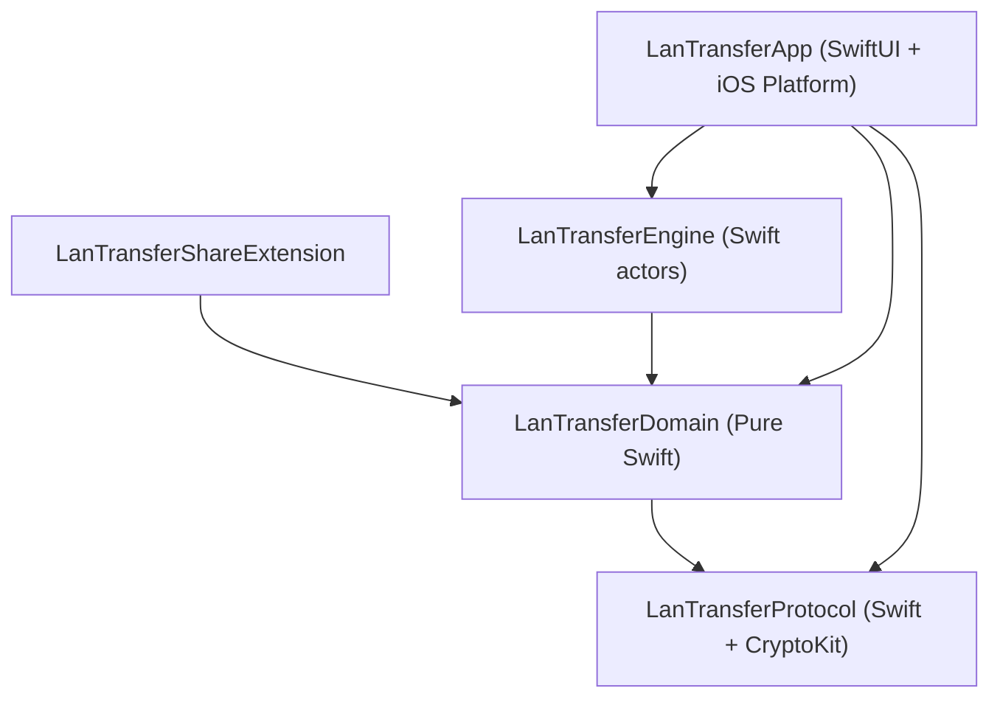

# LanTransfer iOS 端架构设计文档

> **版本**：v1.0（开发前设计定稿）  
> **目标平台**：iOS 17.0+（Swift 5.10 / Swift 6、SwiftUI、Apple 原生框架零第三方依赖）  
> **协议对齐**：`Protocol_Version = 1.0`（`protocol/spec/lan-transfer-protocol.md`，`device_type = 3 (iOS)`，`FsProfile.ios`）  
> **互通目标**：与 Android 端（Kotlin / Compose）及 Windows 端（.NET 10 / WPF）无缝互通，共用唯一协议规范、JSON 测试向量、简体中文文案表与设计令牌。

---

## 1. 架构目标与核心约束

1. **零外网、零第三方依赖（需求 2.7）**：
   - 全部密码学、网络、持久化、扫码与界面能力均由 Apple 系统框架提供（`CryptoKit`、`Network`、`SQLite3`、`Security`、`AVFoundation`、`CoreImage`、`PhotosUI`、`QuickLook`、`SwiftUI`），不引入任何 HTTP 客户端、埋点、崩溃上报或第三方 Swift Package。
   - 严禁调用域名解析 API（`getaddrinfo`、`URLSession`、`NWEndpoint.hostPort` 传主机名等）；仅使用 IPv4 字面量与本地私有子网接口。
2. **三端四层同构**：
   - 与 Android（`core:protocol` / `core:domain` / `core:engine` / `app`）及 Windows（`Protocol` / `Domain` / `Engine` / `Platform` + `App`）保持严格同构的类名、状态机、错误码与数据库表结构（M2）。
   - 核心三层放入独立 Swift Package `LanTransferCore`，同时声明 `iOS 17+` 与 `macOS 14+` 平台支持，使全部协议、领域与引擎单元测试（含 `protocol/test-vectors/` 全部向量测试）可在 macOS 终端或 CI 上直接通过 `swift test` 秒级运行，无需启动模拟器。
3. **固定简体中文（需求 1.5）**：
   - 应用与 Share Extension 固定 `zh-Hans` 本地化资源，所有 UI 文案由 `shared/ui-text/zh-CN.tsv` 经 `generate.py` 自动生成 `Localizable.strings` 与强类型 `UiText.g.swift`。

---

## 2. 仓库目录与模块化分层

```text
ios/
├── README.md                                  # iOS 构建、签名、Entitlement 与调试指南
├── project.yml                                # XcodeGen 工程定义（生成 LanTransfer.xcodeproj）
├── Packages/
│   └── LanTransferCore/
│       ├── Package.swift                      # SwiftPM 包定义（3 个核心库 + 1 个测试夹具库 + 3 个测试集）
│       ├── Sources/
│       │   ├── LanTransferProtocol/           # 纯 Swift + CryptoKit（零 UIKit/Network）
│       │   ├── LanTransferDomain/             # 纯 Swift：规则、无损文本映射、三个纯归约器
│       │   ├── LanTransferEngine/             # Swift Concurrency actor：会话、发现、配对、文字、文件引擎
│       │   └── LanTransferTesting/            # 内存网络、虚拟时钟、FakeStore、测试向量加载器
│       └── Tests/
│           ├── LanTransferProtocolTests/      # 协议编解码、Noise XX 官方/转录向量、公告/QR 向量
│           ├── LanTransferDomainTests/        # 文件名清洗、显示名、地址、无损文本、归约器迁移表
│           └── LanTransferEngineTests/        # 会话/配对/文字/文件传输/发现与线路机密性测试
├── LanTransferApp/                            # 主应用（SwiftUI + 平台适配层）
│   ├── App/                                   # LanTransferApp.swift、AppController、前后台协调器
│   ├── Platform/
│   │   ├── Network/                           # IosNetworkMonitor（getifaddrs + NWPathMonitor）、IosTransport（NWConnection/NWListener + BSD UDP）
│   │   ├── Storage/                           # Schema.sql（同 M2）、SqliteDatabase、SqliteTrust/History/TaskStore
│   │   ├── Security/                          # KeychainIdentityStore（DeviceOnly，不入 iCloud）
│   │   ├── Settings/                          # UserDefaultsSettingsStore（含 App Group 共享与主题模式）
│   │   ├── Files/                             # IosReceiveStorage、IosSourceFiles、IosOutgoingTextCache
│   │   └── SystemServices/                    # IosClipboard、IosFileLocator、IosNotifier、IosAppLifecycle
│   ├── UI/
│   │   ├── Theme/                             # LanTheme.swift（对齐 shared/design-tokens.json）
│   │   ├── Text/                              # UiText.g.swift（自动生成）+ UiTextMapper.swift
│   │   ├── ViewModels/                        # @Observable 主状态与会话/历史/设置状态
│   │   ├── Components/                        # LosslessTextView（UITextView 桥接）、DeviceBadge、TransferCard
│   │   └── Screens/                           # DevicesTab、Conversation、QrShow、QrScan、ManualConnect、History、Settings
│   ├── Resources/
│   │   └── zh-Hans.lproj/Localizable.strings  # 自动生成自 shared/ui-text/zh-CN.tsv
│   ├── Info.plist
│   └── LanTransferApp.entitlements
└── LanTransferShareExtension/                 # 系统“共享”扩展（App Group 共享信任列表与待发文件）
    ├── ShareViewController.swift
    ├── Info.plist
    └── LanTransferShareExtension.entitlements
```

### 模块依赖拓扑



---

## 3. 核心四层关键技术方案

### 3.1 协议层（`LanTransferProtocol`）
- **加密原语（纯 `CryptoKit`，零外部库）**：
  - X25519：`Curve25519.KeyAgreement.PrivateKey` / `PublicKey`（注意校验共享密钥非全零，防范小阶点）。
  - AES-256-GCM：`AES.GCM.seal` / `AES.GCM.open`（12 字节 nonce = `0x00000000 || u64_be(n)`，16 字节 tag 附加于密文尾部）。
  - SHA-256 / HMAC-SHA256：`CryptoKit.SHA256`、`CryptoKit.HMAC<SHA256>`（Noise HKDF 直接用 HMAC-SHA256 构造 `hkdf2`，与两端字节级一致）。
- **编解码**：手写无拷贝 `ByteReader` / `ByteWriter`（大端整数、TLV tag 严格递增校验、跳过未知 tag、严格 UTF-8 标量值校验、RFC 4648 无填充 Base32）。
- **测试向量硬门禁**：直接读取仓库根 `protocol/test-vectors/` 中的全部 10 个 JSON 文件（含 `announcements.json` 中的 `IOS` 向量、`noise-xx.json`、`filename-sanitizer.json` 等）。

### 3.2 领域层（`LanTransferDomain`）
- 与 Android/Windows 保持 1:1 类型与行为镜像：
  - `DeviceType`: `.android(1)`, `.windows(2)`, `.ios(3)`；
  - `FsProfile.ios`: APFS / POSIX 规则（UTF-8 ≤ 255 字节，禁止 `/` 与 NUL，非法代理项替换为 `_`，`.` / `..` 回退 `file_YYYYMMDD_HHMMSS`）；
  - `DisplayNameRules`: 默认名称 `"iOS 设备"`（当 `UIDevice.current.name` 不可用或被 iOS 16+ 脱敏为通用 `"iPhone"` 时，按 `DisplayNameRules.defaultName` 清洗，用户可在设置页自由改名）；
  - `TextDisplayMapper`: 控制字符（C0/DEL/C1）与 CRLF 映射及 `originalRange(selStart:selEnd:)` 反查；
  - 三个纯值类型归约器：`PairingReducer`、`TextReducer`、`TransferReducer`（`struct` + `Sendable`）。

### 3.3 引擎层（`LanTransferEngine`）
- 全部状态机宿主使用 Swift Concurrency `actor`（天然单线程串行访问，对应 Kotlin `Channel` actor 与 C# `Channel` actor）：
  - `SessionManager`（actor）：TCP 监听 `42580 → 42590..42599 → 0`、出站 10s 预算 / 扫码每地址 5s、同时互连按发起方 `DeviceId` 去重、P0/P1/P2 优先级写队列、5s/15s 心跳。
  - `DiscoveryService`（actor）：每活动接口 2s (±0.2s) 周期广播 + 组播（`42581` / `239.255.42.58`）、1s 过期检查（10s 移除）。
  - `PairingService`（actor）：点选 SAS 6 位验证码与 QR 令牌注册表（5min 有效、5 次失败失效、1 次使用作废）。
  - `TextService`（actor）：10s 发送超时、严格 UTF-8 与去重、超 1 MiB 转 `.txt` 缓存发送。
  - `FileTransferEngine`（actor）：64 KiB 分块、4 MiB 滑动窗口、每 256 KiB / 200 ms `FILE_ACK`、增量 `CryptoKit.SHA256`、断点续传、24h 临时文件清理。
  - 状态发布统一使用 `AsyncStream` / `@MainActor` 观测桥接，供 SwiftUI `@Observable` ViewModel 消费。

---

## 4. iOS 平台难点与适配设计

### 4.1 局域网接口监视与零外网传输（`Platform/Network/`）
| 环节 | iOS 实现方案 | 说明与边界处理 |
| --- | --- | --- |
| **接口枚举** | `NWPathMonitor` 触发 + `getifaddrs()` 枚举 IPv4（常态 2s、有 Session 时 1s 轮询） | 仅保留 `IFF_UP && !IFF_LOOPBACK && !IFF_POINTOPOINT` 的私有 IPv4 接口；分类规则：`en0` → `.wifi`、`bridge100` → `.hotspot`、USB/有线 `en*` → `.ethernet`；**严格剔除** `pdp_ip*`（蜂窝）、`utun*`/`ipsec*`/`ppp*`（VPN）、`awdl0`/`llw0`/`anpi*`（Apple 内部虚拟网卡）。 |
| **TCP 出站** | `NWConnection`（`NWParameters.tcp`） | 显式设置 `prohibitedInterfaceTypes = [.cellular]`，通过 `requiredLocalEndpoint = .hostPort(host: .ipv4(via.address), port: .any)` 绑定目标私有子网网卡，`tcp.noDelay = true`，绝不走蜂窝或 DNS。 |
| **TCP 监听** | `NWListener`（`NWParameters.tcp`） | 按 `[42580, 42590...42599, 0]` 顺序绑定监听端口；入站连接核验对端 IPv4 属于私有地址且命中本机某子网。 |
| **UDP 发现** | `NWMulticastGroup` 或 BSD `socket(AF_INET, SOCK_DGRAM)` + `SO_REUSEADDR`/`SO_REUSEPORT`/`SO_BROADCAST`/`IP_ADD_MEMBERSHIP` | 端口 `42581`、组播组 `239.255.42.58`。若用户拒绝“本地网络”权限或未签 `com.apple.developer.networking.multicast` 权限，安全降级为 `DiscoveryStatus.unavailable`，横幅提示用户仍可通过 **扫码** 或 **手动输入 IP** 正常连接与传输。 |

> **Apple Multicast Entitlement 说明**：
> - 正式上架 / 企业分发 / 付费 Apple Developer 账号在 Apple Developer Portal 获批 `com.apple.developer.networking.multicast` 后，在 `ios/project.yml` 将 `settings.base.CODE_SIGN_ENTITLEMENTS` 切换为 `LanTransferApp/LanTransferApp-Multicast.entitlements`，即可启用完整 UDP 广播/组播自动发现能力。（注意：`project.yml` 统一使用 `INFOPLIST_FILE` + `GENERATE_INFOPLIST_FILE: NO` + `CODE_SIGN_ENTITLEMENTS` 指向仓库手写文件，切勿使用无 `properties` 的 XcodeGen `info:` / `entitlements:` 生成块，以免覆盖 `NSExtension` 与权限声明。）
> - 个人免费开发账号（Personal Team）/ Simulator / CI 默认使用 `LanTransferApp/LanTransferApp.entitlements`（仅声明 App Group，不含组播权限）；此时单播 TCP（扫码配对、手动 IP、已信任设备直连）100% 正常工作，自动发现优雅降级并给出清晰中文提示。

### 4.2 身份密钥与 SQLite M2 存储（`Platform/Security/` & `Platform/Storage/`）
- **Keychain 身份存储（`KeychainIdentityStore`）**：
  - 使用 `SecItemAdd` / `SecItemCopyMatching` / `SecItemUpdate`，`kSecClassGenericPassword`，服务名 `com.lantransfer.app.identity`，账户 `device_identity_v1`。
  - 访问属性固定 `kSecAttrAccessibleAfterFirstUnlockThisDeviceOnly` 且 `kSecAttrSynchronizable = kCFBooleanFalse`（**严禁同步到 iCloud 钥匙串**，满足需求 4.1 卸载/换机不跨机复用身份）。
  - 载荷为 80 字节 `device_id(16) || private_key(32) || public_key(32)`，加载时重算 X25519 公钥自检，损坏则返回 `IdentityLoad.resetCorrupted`。
- **SQLite 数据库（`SqliteDatabase`）**：
  - 并发模型：使用 iOS 原生 `libsqlite3` + `NSLock` 保护的 `@unchecked Sendable` 类（与 `IosFiles` / `IosNetworkMonitor` / `NwTcpListener` 等非 `Sendable` 底层 C/SDK 句柄适配层一致，避免阻塞 Swift 并发协作线程池及 SE-0414 跨 actor 区域隔离冲突）。
  - 位置：App Group 共享容器 `LanTransfer/lantransfer.db`（无 App Group 权限时自动回退至 `Application Support/LanTransfer/lantransfer.db`；Share Extension 通过只读连接快照查询 `trusted_device` 列表）。
  - 表结构：直接复用与 Windows / Android 完全一致的 M2 6 张表（`schema_meta`、`trusted_device`、`text_message`、`transfer_task`、`transfer_file`、`pending_cancel`），WAL 模式，`PRAGMA user_version = 1`，检测到更高版本时拒绝降级并弹窗提示更新，绝不删库。

### 4.3 文件接收、相册 / 文件选择与打开（`Platform/Files/`）
- **默认接收目录**：`<App Container>/Documents/LanTransfer/`。
  - 在 `Info.plist` 中配置 `UIFileSharingEnabled = true` 和 `LSSupportsOpeningDocumentsInPlace = true`，用户打开系统 **“文件 (Files)” App → 我的 iPhone → 局域网传输** 即可直接看到全部已接收文件，无需复杂导入导出。
- **临时文件隔离**：写入 `<App Container>/Library/Caches/lantransfer-tmp/.lt-<tid>-<index>.part`（**不在 `Documents/` 下**），保证传输未完成或校验失败的 `.part` 文件绝不会污染用户的“文件” App 视图；SHA-256 校验通过后执行 `FileNameSanitizer` + `NameCollisionResolver` 并通过 `FileManager.moveItem` 原子提交至 `Documents/LanTransfer/`。
- **多来源文件选取**：
  - 文档与任意文件：`UIDocumentPickerViewController(forOpeningContentTypes: [.item], asCopy: false)`（搭配 `startAccessingSecurityScopedResource()` 读取元数据与分块，不额外拷贝整份大文件）。
  - 相册照片与视频：`PhotosPicker`（`PhotosUI`，无需申请完整相册权限即可安全选取原图/原视频导出至传输队列）。
- **文件打开与定位（`IosFileLocator`）**：
  - “打开文件”：使用系统原生 `QLPreviewController`（QuickLook）直接预览图片、视频、PDF、Office、文本等，同时右上角原生支持共享 / 存至相册 / 用其他 App 打开。
  - “在‘文件’中查看”：通过 `shareddocuments://` URL Scheme 跳转至系统“文件” App 中的 `LanTransfer` 目录，若系统不支持则展示完整逻辑路径并提供“复制路径”。

### 4.4 后台传输限制与用户预期管理
- iOS 沙盒限制后台进程无法无限期监听端口，因此明确区分与 Android/Windows 的差异并做最优体验设计：
  1. **前台防熄屏**：有进行中传输（`RUNNING` / `RESUMING`）时自动开启 `UIApplication.shared.isIdleTimerDisabled = true`，传输全部结束后立即恢复。
  2. **切后台宽限期**：进入后台时申请 `UIApplication.shared.beginBackgroundTask(withName: "LanTransferActive")`，尽量在系统给予的 ~25–30 秒内完成短传输；在 `expirationHandler` 触发前主动发送 `SESSION_CLOSE(BACKGROUND)` 并持久化进度，将任务优雅转入 `INTERRUPTED`，并推送本地通知提醒用户返回继续。
  3. **回到前台无缝续传**：回到前台自动调用 `EngineHost.startNetworking()`，中断任务一键点击“继续”即可从断点校验并续传。

### 4.5 无损文字选区复制与二维码安全
- **无损选区复制**：SwiftUI 原生 `Text.textSelection(.enabled)` 无法拦截复制内容以还原 `TextDisplayMapper` 映射前的原始 NUL / 控制字符 / CRLF，因此消息气泡正文封装 `LosslessTextView: UIViewRepresentable`（内部为只读 `UITextView`），重写 `copy(_:)` 方法，根据 `selectedRange` 查 `DisplayText.originalRange` 提取原始子串写入 `UIPasteboard.general.string` 并读回校验。
- **二维码生成与扫描**：
  - 生成：`CoreImage.CIFilter.qrCodeGenerator()`（纠错级 `M`）+ `CGAffineTransform` 最近邻无模糊放大；进入二维码展示页时自动临时提高屏幕亮度（离开恢复），并监听 `UIApplication.userDidTakeScreenshotNotification` 提示勿分享含一次性配对令牌的截屏。
  - 扫描：`AVCaptureSession` + `AVCaptureMetadataOutput`（`.qr`），纯系统硬件加速解码，无效二维码 3 秒提示防抖，无相机权限时引导前往系统设置或切换手动连接。

### 4.6 系统分享扩展（`LanTransferShareExtension`）
- 与主 App 共享 App Group `group.com.lantransfer.app`：
  - Share Extension 以只读方式从共享 SQLite 读取 `trusted_device` 列表；
  - 用户选择接收设备后，将分享的文字或文件（复制到共享暂存目录 `AppGroup/share-inbox/<uuid>/`）写入共享清单，并通过自定义 URL Scheme `lantransfer://share?batch=<uuid>&peer=<hex>` 唤起主 App 自动进入该设备会话并填充/发送。

---

## 5. 与 Android / Windows 的差异对照总览

| 能力维度 | Android | Windows | iOS |
| --- | --- | --- | --- |
| 界面框架 | Jetpack Compose (M3) | WPF (Fluent Win11) | SwiftUI (Apple HIG) |
| 密码学实现 | BouncyCastle + JCA | BouncyCastle + .NET Crypto | Apple `CryptoKit`（零三方库） |
| 数据库 | Room (`lantransfer.db`) | `Microsoft.Data.Sqlite` | 系统 `libsqlite3`（同 M2 Schema） |
| 身份密钥保护 | Android Keystore AES-GCM | Windows DPAPI CurrentUser | iOS Keychain `ThisDeviceOnly` |
| 接收文件位置 | `Download/LanTransfer` / SAF | `Downloads\LanTransfer` / 任意目录 | `Documents/LanTransfer`（“文件”App 可见） |
| 后台常驻接收 | 前台服务 (`connectedDevice`) | 系统托盘常驻 | 后台宽限期 + 断点续传 + 防熄屏 |
| 系统分享入口 | `ShareActivity` | 文件拖放 | `LanTransferShareExtension`（App Group） |
| 二维码能力 | 展示 + CameraX/ZXing 扫码 | 仅展示（QRCoder） | 展示（CoreImage）+ 扫码（AVFoundation） |

---

## 6. 关联文档索引
- **iOS 界面与交互视觉规范**：[docs/ios-ui-design-spec.md](ios-ui-design-spec.md)
- **iOS 可交互视觉原型**：[docs/ios-ui-preview.html](ios-ui-preview.html)
- **iOS 分阶段实施任务清单**：[.kiro/specs/lan-file-transfer/ios-tasks.md](../.kiro/specs/lan-file-transfer/ios-tasks.md)
- **统一设计令牌**：[shared/design-tokens.json](../shared/design-tokens.json)
- **共享简体中文文案表**：[shared/ui-text/zh-CN.tsv](../shared/ui-text/zh-CN.tsv)
