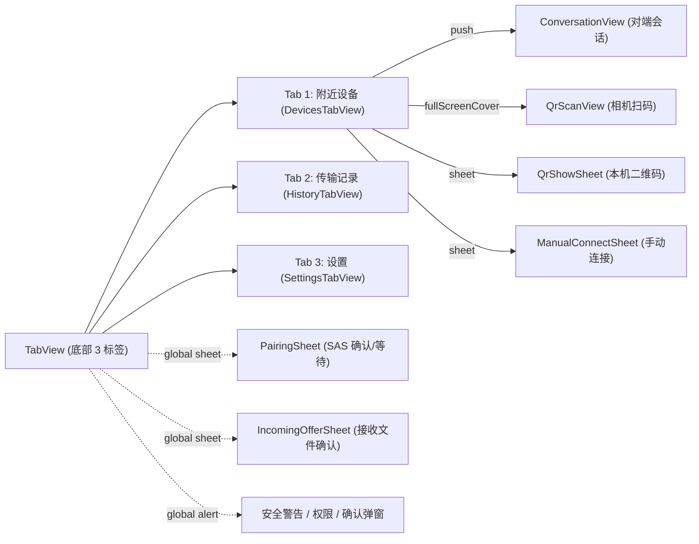

# LanTransfer iOS 端 UI 与交互设计规范（SwiftUI / Apple HIG）

> **视觉方向**：Modern Native Unified Aesthetic —— 在严格复用 `shared/design-tokens.json` 跨端品牌基因（靛蓝主色、冷瓷浅色 / 深邃板岩暗色、圆角卡片、等宽数字、Android/Windows/iOS 三端彩色徽章）的基础上，遵循 **Apple Human Interface Guidelines (iOS 17+)** 的导航层级、毛玻璃层次、原生手势与触觉反馈，打造地道、克制、轻盈的原生 iOS 体验。

---

## 1. 设计语言与视觉令牌（对齐 `shared/design-tokens.json`）

### 1.1 色彩系统（支持跟随系统 / 浅色 / 深色）
| 语义令牌 | 浅色模式 | 深色模式 | iOS 使用场景 |
| --- | --- | --- | --- |
| `canvas` | `#F4F6FA` | `#0B1120` | 主页面底色（替代纯白，突出卡片层级） |
| `surface` | `#FFFFFF` | `#162032` | 设备卡片、英雄状态卡、设置分组卡片、任务卡片 |
| `surfaceSubtle` | `#F8FAFC` | `#111A2B` | IP 胶囊芯片、子文件行背景、搜索框底色 |
| `border` | `#E2E8F0` | `#263449` | `1px` (`0.5pt–1pt`) 卡片柔边描边 |
| `accent` | `#2563EB` | `#3B82F6` | 品牌主色、主 CTA 按钮、SAS 验证码、选中态 |
| `accentSoft` | `#EFF6FF` | `#172554` | Tonal 按钮底色、已信任标签底色、加密徽章 |
| `success` / `Soft` | `#059669` / `#ECFDF5` | `#10B981` / `#064E3B` | 在线脉动点、已连接状态、接收方向标签 |
| `warning` / `Soft` | `#D97706` / `#FFFBEB` | `#F59E0B` / `#451A03` | 无网络 / 本地网络受限 / 自动发现不可用横幅 |
| `danger` / `Soft` | `#DC2626` / `#FEF2F2` | `#EF4444` / `#450A0A` | 安全警告、传输中断、解除配对 / 删除动作 |
| `bubbleOutgoing` | `#2563EB`（白字） | `#2563EB`（白字） | 本机发出的文字气泡 |
| `bubbleIncoming` | `#FFFFFF`（深字+柔边） | `#1E293B`（浅字+柔边） | 对端收到的文字气泡 |

### 1.2 三端设备平台徽章（SF Symbols + 语义色）
| 设备类型 | 协议码 | SF Symbol | 徽章强调色 | 展示文案 |
| --- | --- | --- | --- | --- |
| Android | `1` | `smartphone` | `#10B981`（翡翠绿） | `Android` |
| Windows | `2` | `desktopcomputer` | `#2563EB`（皇家蓝） | `Windows` |
| iOS | `3` | `iphone` | `#6366F1`（靛紫色） | `iOS` |

### 1.3 圆角、间距、字体与触觉反馈
- **圆角体系**：主卡片 `16pt`（`RoundedRectangle(cornerRadius: 16, style: .continuous)` 连续曲率平滑圆角）、内嵌子卡片 `12pt`、按钮/输入框 `12pt`、小标签 `8pt`、胶囊 `999pt`。
- **字体排印**：全程使用系统 **SF Pro + PingFang SC**，全面支持 Dynamic Type；所有 IP 地址、端口号、传输速度、百分比、文件大小、时间与 6 位 SAS 验证码一律启用 `.monospacedDigit()` 或 `.fontDesign(.monospaced)`，杜绝数字跳动。
- **原生触觉反馈（`.sensoryFeedback`）**：
  - 复制地址/文字成功：`.impact(weight: .light)`
  - 扫码识别成功 / 配对成功 / 传输完成：`.success`
  - 校验失败 / 安全警告 / 拒绝或取消：`.warning` / `.error`

---

## 2. 信息架构与导航骨架

- **底部 `TabView`**：
  1. `附近设备`（`wifi` / `laptopcomputer.and.iphone`）
  2. `传输记录`（`clock.arrow.circlepath`，存在未完成任务时显示原生 `.badge(unfinishedCount)`）
  3. `设置`（`gearshape`）
- **导航栏**：各 Tab 顶层采用 iOS 原生 `.navigationTitle(...)` + `.navigationBarTitleDisplayMode(.large)`，滚动时平滑折叠为毛玻璃 inline 标题栏。

---

## 3. 九大核心页面详细设计

### 3.1 附近设备主页（`DevicesTabView`）
- **顶部导航栏**：Large Title `局域网传输`，右上角放置轻量化主题快捷切换按钮（`sun.max` / `moon.stars`）。
- **状态横幅栈（条件显示）**：
  - 本地网络权限被拒（附“前往设置”按钮，直接跳转 `UIApplication.openSettingsURLString`）
  - 未连接 Wi-Fi 或个人热点
  - 自动发现不可用（明确提示仍可使用扫码或手动连接）
  - 监听失败 / 身份重置 / 通知关闭提醒
- **本机英雄状态卡片（Hero Card）**：
  - 第一行：绿色在线指示点（无网为琥珀色）+ 本机名称 + 右侧绿色胶囊 `端到端加密`（`checkmark.shield.fill`）。
  - 第二行：横向流式 IPv4:端口等宽芯片（如 `192.168.1.28:42580`），轻点即复制地址并弹顶部柔和 Toast 胶囊 + 轻触觉反馈。
  - 第三行：三联快捷连接按钮组 —— 主按钮 `扫描二维码`（`qrcode.viewfinder`，蓝底白字）、次主按钮 `二维码配对`（`qrcode`，浅蓝 Tonal）、轮廓按钮 `手动连接`（`network`，白底描边）。
- **局域网与已信任设备列表**：
  - 每张设备卡片包含 `44×44pt` 连续圆角平台图标底板、设备名、状态胶囊（`已连接` 绿 / `已信任` 蓝 / `未配对` 灰）与等宽 `设备类型 · IP:端口`。
  - 未发现任何设备时展示精致雷达/波形空态卡片（`正在扫描同一局域网内的设备…` + `端到端加密 · 仅限本地网络`）。

### 3.2 对端会话与传输页（`ConversationView`）
- **导航栏**：居中或左对齐显示对端小徽章 + 设备名 + 实时在线绿点 + 副标题 `Windows · 192.168.1.100:42580`。
- **消息与任务混合时间线**：
  - **文字气泡**：发出右对齐皇家蓝，接收左对齐白底柔边；正文使用 `LosslessTextView`（`UITextView` 桥接）支持精确划词选区并按 `TextDisplayMapper` 还原原始码点复制；超过 20 行或 1000 码点自动折叠并显示 `展开 / 收起`；下方附时间戳、送达状态、一键 `复制` 与失败时 `重试`。
  - **文件任务卡片**：顶部方向胶囊（`发送` / `接收`）+ 文件数与总大小 + 状态文字；传输中/中断展示平滑圆角进度条、`百分比 · 已传/总量` 及等宽 `速率 · 剩余时间`；逐文件列出文件名、大小、单文件状态，已接收完成的文件直接提供 `预览`（QuickLook）与 `在“文件”中查看` 按钮；中断任务展示 `继续`（主按钮）与 `取消`（轮廓按钮）。
- **待发送队列条（吸底于输入框上方）**：横向芯片列表显示已选文件及大小，支持单项删除 `×`、`清空列表` 与 `发送全部文件`。
- **底部工具与输入栏（毛玻璃 `.ultraThinMaterial` 背板）**：
  - 工具行：四个清晰胶囊 —— `文件`（`doc.badge.plus`）、`相册`（`photo.on.rectangle`）、`粘贴`（`doc.on.clipboard`）、`发送剪贴板`。
  - 输入行：多行自适应圆角文本框 + 右侧圆形/圆角发送按钮（`paperplane.fill`），无网络或空内容时自动禁用。

### 3.3 二维码展示 Sheet（`QrShowSheet`）
- `.presentationDetents([.medium, .large])` + `.presentationDragIndicator(.visible)`。
- 中央纯白高对比度圆角卡片展示锐利无插值 QR 码，下方显示等宽候选 `IP:端口` 列表与“令牌每 5 分钟自动刷新”提示。
- 打开时适度提升屏幕亮度方便对端扫码，关闭恢复；若用户触发系统截屏，页内弹出温和提醒“二维码包含一次性配对令牌，请勿发送给他人”。

### 3.4 相机扫码全屏页（`QrScanView`）
- 沉浸式全屏 `AVCaptureVideoPreviewLayer` + 半透明暗色遮罩 + 中央亮蓝边角扫描取景框 + 柔和扫描光线动画。
- 顶部返回按钮 + 手电筒开关（`flashlight.on.fill` / `flashlight.off.fill`）；底部悬浮毛玻璃胶囊提示状态并提供一键切换 `手动连接`。
- 相机未授权时展示优雅引导页，提供 `去系统设置` 与 `手动连接` 双按钮。

### 3.5 手动连接 Sheet（`ManualConnectSheet`）
- Inset-grouped 卡片表单：IPv4 地址（`.decimalPad` / `.asciiCapable`）、可选端口（占位 `42580`，`.numberPad`）、实时字段级红色错误提示、全宽圆角主按钮 `连接`（连接中切为 `ProgressView + 正在连接`）。

### 3.6 配对确认（`PairingSheet`）与文件接收确认（`IncomingOfferSheet`）
- **配对确认**：展示对方名称、设备类型、IP 与超大等宽 6 位验证码卡片（`123 456`，`32pt Bold Monospace`），发起方显示“等待对方确认 + 取消”，接收方显示 `拒绝` / `接受`（在承诺校验完成得出 SAS 前禁用 `接受`）。
- **文件接收确认**：顶部展示发送方、文件数、总大小，中间可滚动文件清单（文件名 + 等宽大小），底部双按钮 `拒绝`（次要）与 `接收`（主强调）。多个并发 Offer 自动排队逐个展示。

### 3.7 传输记录页（`HistoryTabView`）
- 集成 iOS 原生 `.searchable(text:prompt:)` 搜索栏 + 顶部三段式 `Picker(.segmented)`（`全部` / `文字` / `文件`）+ 导航栏右上角红色 `清空记录`。
- 每条记录卡片展示方向胶囊、对端名称、等宽时间 `yyyy-MM-dd HH:mm`、状态标签、文字预览或文件名/大小/逻辑路径、快捷操作（`复制` / `打开文件` / `在“文件”中查看` / `复制路径`），并支持 iOS 原生左滑删除（`.swipeActions`）触发 20.4 / 20.10 确认弹窗。

### 3.8 设置页（`SettingsTabView`）
- 原生 iOS Inset Grouped `List` 分组结构：
  1. **外观主题**：三段式 `Segmented Picker`（`跟随系统` / `浅色` / `深色`），实时切换 `.preferredColorScheme`。
  2. **本机信息**：设备名称输入框 + `保存`（严格执行 4.4 / 4.5 / 4.8 清理校验与提示），下方展示只读本机设备 ID 摘要。
  3. **传输与存储**：展示固定保存位置 `“文件”App → 我的 iPhone → 局域网传输` + `在“文件”中打开` 按钮；`自动复制收到的文字` 原生 `Toggle`。
  4. **后台与权限**：展示 iOS 后台传输行为说明卡片（“切至后台后系统允许短暂继续，中断后回到前台可一键续传；大文件传输时应用会自动保持亮屏”）+ `本地网络与通知设置` 快捷跳转。
  5. **已信任设备**：每行展示三端平台图标、设备名、`自动接收文件` Toggle，支持左滑或按钮 `解除配对`（二次确认）。

### 3.9 系统分享扩展（`ShareExtensionView`）
- 轻量化系统弹窗风格：顶部展示“选择接收设备”与分享摘要卡片（`准备分享 N 个文件` / `准备分享一段文字`），下方为已信任设备卡片列表，轻点即刻写入 App Group 并唤起主 App 进入对应会话。

---

## 4. 可视化交互原型

仓库内置了免编译、可直接在浏览器打开体验的交互式 iOS UI 原型：[docs/ios-ui-preview.html](ios-ui-preview.html)，包含浅色/深色主题一键切换与发现页、会话页、二维码页、扫码页、历史页、设置页及配对确认弹窗的高保真交互预览。
